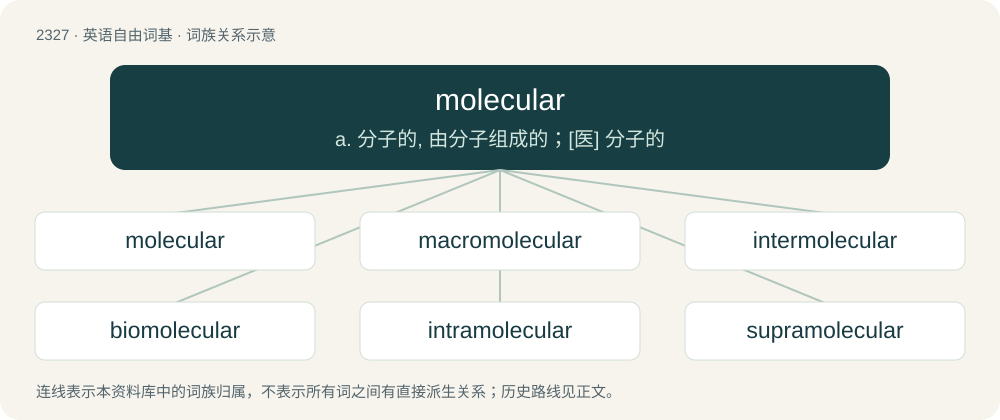

# 2427 · molecular — a. 分子的, 由分子组成的；\[医\] 分子的

[总目录](../00_总目录_按常用程度.md)

**类型**：英语自由词基　｜　**来源语言**：见词源记录

## 核心含义与来源

- 核心含义：a. 分子的, 由分子组成的；\[医\] 分子的
- 英文含义：Relating to, or consisting of, or produced by molecules.
- 词形：molecular

**来源记录 1**（形容词；Relating to, or consisting of, or produced by molecules.）

From molecule + -ar.

## 词族图

## 单词速览（常用到不常用）

| 单词 | 音标 | 释义 |
|---|---|---|
| [molecular](#w-1) | 英 /məˈlɛk.jʊ.lə/；美 /məˈlɛk.jə.ləɹ/ | a. 分子的, 由分子组成的；\[医\] 分子的 |
| [macromolecular](#w-2) |  | \[医\] 大分子的, 巨分子的 |
| [intermolecular](#w-3) | /,intə(ː)məˈlekjulə/ | a. 分子间的 |
| [biomolecular](#w-4) | /baɪɒməʊˈlekjʊlə/ | \[计\]\[修\]生物分子 |
| [intramolecular](#w-5) | /,ɪntrəməˈlekjʊlə/ | a. \[化学\] 分子内的 |
| [supramolecular](#w-6) | /,sjuːprəməˈlekjulə/ | a. 超分子的 |

## 逐词详解

### 1. molecular

**词性**：形容词　｜　**音标**：英 /məˈlɛk.jʊ.lə/；美 /məˈlɛk.jə.ləɹ/

**中文释义**：a. 分子的, 由分子组成的；\[医\] 分子的

**英文义项**：Relating to, or consisting of, or produced by molecules. / (of an element) Combined with itself and with no other element; elemental.

**构词拆分**：molecule + -ar

**词源与演化**：

From molecule + -ar.

**例句**：

> Molecular weight is the sum of all the atoms in a molecule.

该用例对应义项：relating to or produced by or consisting of molecules

### 2. macromolecular

**词性**：形容词

**中文释义**：\[医\] 大分子的, 巨分子的

**英文义项**：Of or relating to a macromolecule

**构词拆分**：macro- + molecular

**词源与演化**：

From macro- + molecular.

### 3. intermolecular

**词性**：形容词　｜　**音标**：/,intə(ː)məˈlekjulə/

**中文释义**：a. 分子间的

**英文义项**：from one molecule to another; between molecules

**构词拆分**：inter- + molecular

**词源与演化**：

From inter- + molecular.

### 4. biomolecular

**词性**：形容词　｜　**音标**：/baɪɒməʊˈlekjʊlə/

**中文释义**：\[计\]\[修\]生物分子

**英文义项**：Relating to biomolecules (especially macromolecules)

**构词拆分**：bio- + molecular

**词源与演化**：

From bio- + molecular.

### 5. intramolecular

**词性**：形容词　｜　**音标**：/,ɪntrəməˈlekjʊlə/

**中文释义**：a. \[化学\] 分子内的

**英文义项**：Between different parts of the same molecule.

**构词拆分**：intra- + molecular

**词源与演化**：

From intra- + molecular.

### 6. supramolecular

**词性**：形容词　｜　**音标**：/,sjuːprəməˈlekjulə/

**中文释义**：a. 超分子的

**英文义项**：Consisting of many molecules; of scale or complexity greater than that of a molecule.

**构词拆分**：supra- + molecular

**词源与演化**：

From supra- + molecular.
