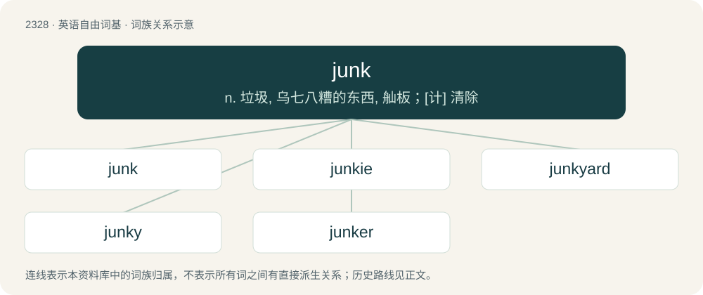

# 2428 · junk — n. 垃圾, 乌七八糟的东西, 舢板；\[计\] 清除

[总目录](../00_总目录_按常用程度.md)

**类型**：英语自由词基　｜　**来源语言**：见词源记录

## 核心含义与来源

- 核心含义：n. 垃圾, 乌七八糟的东西, 舢板；\[计\] 清除
- 英文含义：Miscellaneous items of little value, especially discarded or unwanted items.
- 词形：junk

**多个词源／构词路径**：同一拼写可能有不同来源；以下按词性和含义分别列出。

**来源记录 1**（名词；Miscellaneous items of little value, especially discarded or unwanted items.）

From earlier meaning "old refuse from boats and ships", from Middle English junk, jounke, jonk, joynk (“an old cable or rope”, nautical term), sometimes cut into bits and used as caulking; of uncertain origin; perhaps related to join, joint, juncture. Often compared to Middle English junk, jonk, jonke, junck (“a rush; basket made of rushes”), from Old French jonc, from Latin iuncus (“rush, reed”); however, the Oxford English Dictionary finds "no evidence of connexion".

**来源记录 2**（名词；A Chinese sailing vessel.）

From Portuguese junco with reinforcement from Dutch jonk, from Arabic جُنْك (junk), from Malay jong, جوڠ, from Javanese ꦗꦺꦴꦁ (jong), from Old Javanese joṅ (“seagoing ship”), probably from Proto-Mon-Khmer \*d₂luuŋ ~ \*d₂luŋ ~ \*d₂luəŋ ~ \*d₂ləŋ (“boat”). Doublet of djong.

## 词族图

## 单词速览（常用到不常用）

| 单词 | 音标 | 释义 |
|---|---|---|
| [junk](#w-1) | 英 /d͡ʒʌŋk/ | n. 垃圾, 乌七八糟的东西, 舢板；\[计\] 清除 |
| [junkie](#w-2) | /ˈd͡ʒʌŋki/ | n. 有毒瘾者, 废旧品商人 |
| [junkyard](#w-3) | 美 /ˈd͡ʒʌŋkˌjɑɹd/ | n. 废品旧货栈 |
| [junky](#w-4) | /ˈd͡ʒʌŋkiː/ | n. 吸海洛因成瘾者, 吸毒的人, 毒品贩子, 废旧品商人 |
| [junker](#w-5) | /ˈd͡ʒʌŋkə(ɹ)/ | 【英文】A beat-up automobile. |

## 逐词详解

### 1. junk

**词性**：名词　｜　**音标**：英 /d͡ʒʌŋk/

**中文释义**：n. 垃圾, 乌七八糟的东西, 舢板；\[计\] 清除

**英文义项**：Miscellaneous items of little value, especially discarded or unwanted items. / Material or resources of poor quality or low value, especially resources that lack commercial value.

**词源与演化**：

From earlier meaning "old refuse from boats and ships", from Middle English junk, jounke, jonk, joynk (“an old cable or rope”, nautical term), sometimes cut into bits and used as caulking; of uncertain origin; perhaps related to join, joint, juncture. Often compared to Middle English junk, jonk, jonke, junck (“a rush; basket made of rushes”), from Old French jonc, from Latin iuncus (“rush, reed”); however, the Oxford English Dictionary finds "no evidence of connexion".

**例句**：

> The student put down junk for answers just to finish his homework more quickly.

该用例对应义项：Nonsense; gibberish.

### 2. junkie

**词性**：名词　｜　**音标**：/ˈd͡ʒʌŋki/

**中文释义**：n. 有毒瘾者, 废旧品商人

**英文义项**：A narcotics addict, especially a heroin user. / An enthusiast of something.

**构词拆分**：junk + -ie

**词源与演化**：

From junk (“narcotic drug”) + -ie.

**例句**：

> English people are travel junkies, but Americans hardly ever leave their state.

该用例对应义项：An enthusiast of something.

### 3. junkyard

**词性**：名词　｜　**音标**：美 /ˈd͡ʒʌŋkˌjɑɹd/

**中文释义**：n. 废品旧货栈

**英文义项**：A place where rubbish is discarded. / A business that sells used metal or items.

**构词拆分**：From junk + yard.

**词源与演化**：

From junk + yard.

**例句**：

> Janos allowed the kids to come into the junkyard and look for scraps.

### 4. junky

**词性**：形容词　｜　**音标**：/ˈd͡ʒʌŋkiː/

**中文释义**：n. 吸海洛因成瘾者, 吸毒的人, 毒品贩子, 废旧品商人

**英文义项**：Resembling or characteristic of junk; cheap, worthless, or of low quality. / Full of junk.

**构词拆分**：junk + -y

**词源与演化**：

From junk + -y (adjectival suffix).

**例句**：

> We really need to clear out the junky basement.

该用例对应义项：Full of junk.

### 5. junker

**词性**：名词　｜　**音标**：/ˈd͡ʒʌŋkə(ɹ)/

**英文义项**：A beat-up automobile. / A person with an interest in disused or discarded objects.

**构词拆分**：junk + -er (relational noun suffix)

**词源与演化**：

From junk + -er (relational noun suffix) or + -er (occupational suffix).
