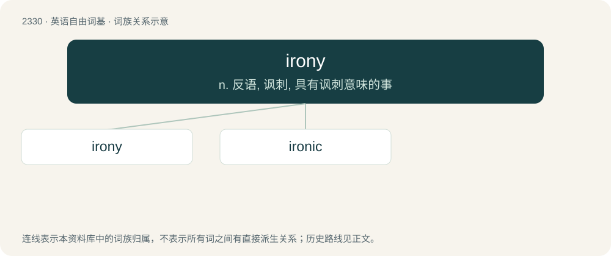

# 2429 · irony — n. 反语, 讽刺, 具有讽刺意味的事

[总目录](../00_总目录_按常用程度.md)

**类型**：英语自由词基　｜　**来源语言**：见词源记录

## 核心含义与来源

- 核心含义：n. 反语, 讽刺, 具有讽刺意味的事
- 英文含义：The quality of a statement that, when taken in context, may actually mean something different from, or the opposite of, what is written literally; the use of words expressing something other than their literal intention, often in a humorous context.
- 词形：irony

**多个词源／构词路径**：同一拼写可能有不同来源；以下按词性和含义分别列出。

**来源记录 1**（名词；The quality of a statement that, when taken in context, may actually mean something different from, or the opposite of, what is written literally; the use of words expressing something other than their literal intention, often in a humorous context.）

First attested in 1502. From Middle French ironie, from Old French, from Latin īrōnīa, from Ancient Greek εἰρωνεία (eirōneía, “irony, pretext”), from εἴρων (eírōn, “one who feigns ignorance”).

**来源记录 2**（形容词；Of or pertaining to the metal iron.）

From Middle English hyrony, yreny, yrony, yrunny, equivalent to iron + -y.

## 词族图

## 单词速览（常用到不常用）

| 单词 | 音标 | 释义 |
|---|---|---|
| [irony](#w-1) | 英 /ˈaɪə.ɹə.ni/；美 /ˈaɪ.ɹə.ni/ | n. 反语, 讽刺, 具有讽刺意味的事 |
| [ironic](#w-2) | 英 /aɪˈɹɒn.ɪk/；美 /aɪˈɹɑ.nɪk/ | a. 冷嘲的, 挖苦的, 反话的, 讽刺的, 令人啼笑皆非的, 出乎意料的 |

## 逐词详解

### 1. irony

**词性**：名词　｜　**音标**：英 /ˈaɪə.ɹə.ni/；美 /ˈaɪ.ɹə.ni/

**中文释义**：n. 反语, 讽刺, 具有讽刺意味的事

**英文义项**：The quality of a statement that, when taken in context, may actually mean something different from, or the opposite of, what is written literally; the use of words expressing something other than their literal intention, often in a humorous context. / An ironic statement.

**词源与演化**：

First attested in 1502. From Middle French ironie, from Old French, from Latin īrōnīa, from Ancient Greek εἰρωνεία (eirōneía, “irony, pretext”), from εἴρων (eírōn, “one who feigns ignorance”).

**例句**：

> The irony of Ireland's copying the nation she most hated.

该用例对应义项：incongruity between what might be expected and what actually occurs

### 2. ironic

**词性**：形容词　｜　**音标**：英 /aɪˈɹɒn.ɪk/；美 /aɪˈɹɑ.nɪk/

**中文释义**：a. 冷嘲的, 挖苦的, 反话的, 讽刺的, 令人啼笑皆非的, 出乎意料的

**英文义项**：Characterized by or constituting (any kind of) irony. / Odd or coincidental; strange.

**构词拆分**：irony + -ic

**词源与演化**：

Borrowed from Late Latin īrōnicus, from Ancient Greek εἰρωνικός (eirōnikós). Compare Middle French, ironique, equivalent to irony + -ic.

**例句**：

> It's ironic that we are eating a sandwich in Sandwich, Massachusetts.

该用例对应义项：Odd or coincidental; strange.
