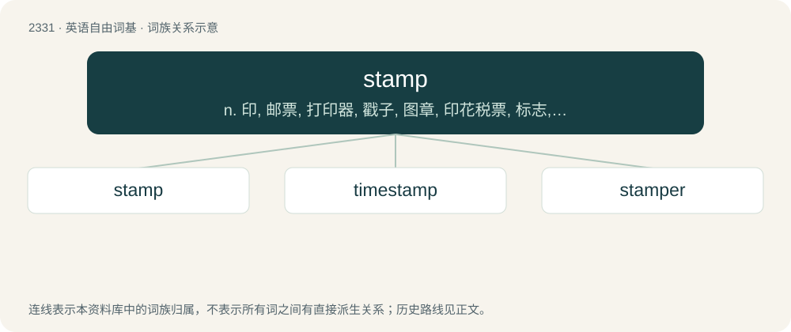

# 2430 · stamp — n. 印, 邮票, 打印器, 戳子, 图章, 印花税票, 标志, 特征, 类型, 跺脚；vt. 盖章于, 顿足, 贴上邮票, 铭刻, 捣碎, 扑灭；vi. 捣碎, 跺脚

[总目录](../00_总目录_按常用程度.md)

**类型**：英语自由词基　｜　**来源语言**：见词源记录

## 核心含义与来源

- 核心含义：n. 印, 邮票, 打印器, 戳子, 图章, 印花税票, 标志, 特征, 类型, 跺脚；vt. 盖章于, 顿足, 贴上邮票, 铭刻, 捣碎, 扑灭；vi. 捣碎, 跺脚
- 英文含义：An act of stamping the foot, paw or hoof.
- 词形：stamp

**来源记录 1**（名词；An act of stamping the foot, paw or hoof.）

From Middle English stampen (“to pound, crush”), from assumed Old English \*stampian, variant of Old English stempan (“to crush, pound, pound in mortar, stamp”), from Proto-West Germanic \*stampōn, \*stampijan, from Proto-Germanic \*stampōną, \*stampijaną (“to trample, beat”), from Proto-Indo-European \*stemb- (“to trample down”). Cognate with Dutch stampen (“to stamp, pitch”), German stampfen (“to stamp”), Danish stampe (“to stamp”), Swedish stampa (“to stomp”), Occitan estampar, Polish stąpać (“to step, treat”). See also stomp, step. Marks indicating that postage had been paid were originally made by stamping the item to be mailed; when affixed pieces of paper were introduced for this purpose, the term “stamp” was transferred to cover this new form.

## 词族图

## 单词速览（常用到不常用）

| 单词 | 音标 | 释义 |
|---|---|---|
| [stamp](#w-1) | /stæmp/ | n. 印, 邮票, 打印器, 戳子, 图章, 印花税票, 标志, 特征, 类型, 跺脚；vt. 盖章于, 顿足, 贴上邮票, 铭刻, 捣碎, 扑灭；vi. 捣碎, 跺脚 |
| [timestamp](#w-2) | /ˈtaɪmˌstæmp/ | n. 时间戳；时间邮票 |
| [stamper](#w-3) | 英 /ˈstæmpə/；美 /ˈstæmpɚ/ | n. 盖印人, 打印器, 印章；\[医\] 顿足者 |

## 逐词详解

### 1. stamp

**词性**：名词　｜　**音标**：/stæmp/

**中文释义**：n. 印, 邮票, 打印器, 戳子, 图章, 印花税票, 标志, 特征, 类型, 跺脚；vt. 盖章于, 顿足, 贴上邮票, 铭刻, 捣碎, 扑灭；vi. 捣碎, 跺脚

**英文义项**：An act of stamping the foot, paw or hoof. / An indentation, imprint, or mark made by stamping.

**词源与演化**：

From Middle English stampen (“to pound, crush”), from assumed Old English \*stampian, variant of Old English stempan (“to crush, pound, pound in mortar, stamp”), from Proto-West Germanic \*stampōn, \*stampijan, from Proto-Germanic \*stampōną, \*stampijaną (“to trample, beat”), from Proto-Indo-European \*stemb- (“to trample down”). Cognate with Dutch stampen (“to stamp, pitch”), German stampfen (“to stamp”), Danish stampe (“to stamp”), Swedish stampa (“to stomp”), Occitan estampar, Polish stąpać (“to step, treat”). See also stomp, step. Marks indicating that postage had been paid were originally made by stamping the item to be mailed; when affixed pieces of paper were introduced for this purpose, the term “stamp” was transferred to cover this new form.

**例句**：

> Now that commerce is done electronically, tax stamps are no longer issued here.

该用例对应义项：A small piece of paper, with a design and a face value, used to prepay postage or other dues such as tax or licence fees.

### 2. timestamp

**词性**：名词　｜　**音标**：/ˈtaɪmˌstæmp/

**中文释义**：n. 时间戳；时间邮票

**英文义项**：A variable containing the date and time at which an event occurred, often included in a log to track the sequence of events. / The time at which something in a video occurs.

**构词拆分**：time + stamp

**词源与演化**：

From time + stamp (noun); the verb sense derives from the noun.

**例句**：

> But I saw some newer ones without a timestamp, too.

### 3. stamper

**词性**：名词　｜　**音标**：英 /ˈstæmpə/；美 /ˈstæmpɚ/

**中文释义**：n. 盖印人, 打印器, 印章；\[医\] 顿足者

**英文义项**：One who stamps. / An instrument for pounding or stamping.

**构词拆分**：stamp + -er

**词源与演化**：

From stamp + -er.
