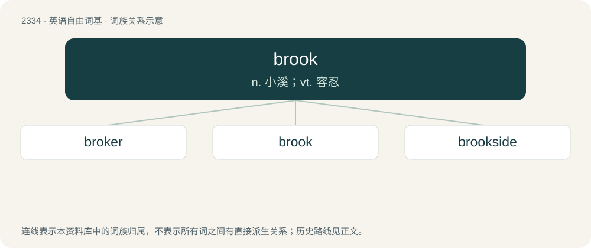

# 2432 · brook — n. 小溪；vt. 容忍

[总目录](../00_总目录_按常用程度.md)

**类型**：英语自由词基　｜　**来源语言**：见词源记录

## 核心含义与来源

- 核心含义：n. 小溪；vt. 容忍
- 英文含义：To bear; endure; support; put up with; tolerate.
- 词形：brook

**多个词源／构词路径**：同一拼写可能有不同来源；以下按词性和含义分别列出。

**来源记录 1**（动词；To bear; endure; support; put up with; tolerate.）

From Middle English brouken (“to use, enjoy”), from Old English brūcan (“to enjoy, brook, use, possess, partake of, spend”), from Proto-West Germanic \*brūkan, from Proto-Germanic \*brūkaną (“to enjoy, use”), from Proto-Indo-European \*bʰruHg- (“to enjoy”). Cognate with Saterland Frisian bruke (“to need”), Dutch bruiken (“to use”), German Low German bruken (“to need”), German brauchen (“to need”), Swedish bruka (“to use”), Icelandic brúka (“to use”).

**来源记录 2**（名词；A body of running water smaller than a river; a small stream.）

From Middle English brook, from Old English brōc (“brook; stream; torrent”), from Proto-West Germanic \*brōk (“stream”).

## 词族图

## 单词速览（常用到不常用）

| 单词 | 音标 | 释义 |
|---|---|---|
| [broker](#w-1) | 英 /ˈbɹəʊkə/；美 /ˈbɹoʊkɚ/ | n. 掮客, 经纪人；\[经\] 经纪人, 掮客 |
| [brook](#w-2) | 英 /bɹʊk/ | n. 小溪；vt. 容忍 |
| [brookside](#w-3) |  | \[地名\] \[美国\] 布鲁克赛德 |

## 逐词详解

### 1. broker

**词性**：名词　｜　**音标**：英 /ˈbɹəʊkə/；美 /ˈbɹoʊkɚ/

**中文释义**：n. 掮客, 经纪人；\[经\] 经纪人, 掮客

**英文义项**：A mediator between a buyer and seller. / A stockbroker.

**构词拆分**：brook + -er

**词源与演化**：

From Middle English broker, brokour, brocour, from Anglo-Norman brocour (“small trader”) (compare also abroker (“to act as a broker”)), from Old Dutch \*brokere (“one who determines the usages of trade, manager”), from broke, bruyck, breuck (“use, usage, trade”), from Proto-West Germanic \*brūkī (“use, custom”), from Proto-Germanic \*brūkiz (“use, custom”), from Proto-Indo-European \*bʰruHg- (“to use, enjoy”), equivalent to brook + -er. Cognates Cognate with Middle Low German brukere (“a broker”), Danish bruger (“a broker, user, handler”), Swedish bruk (“use, custom, trade, business”), Old English broc (“use, profit, advantage, foredeal”). Compare also French brocanter (“to deal in second-hand goods”) from the same Germanic source. More at brook.

**例句**：

> My insurance broker sells both home and vehicle insurance but not life insurance.

### 2. brook

**词性**：动词　｜　**音标**：英 /bɹʊk/

**中文释义**：n. 小溪；vt. 容忍

**英文义项**：To bear; endure; support; put up with; tolerate. / To enjoy the use of; make use of; profit by; to use, enjoy, possess, or hold.

**词源与演化**：

From Middle English brouken (“to use, enjoy”), from Old English brūcan (“to enjoy, brook, use, possess, partake of, spend”), from Proto-West Germanic \*brūkan, from Proto-Germanic \*brūkaną (“to enjoy, use”), from Proto-Indo-European \*bʰruHg- (“to enjoy”). Cognate with Saterland Frisian bruke (“to need”), Dutch bruiken (“to use”), German Low German bruken (“to need”), German brauchen (“to need”), Swedish bruka (“to use”), Icelandic brúka (“to use”).

**例句**：

> I will not brook any disobedience.

该用例对应义项：To bear; endure; support; put up with; tolerate.

### 3. brookside

**词性**：形容词

**中文释义**：\[地名\] \[美国\] 布鲁克赛德

**英文义项**：On the side of a brook.

**构词拆分**：brook + side

**词源与演化**：

From brook + side.
