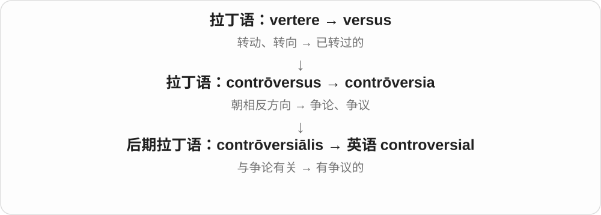
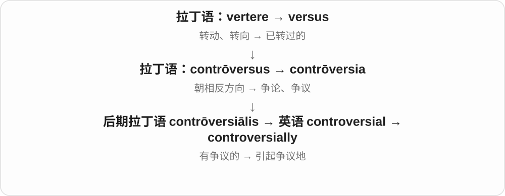

# 2433 · controversial — 引起分歧与没有多少分歧的性质

[逐词精讲目录](../00_逐词精讲目录.md) · [总目录](../00_总目录_按常用程度.md)

## 核心词根与来源

争议程度与真假、重要程度不是同一条尺度。先看句子是在呈现事实还是说明人们的分歧。

**CONTROVERSIAL：看人们是否容易产生争论**

controversial → controversially；uncontroversial 否定争议性质。

- **性质、方式与否定**：controversial · controversially · uncontroversial

## 词形与演化规律

controversy + -al → controversial；-ly 副词，un- 否定。

## 单词速览（按词族由简到繁）

同一基础词的相关扩展放在一起，先读基础形式，再读扩展；各组之间优先读常用的。具体词源关系见各词讲解。

| 单词 | 音标 | 核心意思 |
|---|---|---|
| [controversial](#w-1) | 英 /ˌkɒntrəˈvɜːʃəl/；美 /ˌkɑːntrəˈvɜːrʃəl/ | 有争议的；容易引起争论的 |
| [controversially](#w-2) | 英 /ˌkɒntrəˈvɜːʃəli/；美 /ˌkɑːntrəˈvɜːrʃəli/ | 有争议地；引发争议地 |
| [uncontroversial](#w-3) | 英 /ˌʌnkɒntrəˈvɜːʃəl/；美 /ˌʌnkɑːntrəˈvɜːrʃəl/ | 没有争议的、不太引起分歧的 |

## 逐词讲解

### 1. controversial — 有争议的；容易引起争论的

**音标**：英 /ˌkɒntrəˈvɜːʃəl/；美 /ˌkɑːntrəˈvɜːrʃəl/

**先抓住这个画面**

一提出就会有人赞成、有人强烈反对，难以让大家轻松达成共识。

**怎么拆**

源自后期拉丁语 contrōversiālis，与 contrōversia 同支；现代对应 controversy + -al。

**怎么变成今天的意思**

controversial 不自动说明观点错、危险或大胆，只说明它引起明显分歧。描述研究时，仍应另外解释争论点。

**常见搭配与例句**

a controversial decision；a controversial figure；highly controversial。

> The committee postponed its most controversial proposal.

委员会推迟了最有争议的提案。

> The book became controversial because of its account of the war.

这本书因对战争的叙述而引发争议。

**别混淆**

unpopular 是不受欢迎；controversial 常指不同群体态度分裂，不一定所有人都反对。

### 2. controversially — 有争议地；引发争议地

**音标**：英 /ˌkɒntrəˈvɜːʃəli/；美 /ˌkɑːntrəˈvɜːrʃəli/

**先抓住这个画面**

讲完一个决定，再提醒读者：这个做法当时引起了不少反对和争论。

**怎么拆**

controversial + -ly。

**怎么变成今天的意思**

放句首时可评价整件事；放动词前时可标记某个行为受到争议。它表达的是公众分歧，不直接等于作者反对。

**常见搭配与例句**

controversially appointed；controversially banned；Controversially, … 。

> The council controversially approved the demolition.

市议会批准拆除，这个决定引发了争议。

> Controversially, the new edition removed an entire chapter.

引人争议的是，新版删掉了整整一章。

**别混淆**

allegedly 表示据称、尚未证实；controversially 表示有争议，不能替代证据状态。

### 3. uncontroversial — 没有争议的、不太引起分歧的

**音标**：英 /ˌʌnkɒntrəˈvɜːʃəl/；美 /ˌʌnkɑːntrəˈvɜːrʃəl/

**先抓住这个画面**

一个事实、步骤大家基本都接受，没什么争吵，可以 uncontroversial。它评价争议程度，不是宣称观点永远正确。

**怎么拆**

un- 不 + controversial 有争议的。否定的是引起分歧这一性质。

**怎么变成今天的意思**

**controversy 争论、争议 → controversial**  
引起分歧、争论的性质

↓

**un- + controversial → uncontroversial**  
没有多少争议、容易获得一致认可

an uncontroversial fact 没有争议的事实，an uncontroversial proposal 不太引起分歧的提议，relatively uncontroversial 相对没有争议。

**常见搭配与例句**

an uncontroversial fact；a relatively uncontroversial proposal。

> The first part of the proposal was relatively uncontroversial.

提案第一部分相对没什么争议。

> They began with an uncontroversial statement of the facts.

他们先陈述了一段没有争议的事实。

**别混淆**

uncontroversial 不等于 trivial 微不足道；重要事项也可能得到广泛认同。没有争议的范围还要看哪些人、什么背景。

## 这一组要分清什么

controversial 不自动错误，uncontroversial 不自动不重要；争议可随群体、语境变化。

## 串起来练习

An uncontroversial introduction led into the controversial proposal.

没有争议的引言之后，是那个引起分歧的提案。
