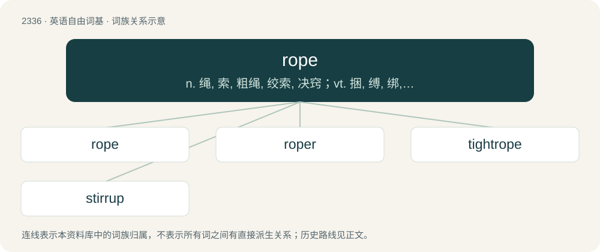

# 2434 · rope — n. 绳, 索, 粗绳, 绞索, 决窍；vt. 捆, 缚, 绑, 圈起, 以绳将...系住；vi. 拧成绳状

[总目录](../00_总目录_按常用程度.md)

**类型**：英语自由词基　｜　**来源语言**：见词源记录

## 核心含义与来源

- 核心含义：n. 绳, 索, 粗绳, 绞索, 决窍；vt. 捆, 缚, 绑, 圈起, 以绳将...系住；vi. 拧成绳状
- 英文含义：Thick strings, yarn, monofilaments, metal wires, or strands of other cordage that are twisted together to form a stronger line.
- 词形：rope

**多个词源／构词路径**：同一拼写可能有不同来源；以下按词性和含义分别列出。

**来源记录 1**（名词；Thick strings, yarn, monofilaments, metal wires, or strands of other cordage that are twisted together to form a stronger line.）

From Middle English rop, rope, from Old English rāp (“rope, cord, cable”), from Proto-West Germanic \*raip, from Proto-Germanic \*raipaz, \*raipą (“rope, cord, band, ringlet”), from Proto-Indo-European \*h₁roypnós (“strap, band, rope”), from \*h₁reyp- (“to peel off, tear; border, edge, strip”). Cognates Cognate with Scots rape, raip (“rope”), Saterland Frisian Roop (“rope”), West Frisian reap (“rope, cord”), Dutch roop, reep (“rope, cord, ring, strip, bar”), German Low German Reep (“rope”), German Reif (“ring, hoop”), Norwegian Bokmål and Swedish rep (“rope”), Faroese and Norwegian Nynorsk reip (“rope”), Danish reb (“rope”), Icelandic reipi (“rope”), Albanian rrip (“belt, rope”).

**来源记录 2**（动词；To tie (something) with rope.）

From Middle English ropen, rope (“to form ropes”), from rop (“rope”); see above.

**来源记录 3**（名词；The small intestines.）

From Middle English rop (“gut, intestine”), from Old English rop, ropp; compare Middle Dutch rop, roppe (“fish guts”). The modern pronunciation results from phonological assimilation to Etymology 1.

## 词族图

## 单词速览（常用到不常用）

| 单词 | 音标 | 释义 |
|---|---|---|
| [rope](#w-1) | 英 /ɹəʊp/；美 /ɹoʊp/ | n. 绳, 索, 粗绳, 绞索, 决窍；vt. 捆, 缚, 绑, 圈起, 以绳将...系住；vi. 拧成绳状 |
| [roper](#w-2) | /ˈɹəʊpə(ɹ)/ | n. 制绳者, &lt;美&gt;用索套捕牲口的牧人,诱人进入赌场者 |
| [tightrope](#w-3) | 美 /ˈtaɪtˌɹoʊp/ | n. 拉紧的绳索 |
| [stirrup](#w-4) | 英 /ˈstɪ.ɹəp/；美 /ˈstɝ.əp/ | n. 马镫, 镫具, U形物；\[化\] 钢箍 |

## 逐词详解

### 1. rope

**词性**：名词　｜　**音标**：英 /ɹəʊp/；美 /ɹoʊp/

**中文释义**：n. 绳, 索, 粗绳, 绞索, 决窍；vt. 捆, 缚, 绑, 圈起, 以绳将...系住；vi. 拧成绳状

**英文义项**：Thick strings, yarn, monofilaments, metal wires, or strands of other cordage that are twisted together to form a stronger line. / An individual length of such material.

**词源与演化**：

From Middle English rop, rope, from Old English rāp (“rope, cord, cable”), from Proto-West Germanic \*raip, from Proto-Germanic \*raipaz, \*raipą (“rope, cord, band, ringlet”), from Proto-Indo-European \*h₁roypnós (“strap, band, rope”), from \*h₁reyp- (“to peel off, tear; border, edge, strip”). Cognates Cognate with Scots rape, raip (“rope”), Saterland Frisian Roop (“rope”), West Frisian reap (“rope, cord”), Dutch roop, reep (“rope, cord, ring, strip, bar”), German Low German Reep (“rope”), German Reif (“ring, hoop”), Norwegian Bokmål and Swedish rep (“rope”), Faroese and Norwegian Nynorsk reip (“rope”), Danish reb (“rope”), Icelandic reipi (“rope”), Albanian rrip (“belt, rope”).

**例句**：

> Nylon rope is usually stronger than similar rope made of plant fibers.

该用例对应义项：Thick strings, yarn, monofilaments, metal wires, or strands of other cordage that are twisted together to form a stronger line.

### 2. roper

**词性**：名词　｜　**音标**：/ˈɹəʊpə(ɹ)/

**中文释义**：n. 制绳者, &lt;美&gt;用索套捕牲口的牧人,诱人进入赌场者

**英文义项**：A ropemaker (a maker of ropes). / One who ropes goods; a packer.

**构词拆分**：rope + -er

**词源与演化**：

From Middle English roper, ropere; equivalent to rope + -er.

### 3. tightrope

**词性**：名词　｜　**音标**：美 /ˈtaɪtˌɹoʊp/

**中文释义**：n. 拉紧的绳索

**英文义项**：A tightly stretched rope or cable on which acrobats perform high above the ground. / A difficult or desperate situation.

**构词拆分**：tight + rope

**词源与演化**：

From tight + rope.

**例句**：

> I've been walking a tightrope; I don't know if I'm going to pass.

### 4. stirrup

**词性**：名词　｜　**音标**：英 /ˈstɪ.ɹəp/；美 /ˈstɝ.əp/

**中文释义**：n. 马镫, 镫具, U形物；\[化\] 钢箍

**英文义项**：A ring or hoop suspended by a rope or strap from the saddle, for a horseman's foot while mounting or riding. / Any piece shaped like the stirrup of a saddle, used as a support, clamp, etc.

**构词拆分**：sty + rope

**词源与演化**：

From Middle English stirop, stirope, from Old English stiġrāp (“stirrup”), a compound of stiġe ("ascent, descent, a going up or down"; related to stīġan (“to climb”)) and rāp (“rope”), equivalent to sty + rope. Cognate with Dutch stegereep, stegelreep (“stirrup”), Old Saxon stigerēp (“stirrup”), Middle High German stereip, stegreif ("stirrup"; &gt; German Stegreif (“improvisation”)), Icelandic stigreip (“stirrup”).

**例句**：

> He put his foot into the stirrup, then jumped onto the horse.
