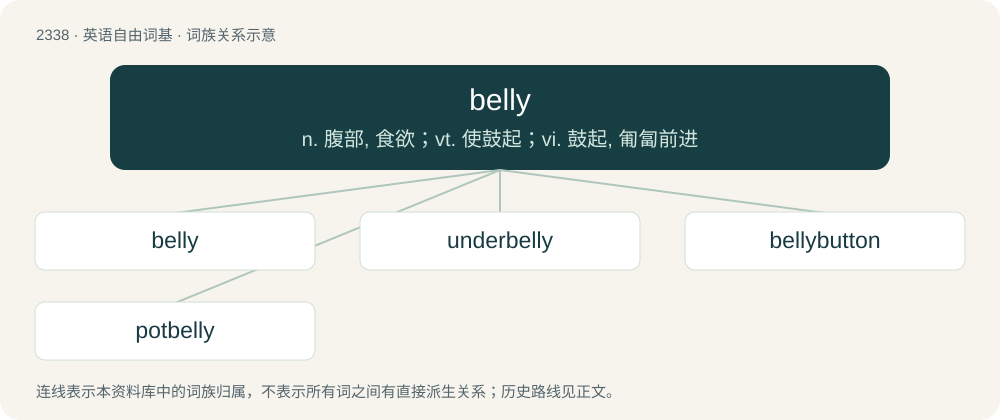

# 2435 · belly — n. 腹部, 食欲；vt. 使鼓起；vi. 鼓起, 匍匐前进

[总目录](../00_总目录_按常用程度.md)

**类型**：英语自由词基　｜　**来源语言**：见词源记录

## 核心含义与来源

- 核心含义：n. 腹部, 食欲；vt. 使鼓起；vi. 鼓起, 匍匐前进
- 英文含义：The abdomen (especially a fat one).
- 词形：belly

**来源记录 1**（名词；The abdomen (especially a fat one).）

Inherited from Middle English bely, beli, bali, below, belew, balyw, from Old English bielġ (“bag, pouch, bulge”), from Proto-West Germanic \*balgi, \*balgu, from Proto-Germanic \*balgiz, \*balguz (“skin, hide, bellows, bag”), from Proto-Indo-European \*bʰelǵʰ- (“to swell, blow up”). Cognate with Dutch balg, German Balg, Danish bælg, Old Irish bolg, Welsh bol. Doublet of bellows, blague, bulge, and budge. See also bellows. For the belly — bellows relation, compare typologically Macedonian мев (mev, “abdomen, belly; bellows”). Also compare Ancient Greek φῦσα (phûsa, “bellows; bladder; ...”), Latin venter — vēsīca, Russian пу́зо (púzo) — пузы́рь (puzýrʹ), пузырёк (puzyrjók).

## 词族图

## 单词速览（常用到不常用）

| 单词 | 音标 | 释义 |
|---|---|---|
| [belly](#w-1) | /ˈbɛli/ | n. 腹部, 食欲；vt. 使鼓起；vi. 鼓起, 匍匐前进 |
| [underbelly](#w-2) | 英 /ˈʌn.dəˌbɛl.i/；美 /ˈʌn.dɚˌbɛl.i/ | n. 下腹部, 薄弱部分 |
| [bellybutton](#w-3) | /ˈbelɪ,bʌtn/ | n. 肚脐 |
| [potbelly](#w-4) | /ˈpɒtbeli/ | n. 大肚子, 大肚子的人, 圆火炉 |

## 逐词详解

### 1. belly

**词性**：名词　｜　**音标**：/ˈbɛli/

**中文释义**：n. 腹部, 食欲；vt. 使鼓起；vi. 鼓起, 匍匐前进

**英文义项**：The abdomen (especially a fat one). / stomach (an organ in animals that stores food in the process of digestion)

**词源与演化**：

Inherited from Middle English bely, beli, bali, below, belew, balyw, from Old English bielġ (“bag, pouch, bulge”), from Proto-West Germanic \*balgi, \*balgu, from Proto-Germanic \*balgiz, \*balguz (“skin, hide, bellows, bag”), from Proto-Indo-European \*bʰelǵʰ- (“to swell, blow up”). Cognate with Dutch balg, German Balg, Danish bælg, Old Irish bolg, Welsh bol. Doublet of bellows, blague, bulge, and budge. See also bellows. For the belly — bellows relation, compare typologically Macedonian мев (mev, “abdomen, belly; bellows”). Also compare Ancient Greek φῦσα (phûsa, “bellows; bladder; ...”), Latin venter — vēsīca, Russian пу́зо (púzo) — пузы́рь (puzýrʹ), пузырёк (puzyrjók).

**例句**：

> You've grown a belly over Christmas! Time to join the gym again.

该用例对应义项：The abdomen (especially a fat one).

### 2. underbelly

**词性**：名词　｜　**音标**：英 /ˈʌn.dəˌbɛl.i/；美 /ˈʌn.dɚˌbɛl.i/

**中文释义**：n. 下腹部, 薄弱部分

**英文义项**：The underside of an animal. / The underside of any thing.

**构词拆分**：under- + belly

**词源与演化**：

From under- + belly.

**例句**：

> The area by the canal is the underbelly of town – not something you’d see in the guidebooks.

该用例对应义项：The side which is not normally seen, normally a dark, immoral place.

### 3. bellybutton

**词性**：名词　｜　**音标**：/ˈbelɪ,bʌtn/

**中文释义**：n. 肚脐

**英文义项**：The navel or umbilicus.

**构词拆分**：belly + button

**词源与演化**：

From belly + button.

### 4. potbelly

**词性**：名词　｜　**音标**：/ˈpɒtbeli/

**中文释义**：n. 大肚子, 大肚子的人, 圆火炉

**英文义项**：A large, protruding, or swollen abdomen; a paunch.

**构词拆分**：pot + belly

**词源与演化**：

From pot + belly.
