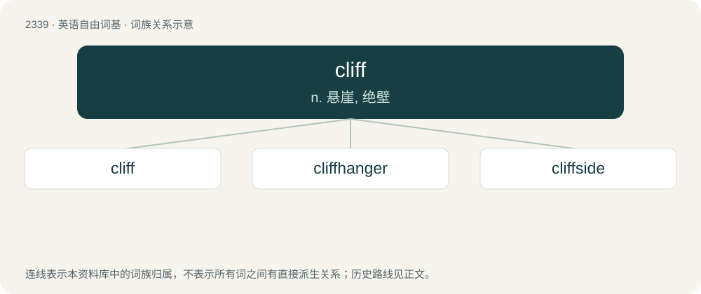

# 2436 · cliff — n. 悬崖, 绝壁

[总目录](../00_总目录_按常用程度.md)

**类型**：英语自由词基　｜　**来源语言**：见词源记录

## 核心含义与来源

- 核心含义：n. 悬崖, 绝壁
- 英文含义：A vertical (or nearly vertical) rock face.
- 词形：cliff

**来源记录 1**（名词；A vertical (or nearly vertical) rock face.）

From Middle English clyf, from Old English clif, from Proto-West Germanic \*klib, from Proto-Germanic \*klibą.

## 词族图

## 单词速览（常用到不常用）

| 单词 | 音标 | 释义 |
|---|---|---|
| [cliff](#w-1) | /klɪf/ | n. 悬崖, 绝壁 |
| [cliffhanger](#w-2) | 英 /ˌklɪfˈhæŋ.ə(ɹ)/ | n. 惊险故事, 惊心动魄的比赛 |
| [cliffside](#w-3) | /klɪfˈsaɪd/ | n. 悬崖的边或面 |

## 逐词详解

### 1. cliff

**词性**：名词　｜　**音标**：/klɪf/

**中文释义**：n. 悬崖, 绝壁

**英文义项**：A vertical (or nearly vertical) rock face. / A point beyond which something abruptly fails or decreases in value, performance, etc.

**词源与演化**：

From Middle English clyf, from Old English clif, from Proto-West Germanic \*klib, from Proto-Germanic \*klibą.

**例句**：

> He stood on a high cliff overlooking the town.

该用例对应义项：a steep high face of rock

### 2. cliffhanger

**词性**：名词　｜　**音标**：英 /ˌklɪfˈhæŋ.ə(ɹ)/

**中文释义**：n. 惊险故事, 惊心动魄的比赛

**英文义项**：An ending or stopping point calculated to leave a story unresolved, in order to create suspense. / An outcome which is awaited with keen anticipation, especially one which is delayed for a period of time or which is not known until the last minute.

**构词拆分**：cliff + hanger

**词源与演化**：

From cliff + hanger, evoking the image of someone left hanging from a cliff, thereby having an uncertain fate. The term cliffhanger is considered to have originated with the serialized version of Thomas Hardy's A Pair of Blue Eyes, published in Tinsley's Magazine in the 1870s, in which the character Henry Knight is left hanging off of a cliff. It was inspired by a real life story from his wife Emma's childhood, when she had to rescue one of her school friends from a similar position.

**例句**：

> Was the cliffhanger a downer or did it whet your appetite for more?

### 3. cliffside

**词性**：名词　｜　**音标**：/klɪfˈsaɪd/

**中文释义**：n. 悬崖的边或面

**英文义项**：The side of a cliff.

**构词拆分**：cliff + side

**词源与演化**：

From cliff + side.

**例句**：

> We strolled along the cliffside.

该用例对应义项：The side of a cliff.
