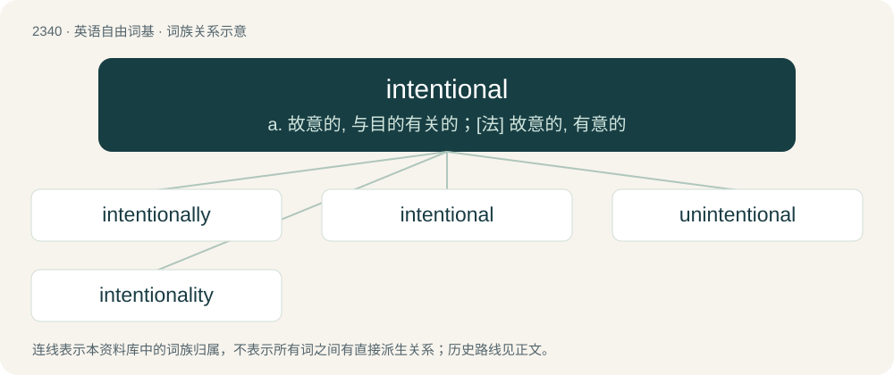

# 2438 · intentional — a. 故意的, 与目的有关的；\[法\] 故意的, 有意的

[总目录](../00_总目录_按常用程度.md)

**类型**：英语自由词基　｜　**来源语言**：见词源记录

## 核心含义与来源

- 核心含义：a. 故意的, 与目的有关的；\[法\] 故意的, 有意的
- 英文含义：Intended or planned; done deliberately or voluntarily.
- 词形：intentional

**来源记录 1**（形容词；Intended or planned; done deliberately or voluntarily.）

Borrowed from Medieval Latin intentiōnālis, from intentiō + -ālis. By surface analysis, intention + -al.

## 词族图

## 单词速览（常用到不常用）

| 单词 | 音标 | 释义 |
|---|---|---|
| [intentionally](#w-1) | /ɪnˈtɛn(t)ʃənəli/ | adv. 故意地, 有意地 |
| [intentional](#w-2) | 英 /ɪnˈtɛnʃn̩(ə)l/；美 /ɪnˈtɛn(t)ʃ(ə)nəl/ | a. 故意的, 与目的有关的；\[法\] 故意的, 有意的 |
| [unintentional](#w-3) | 英 /ˌʌnɪnˈtɛnʃn̩(ə)l/；美 /ˌʌnɪnˈtɛn(t)ʃ(ə)nəl/ | a. 无心的, 不是故意的；\[法\] 非故意的, 无意的, 无心的 |
| [intentionality](#w-4) | /ɪnˌtenʃəˈnælɪtɪ/ | 意向性 |

## 逐词详解

### 1. intentionally

**词性**：副词　｜　**音标**：/ɪnˈtɛn(t)ʃənəli/

**中文释义**：adv. 故意地, 有意地

**英文义项**：In an intentional manner; on purpose.

**构词拆分**：intentional + -ly

**词源与演化**：

From intentional + -ly.

**例句**：

> He used that word intentionally.

该用例对应义项：with intention; in an intentional manner

### 2. intentional

**词性**：形容词　｜　**音标**：英 /ɪnˈtɛnʃn̩(ə)l/；美 /ɪnˈtɛn(t)ʃ(ə)nəl/

**中文释义**：a. 故意的, 与目的有关的；\[法\] 故意的, 有意的

**英文义项**：Intended or planned; done deliberately or voluntarily. / Reflecting intention; marking an expenditure of will in the shape of a matter.

**词源与演化**：

Borrowed from Medieval Latin intentiōnālis, from intentiō + -ālis. By surface analysis, intention + -al.

**例句**：

> Of course, it wasn't intentional or done with any sort of awareness.

### 3. unintentional

**词性**：形容词　｜　**音标**：英 /ˌʌnɪnˈtɛnʃn̩(ə)l/；美 /ˌʌnɪnˈtɛn(t)ʃ(ə)nəl/

**中文释义**：a. 无心的, 不是故意的；\[法\] 非故意的, 无意的, 无心的

**英文义项**：Inadvertent; unwitting. / Unmindful.

**构词拆分**：un- + intentional

**词源与演化**：

From un- + intentional.

**例句**：

> His omission of her name from the acknowledgments section was unintentional; it was fixed for the second print run.

该用例对应义项：Inadvertent; unwitting.

### 4. intentionality

**词性**：名词　｜　**音标**：/ɪnˌtenʃəˈnælɪtɪ/

**中文释义**：意向性

**英文义项**：The state or quality of being intentional. / The characteristic of a mental state whereby it is about something, which relates to mental states in an analogous way as meaning relates to a word.

**构词拆分**：intentional + -ity

**词源与演化**：

From intentional + -ity.

**例句**：

> The naturalization of intentionality is an ongoing project in philosophy.

该用例对应义项：The characteristic of a mental state whereby it is about something, which relates to mental states in an analogous way as meaning relates to a word.
