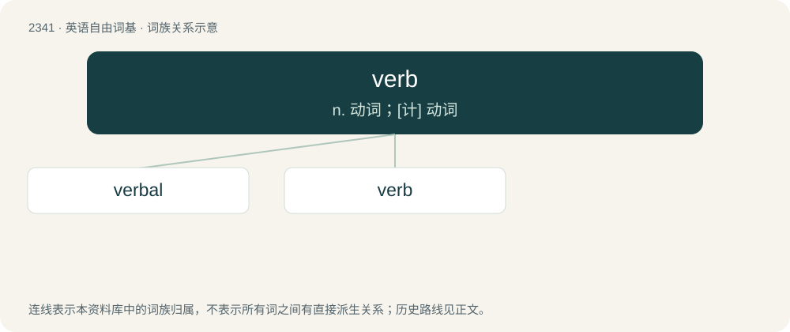

# 2439 · verb — n. 动词；\[计\] 动词

[总目录](../00_总目录_按常用程度.md)

**类型**：英语自由词基　｜　**来源语言**：见词源记录

## 核心含义与来源

- 核心含义：n. 动词；\[计\] 动词
- 英文含义：A word that indicates an action, event, or state of being.
- 词形：verb

**多个词源／构词路径**：同一拼写可能有不同来源；以下按词性和含义分别列出。

**来源记录 1**（名词；A word that indicates an action, event, or state of being.）

From Middle English verbe, directly from Latin verbum (“word, verb”), reinforced by Old French verbe, from Proto-Indo-European \*werdʰo-. Doublet of verve and word.

**来源记录 2**（名词；Reverb.）

Clipping of reverb.

## 词族图

## 单词速览（常用到不常用）

| 单词 | 音标 | 释义 |
|---|---|---|
| [verbal](#w-1) | 英 /ˈvɜː.bəl/；美 /ˈvɝ.bəl/ | a. 用言辞的, 言语的, 口头的, 逐字的, 动词的；\[医\] 言语的, 口述的 |
| [verb](#w-2) | 英 /vɜːb/；美 /vɝb/ | n. 动词；\[计\] 动词 |

## 逐词详解

### 1. verbal

**词性**：形容词　｜　**音标**：英 /ˈvɜː.bəl/；美 /ˈvɝ.bəl/

**中文释义**：a. 用言辞的, 言语的, 口头的, 逐字的, 动词的；\[医\] 言语的, 口述的

**英文义项**：Of or relating to words. / Concerned with the words, rather than the substance of a text.

**构词拆分**：verb + -al

**词源与演化**：

From Old French verbal, from Late Latin verbālis (“belonging to a word”). Equivalent to verb + -al.

**用法示例／搭配（非完整句）**：

> a verbal translation

该用例对应义项：Word for word.

### 2. verb

**词性**：名词　｜　**音标**：英 /vɜːb/；美 /vɝb/

**中文释义**：n. 动词；\[计\] 动词

**英文义项**：A word that indicates an action, event, or state of being. / An action as opposed to a trait or thing.

**词源与演化**：

From Middle English verbe, directly from Latin verbum (“word, verb”), reinforced by Old French verbe, from Proto-Indo-European \*werdʰo-. Doublet of verve and word.

**例句**：

> Kindness is a verb, not an adjective. You're only kind if you do kind things.

该用例对应义项：An action as opposed to a trait or thing.
