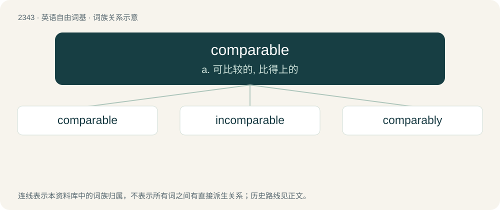

# 2441 · comparable — a. 可比较的, 比得上的

[总目录](../00_总目录_按常用程度.md)

**类型**：英语自由词基　｜　**来源语言**：见词源记录

## 核心含义与来源

- 核心含义：a. 可比较的, 比得上的
- 英文含义：Able to be compared (to).
- 词形：comparable

**来源记录 1**（形容词；Able to be compared (to).）

From Middle English comparable, from Middle French comparable, from Latin comparābilis. By surface analysis, compare + -able.

## 词族图

## 单词速览（常用到不常用）

| 单词 | 音标 | 释义 |
|---|---|---|
| [comparable](#w-1) | /ˈkɒmpəɹəbəl/ | a. 可比较的, 比得上的 |
| [incomparable](#w-2) | 英 /ɪŋˈkɒmp(ə)rəbəl/；美 /ɪŋˈkɑmp(ə)ɹəbəl/ | a. 无比的, 不能比较的 |
| [comparably](#w-3) | 美 /kɒmˈpæɹəbl̩i/ | adv. 可比较地, 同等地 |

## 逐词详解

### 1. comparable

**词性**：形容词　｜　**音标**：/ˈkɒmpəɹəbəl/

**中文释义**：a. 可比较的, 比得上的

**英文义项**：Able to be compared (to). / Similar (to); like.

**词源与演化**：

From Middle English comparable, from Middle French comparable, from Latin comparābilis. By surface analysis, compare + -able.

**例句**：

> You can't say that robbing a bank is like pickpocketing. The two are just not comparable.

该用例对应义项：Able to be compared (to).

### 2. incomparable

**词性**：形容词　｜　**音标**：英 /ɪŋˈkɒmp(ə)rəbəl/；美 /ɪŋˈkɑmp(ə)ɹəbəl/

**中文释义**：a. 无比的, 不能比较的

**英文义项**：Not comparable. / So much better than another as to be beyond comparison.

**构词拆分**：By surface analysis, in- + comparable

**词源与演化**：

From Middle English incomparable, from Middle French incomparable, from Old French \[Term?\], from Latin incomparābilis. By surface analysis, in- + comparable.

**例句**：

> An incomparable week of rest and pleasure.

该用例对应义项：such that comparison is impossible; unsuitable for comparison or lacking features that can be compared

### 3. comparably

**词性**：副词　｜　**音标**：美 /kɒmˈpæɹəbl̩i/

**中文释义**：adv. 可比较地, 同等地

**英文义项**：In a comparable manner.

**构词拆分**：comparable + -ly

**词源与演化**：

From comparable + -ly.

**例句**：

> You will have to work comparably harder.

该用例对应义项：in a comparable manner or to a comparable degree
