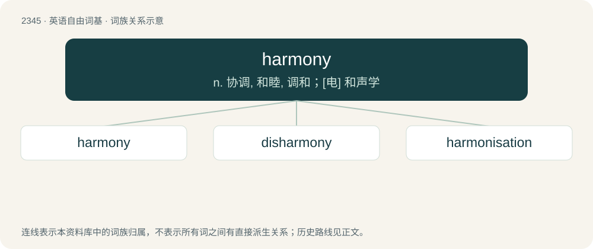

# 2443 · harmony — n. 协调, 和睦, 调和；\[电\] 和声学

[总目录](../00_总目录_按常用程度.md)

**类型**：英语自由词基　｜　**来源语言**：见词源记录

## 核心含义与来源

- 核心含义：n. 协调, 和睦, 调和；\[电\] 和声学
- 英文含义：Agreement or accord.
- 词形：harmony

**来源记录 1**（名词；Agreement or accord.）

From Middle English armonye, from Old French harmonie, armonie, from Latin harmonia, from Ancient Greek ἁρμονία (harmonía, “joint, union, agreement, concord of sounds”), either from or cognate with ἁρμόζω (harmózō, “to fit together”), from Proto-Indo-European \*h₂er- (“to join, fit, fix together”). First attested in 1602. Doublet of harmonia.

## 词族图

## 单词速览（常用到不常用）

| 单词 | 音标 | 释义 |
|---|---|---|
| [harmony](#w-1) | 英 /ˈhɑːmə.ni/；美 /ˈhɑ̟ɹ.mə.ni/ | n. 协调, 和睦, 调和；\[电\] 和声学 |
| [disharmony](#w-2) | 英 /dɪsˈhɑːməni/；美 /dɪsˈhɑɹməni/ | n. 不调和, 不一致, 不和谐；\[医\] 不和谐, 失谐, 失调 |
| [harmonisation](#w-3) | /ˌhaːmənaɪˈzeɪʃən/ | n. 和谐, 协调, 相称； \[医\]调谐 |

## 逐词详解

### 1. harmony

**词性**：名词　｜　**音标**：英 /ˈhɑːmə.ni/；美 /ˈhɑ̟ɹ.mə.ni/

**中文释义**：n. 协调, 和睦, 调和；\[电\] 和声学

**英文义项**：Agreement or accord. / A pleasing combination of elements, or arrangement of sounds.

**词源与演化**：

From Middle English armonye, from Old French harmonie, armonie, from Latin harmonia, from Ancient Greek ἁρμονία (harmonía, “joint, union, agreement, concord of sounds”), either from or cognate with ἁρμόζω (harmózō, “to fit together”), from Proto-Indo-European \*h₂er- (“to join, fit, fix together”). First attested in 1602. Doublet of harmonia.

**用法示例／搭配（非完整句）**：

> a harmony of the Gospels

该用例对应义项：A literary work which brings together or arranges systematically parallel passages of historians respecting the same events, and shows their agreement or consistency.

### 2. disharmony

**词性**：名词　｜　**音标**：英 /dɪsˈhɑːməni/；美 /dɪsˈhɑɹməni/

**中文释义**：n. 不调和, 不一致, 不和谐；\[医\] 不和谐, 失谐, 失调

**英文义项**：The absence of harmony or concordance.

**构词拆分**：dis- + harmony

**词源与演化**：

From dis- + harmony.

### 3. harmonisation

**词性**：名词　｜　**音标**：/ˌhaːmənaɪˈzeɪʃən/

**中文释义**：n. 和谐, 协调, 相称； \[医\]调谐

**英文义项**：Non-Oxford British standard spelling of harmonization.

**构词拆分**：harmony + -isation

**词源与演化**：

From harmony + -isation.
