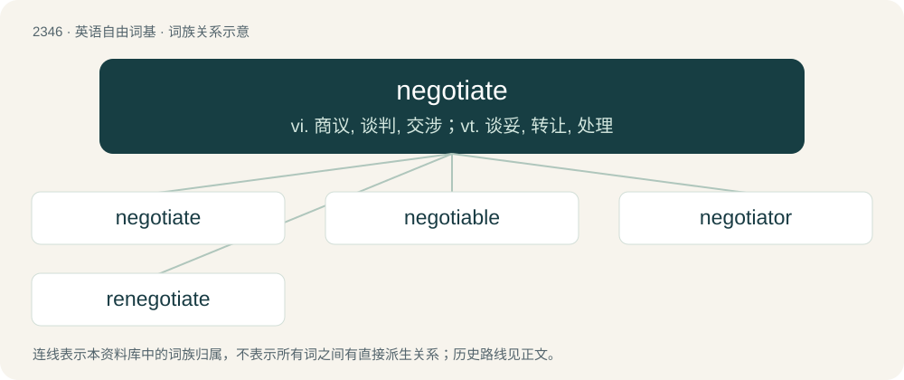

# 2445 · negotiate — vi. 商议, 谈判, 交涉；vt. 谈妥, 转让, 处理

[总目录](../00_总目录_按常用程度.md)

**类型**：英语自由词基　｜　**来源语言**：见词源记录

## 核心含义与来源

- 核心含义：vi. 商议, 谈判, 交涉；vt. 谈妥, 转让, 处理
- 英文含义：To confer with others in order to come to terms or reach an agreement.
- 词形：negotiate

**来源记录 1**（动词；To confer with others in order to come to terms or reach an agreement.）

c. 1598; borrowed from Latin negōtiātus, perfect active participle of negōtior (“to do business, trade”) (see -ate (verb-forming suffix)), from negotium (“business”) + -or, from nec (“not”) + otium (“leisure, ease, inactivity”).

## 词族图

## 单词速览（常用到不常用）

| 单词 | 音标 | 释义 |
|---|---|---|
| [negotiate](#w-1) | 英 /nəˈɡəʊ.ʃi.eɪt/；美 /nəˈɡoʊ.ʃi.eɪt/ | vi. 商议, 谈判, 交涉；vt. 谈妥, 转让, 处理 |
| [negotiable](#w-2) | 英 /nɪˈɡəʊʃəbəl/；美 /nɪˈɡoʊʃəbəl/ | a. 可磋商的, 可转让的, 可通行的；\[经\] 可流通的, 可转让的 |
| [negotiator](#w-3) | 英 /nɪˈɡəʊ.ʃi.eɪ.tə/；美 /nɪˈɡoʊ.ʃi.eɪ.tɚ/ | n. 磋商者, 交涉者, 议定者；\[经\] 谈判者, 交易者, 协商者 |
| [renegotiate](#w-4) | /.riːniˈgəuʃieit/ | vt. 重新谈判 |

## 逐词详解

### 1. negotiate

**词性**：动词　｜　**音标**：英 /nəˈɡəʊ.ʃi.eɪt/；美 /nəˈɡoʊ.ʃi.eɪt/

**中文释义**：vi. 商议, 谈判, 交涉；vt. 谈妥, 转让, 处理

**英文义项**：To confer with others in order to come to terms or reach an agreement. / To arrange or settle something by mutual agreement.

**词源与演化**：

c. 1598; borrowed from Latin negōtiātus, perfect active participle of negōtior (“to do business, trade”) (see -ate (verb-forming suffix)), from negotium (“business”) + -or, from nec (“not”) + otium (“leisure, ease, inactivity”).

**例句**：

> The client and server computers must first negotiate a network protocol to be used.

该用例对应义项：To arrange or settle something by mutual agreement.

### 2. negotiable

**词性**：形容词　｜　**音标**：英 /nɪˈɡəʊʃəbəl/；美 /nɪˈɡoʊʃəbəl/

**中文释义**：a. 可磋商的, 可转让的, 可通行的；\[经\] 可流通的, 可转让的

**英文义项**：Able to be traversed; navigable. / Able to be transferred to another person, with or without endorsement, in exchange for money.

**构词拆分**：negotiate + -able

**词源与演化**：

From negotiate + -able.

**例句**：

> Salary is negotiable, according to education and experience.

该用例对应义项：Open to negotiation or bargaining.

### 3. negotiator

**词性**：名词　｜　**音标**：英 /nɪˈɡəʊ.ʃi.eɪ.tə/；美 /nɪˈɡoʊ.ʃi.eɪ.tɚ/

**中文释义**：n. 磋商者, 交涉者, 议定者；\[经\] 谈判者, 交易者, 协商者

**英文义项**：One who negotiates. / A diplomat, moderator.

**构词拆分**：negotiate + -or

**词源与演化**：

Borrowed from Latin negōtiātor (“merchant, banker”), equivalent to negotiate + -or.

**例句**：

> Carlos is a skilled negotiator and my go-to colleague for contract discussions.

### 4. renegotiate

**词性**：动词　｜　**音标**：/.riːniˈgəuʃieit/

**中文释义**：vt. 重新谈判

**英文义项**：To negotiate new terms to replace old ones.

**构词拆分**：re- + negotiate

**词源与演化**：

From re- + negotiate.

**例句**：

> Does Algeria need to renegotiate its free-trade agreement with Europe?
