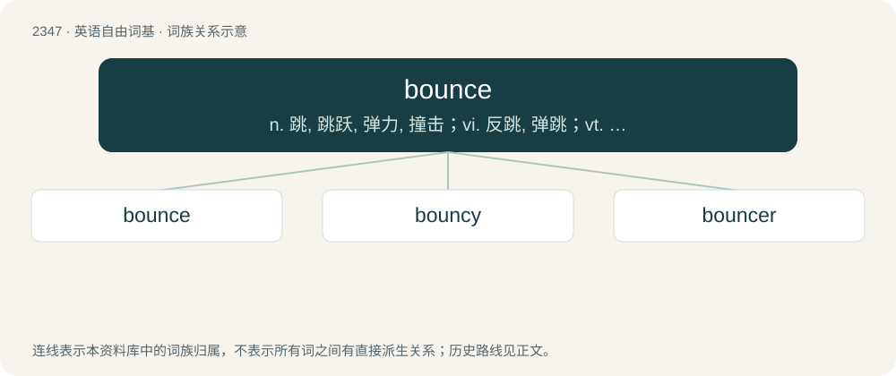

# 2446 · bounce — n. 跳, 跳跃, 弹力, 撞击；vi. 反跳, 弹跳；vt. 使跳回, 撞击

[总目录](../00_总目录_按常用程度.md)

**类型**：英语自由词基　｜　**来源语言**：见词源记录

## 核心含义与来源

- 核心含义：n. 跳, 跳跃, 弹力, 撞击；vi. 反跳, 弹跳；vt. 使跳回, 撞击
- 英文含义：To change the direction of motion after hitting an obstacle.
- 词形：bounce

**来源记录 1**（动词；To change the direction of motion after hitting an obstacle.）

From Middle English bounsen, bunsen (“to beat, thump”), cognate with Scots bunce, bonce (“to bounce”). Of uncertain origin. Perhaps imitative, related to bump, or related to Middle English bonchen (“to pound, beat”) and Dutch bonken (“to bump”). Compare Saterland Frisian bumzje (“to pound, bang, bounce”), West Frisian bûnzje (“to throb, bounce, pulsate”), Dutch bonzen (“to thump, knock, throb, bounce”), German Low German bunsen, bumsen (“to beat, bounce”), German bumsen (“to thud, bang, pound”).

## 词族图

## 单词速览（常用到不常用）

| 单词 | 音标 | 释义 |
|---|---|---|
| [bounce](#w-1) | /baʊns/ | n. 跳, 跳跃, 弹力, 撞击；vi. 反跳, 弹跳；vt. 使跳回, 撞击 |
| [bouncy](#w-2) | 英 /ˈbaʊnsi/；美 /ˈbaʊnsi/ | a. 快活的, 精神饱满的, 有弹性的, 自大的 |
| [bouncer](#w-3) | 英 /ˈbaʊn.sə/；美 /ˈboʊn.sɚ/ | n. 巨大的东西, 巨人, 跳跃的人, 同类中最大者 |

## 逐词详解

### 1. bounce

**词性**：动词　｜　**音标**：/baʊns/

**中文释义**：n. 跳, 跳跃, 弹力, 撞击；vi. 反跳, 弹跳；vt. 使跳回, 撞击

**英文义项**：To change the direction of motion after hitting an obstacle. / To move quickly up and then down (or vice versa), once or repeatedly.

**词源与演化**：

From Middle English bounsen, bunsen (“to beat, thump”), cognate with Scots bunce, bonce (“to bounce”). Of uncertain origin. Perhaps imitative, related to bump, or related to Middle English bonchen (“to pound, beat”) and Dutch bonken (“to bump”). Compare Saterland Frisian bumzje (“to pound, bang, bounce”), West Frisian bûnzje (“to throb, bounce, pulsate”), Dutch bonzen (“to thump, knock, throb, bounce”), German Low German bunsen, bumsen (“to beat, bounce”), German bumsen (“to thud, bang, pound”).

**例句**：

> He tends to bounce a check or two toward the end of each month, before his payday.

该用例对应义项：To fail to cover (have sufficient funds for) (a cheque/check drawn on one's account).

### 2. bouncy

**词性**：形容词　｜　**音标**：英 /ˈbaʊnsi/；美 /ˈbaʊnsi/

**中文释义**：a. 快活的, 精神饱满的, 有弹性的, 自大的

**英文义项**：Easily bounced. / Lively, exuberant, energetic.

**构词拆分**：bounce + -y

**词源与演化**：

From bounce + -y.

**例句**：

> You can’t play tennis without a bouncy ball.

该用例对应义项：Easily bounced.

### 3. bouncer

**词性**：名词　｜　**音标**：英 /ˈbaʊn.sə/；美 /ˈboʊn.sɚ/

**中文释义**：n. 巨大的东西, 巨人, 跳跃的人, 同类中最大者

**英文义项**：A person or thing that bounces something, such as a ball. / A member of security personnel employed by bars, nightclubs, etc. to decide who can enter, maintain order, and deal with patrons who cause trouble.

**构词拆分**：bounce + -er

**词源与演化**：

From bounce + -er.

**例句**：

> I know that Tom used to be a bouncer at a nightclub.
