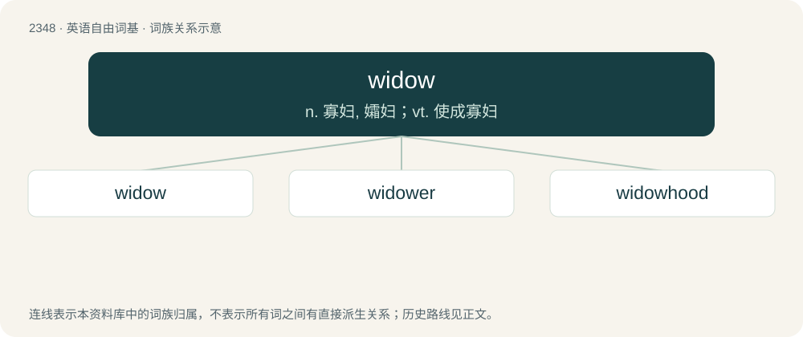

# 2448 · widow — n. 寡妇, 孀妇；vt. 使成寡妇

[总目录](../00_总目录_按常用程度.md)

**类型**：英语自由词基　｜　**来源语言**：见词源记录

## 核心含义与来源

- 核心含义：n. 寡妇, 孀妇；vt. 使成寡妇
- 英文含义：A woman whose spouse (traditionally husband) has died (and who has not remarried); a woman in relation to her late spouse; feminine of widower.
- 词形：widow

**来源记录 1**（名词；A woman whose spouse (traditionally husband) has died (and who has not remarried); a woman in relation to her late spouse; feminine of widower.）

From Middle English widwe, from Old English widuwe (“widow”), from Proto-West Germanic \*widuwā (“widow”), from Proto-Germanic \*widuwǭ (“widow”), from Proto-Indo-European \*h₁widʰéwh₂ (“widow”), possibly from \*h₁weydʰh₁-, \*widʰ- (“to separate, split, cleave, divide”), whence also wood from Old English widu, wudu. Cognates Cognate with Scots weedae, wedow, widdow (“widow”), Cimbrian bittaba (“widow”), Dutch weduwe, weeuw (“widow”), German Witwe (“widow”), Vilamovian wytwa (“widow”), Gothic 𐍅𐌹𐌳𐌿𐍅𐍉 (widuwō, “widow”), Old Irish fedb (“widow”), Welsh gweddw (“widow”), Asturian and Spanish viuda (“widow”), Aragonese and Latin vidua (“widow”), Catalan vídua (“widow”), French veuve (“widow”), Galician and Portuguese viúva (“widow”), Italian vedova (“widow”), Romanian văduvă (“widow”), Ancient Greek ἠΐθεος (ēḯtheos, “bachelor”), Albanian ve (“widow, widower”), Belarusian удава́ (udavá, “widow”), Czech, Slovak, and Slovene vdova (“widow”), Polish gdowa, wdowa (“widow”), Russian and Ukrainian вдова́ (vdová, “widow”), Serbo-Croatian udova, у̀дова (“widow”), Central Kurdish بێوە (bêwe, “widow”), Ossetian идӕдз (idæʒ, “widowed”), Persian بیوه (bive, bêva, “widow”), Sanskrit विधवा (vidhavā, “widow”).

## 词族图

## 单词速览（常用到不常用）

| 单词 | 音标 | 释义 |
|---|---|---|
| [widow](#w-1) | 英 /ˈwɪd.əʊ/；美 /ˈwɪd.oʊ/ | n. 寡妇, 孀妇；vt. 使成寡妇 |
| [widower](#w-2) | 美 /ˈwɪdoʊɚ/ | n. 鳏夫；\[法\] 鳏夫 |
| [widowhood](#w-3) | 美 /ˈwɪd.oʊ.hʊd/；/ˈwɪd.əʊ.hʊd/ | n. 寡妇身分, 守寡 |

## 逐词详解

### 1. widow

**词性**：名词　｜　**音标**：英 /ˈwɪd.əʊ/；美 /ˈwɪd.oʊ/

**中文释义**：n. 寡妇, 孀妇；vt. 使成寡妇

**英文义项**：A woman whose spouse (traditionally husband) has died (and who has not remarried); a woman in relation to her late spouse; feminine of widower. / Any person whose spouse has died (and who has not remarried).

**词源与演化**：

From Middle English widwe, from Old English widuwe (“widow”), from Proto-West Germanic \*widuwā (“widow”), from Proto-Germanic \*widuwǭ (“widow”), from Proto-Indo-European \*h₁widʰéwh₂ (“widow”), possibly from \*h₁weydʰh₁-, \*widʰ- (“to separate, split, cleave, divide”), whence also wood from Old English widu, wudu. Cognates Cognate with Scots weedae, wedow, widdow (“widow”), Cimbrian bittaba (“widow”), Dutch weduwe, weeuw (“widow”), German Witwe (“widow”), Vilamovian wytwa (“widow”), Gothic 𐍅𐌹𐌳𐌿𐍅𐍉 (widuwō, “widow”), Old Irish fedb (“widow”), Welsh gweddw (“widow”), Asturian and Spanish viuda (“widow”), Aragonese and Latin vidua (“widow”), Catalan vídua (“widow”), French veuve (“widow”), Galician and Portuguese viúva (“widow”), Italian vedova (“widow”), Romanian văduvă (“widow”), Ancient Greek ἠΐθεος (ēḯtheos, “bachelor”), Albanian ve (“widow, widower”), Belarusian удава́ (udavá, “widow”), Czech, Slovak, and Slovene vdova (“widow”), Polish gdowa, wdowa (“widow”), Russian and Ukrainian вдова́ (vdová, “widow”), Serbo-Croatian udova, у̀дова (“widow”), Central Kurdish بێوە (bêwe, “widow”), Ossetian идӕдз (idæʒ, “widowed”), Persian بیوه (bive, bêva, “widow”), Sanskrit विधवा (vidhavā, “widow”).

**例句**：

> My aunt is a football widow in the fall and a basketball widow in the winter and early spring.

该用例对应义项：A woman whose husband is often away pursuing a hobby, career, etc.

### 2. widower

**词性**：名词　｜　**音标**：美 /ˈwɪdoʊɚ/

**中文释义**：n. 鳏夫；\[法\] 鳏夫

**英文义项**：A man whose spouse has died (and who has not remarried); a man in relation to his late spouse; masculine of widow.

**构词拆分**：widow + -er

**词源与演化**：

From Middle English widwere, equivalent to widow + -er.

**例句**：

> He's a widower with three small children to take care of.

### 3. widowhood

**词性**：名词　｜　**音标**：美 /ˈwɪd.oʊ.hʊd/；/ˈwɪd.əʊ.hʊd/

**中文释义**：n. 寡妇身分, 守寡

**英文义项**：The state or period of being a widow or widower.

**构词拆分**：widow + -hood

**词源与演化**：

From Middle English widwehede, equivalent to widow + -hood. Compare widowerhood.
