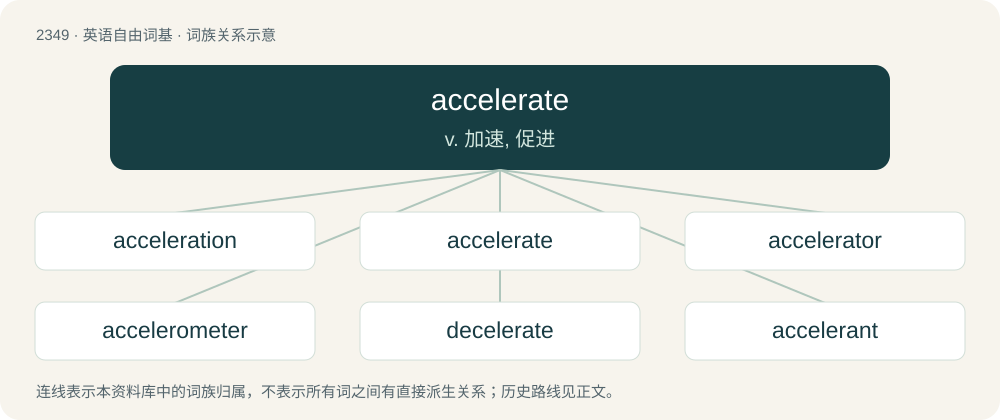

# 2449 · accelerate — v. 加速, 促进

[总目录](../00_总目录_按常用程度.md)

**类型**：英语自由词基　｜　**来源语言**：见词源记录

## 核心含义与来源

- 核心含义：v. 加速, 促进
- 英文含义：To cause to move faster; to quicken the motion of; to add to the speed of.
- 词形：accelerate

**来源记录 1**（动词；To cause to move faster; to quicken the motion of; to add to the speed of.）

First attested in the 1520s. Either from Latin accelerātus, perfect passive participle of accelerō (“to accelerate, hasten”) (see -ate (verb-forming suffix) and -ate (adjective-forming suffix)), formed from ad + celerō (“to hasten”), which is from celer (“quick”) (see celerity), or back-formation from acceleration.

## 词族图

## 单词速览（常用到不常用）

| 单词 | 音标 | 释义 |
|---|---|---|
| [acceleration](#w-1) | /əkˌsɛl.əˈɹeɪ.ʃən/ | n. 加速, 促进, 加速度；\[化\] 加速度 |
| [accelerate](#w-2) | 英 /əkˈsɛl.əˌɹeɪt/；美 /ɪkˈsɛl.əˌɹeɪt/ | v. 加速, 促进 |
| [accelerator](#w-3) | 美 /əkˈsɛl.əˌɹeɪ.tɚ/ | n. 加速剂, 加速器, 油门；\[化\] 加速器; 早强剂; 促进剂; 硫化促进剂 |
| [accelerometer](#w-4) | 美 /ækˌsɛl.əˈɹɑ.mə.tɚ/ | n. 加速度计；\[化\] 加速度计 |
| [decelerate](#w-5) | 英 /diːˈsɛləɹeɪt/ | v. (使)减速 |
| [accelerant](#w-6) | 英 /əkˈsɛləɹ(ə)nt/；美 /əkˈsɛləɹənt/ | n. 促进剂, 加速进程的东西；a. 促进的, 加速的 |

## 逐词详解

### 1. acceleration

**词性**：名词　｜　**音标**：/əkˌsɛl.əˈɹeɪ.ʃən/

**中文释义**：n. 加速, 促进, 加速度；\[化\] 加速度

**英文义项**：The act of accelerating, or the state of being accelerated; increase of motion or action; as opposed to retardation or deceleration. / The amount by which a speed or velocity increases (and so a scalar quantity or a vector quantity).

**构词拆分**：accelerate + -ion

**词源与演化**：

First attested in 1531. From French accélération or more likely directly from Latin accelerātiō (“a hastening, acceleration”). Equivalent to accelerate + -ion.

**例句**：

> The boosters produce an acceleration of 20 metres per second per second.

该用例对应义项：The amount by which a speed or velocity increases (and so a scalar quantity or a vector quantity).

### 2. accelerate

**词性**：动词　｜　**音标**：英 /əkˈsɛl.əˌɹeɪt/；美 /ɪkˈsɛl.əˌɹeɪt/

**中文释义**：v. 加速, 促进

**英文义项**：To cause to move faster; to quicken the motion of; to add to the speed of. / To quicken the natural or ordinary progression or process of.

**词源与演化**：

First attested in the 1520s. Either from Latin accelerātus, perfect passive participle of accelerō (“to accelerate, hasten”) (see -ate (verb-forming suffix) and -ate (adjective-forming suffix)), formed from ad + celerō (“to hasten”), which is from celer (“quick”) (see celerity), or back-formation from acceleration.

**例句**：

> The company plans to accelerate its growth with new marketing strategies.

该用例对应义项：To quicken the natural or ordinary progression or process of.

### 3. accelerator

**词性**：名词　｜　**音标**：美 /əkˈsɛl.əˌɹeɪ.tɚ/

**中文释义**：n. 加速剂, 加速器, 油门；\[化\] 加速器; 早强剂; 促进剂; 硫化促进剂

**英文义项**：One who, or that which, accelerates. / A device for causing acceleration.

**构词拆分**：accelerate + -or

**例句**：

> The Second World War is said to have been a great accelerator for many scientific findings.

该用例对应义项：One who, or that which, accelerates.

### 4. accelerometer

**词性**：名词　｜　**音标**：美 /ækˌsɛl.əˈɹɑ.mə.tɚ/

**中文释义**：n. 加速度计；\[化\] 加速度计

**英文义项**：An instrument for measuring acceleration. / An instrument made for detecting and measuring vibrations.

**构词拆分**：accelerate + -o- + -meter

**词源与演化**：

From accelerate + -o- + -meter.

### 5. decelerate

**词性**：动词　｜　**音标**：英 /diːˈsɛləɹeɪt/

**中文释义**：v. (使)减速

**英文义项**：To reduce the velocity of something. / To reduce the rate of advancement of something, such as a disease.

**构词拆分**：de- + (ac)celerate

**词源与演化**：

Late 19th c., from de- + (ac)celerate. Compare deaccelerate.

**例句**：

> The US can't decelerate China's rise.

### 6. accelerant

**词性**：名词　｜　**音标**：英 /əkˈsɛləɹ(ə)nt/；美 /əkˈsɛləɹənt/

**中文释义**：n. 促进剂, 加速进程的东西；a. 促进的, 加速的

**英文义项**：In the context of fire protection, a substance that accelerates the development of a fire, especially some hydrocarbon-based fuel used to spread a fire caused by arson. / A substance used to catalyze the vulcanization of rubber.

**构词拆分**：accelerate + -ant (suffix forming agent nouns from verbs, or forming adjectives with senses of being prone or tending to do the actions of verbs)

**词源与演化**：

From accelerate + -ant (suffix forming agent nouns from verbs, or forming adjectives with senses of being prone or tending to do the actions of verbs).

**例句**：

> The police were able to determine that an accelerant was used in the fire.
