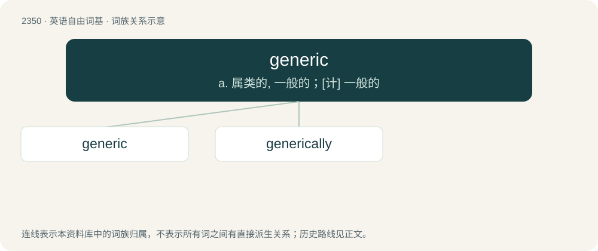

# 2450 · generic — a. 属类的, 一般的；\[计\] 一般的

[总目录](../00_总目录_按常用程度.md)

**类型**：英语自由词基　｜　**来源语言**：见词源记录

## 核心含义与来源

- 核心含义：a. 属类的, 一般的；\[计\] 一般的
- 英文含义：Very broad; pertaining or appropriate to large classes or groups as opposed to specific instances.
- 词形：generic

**来源记录 1**（形容词；Very broad; pertaining or appropriate to large classes or groups as opposed to specific instances.）

From Middle French générique, from Latin genus (“genus, kind”) + -ic.

## 词族图

## 单词速览（常用到不常用）

| 单词 | 音标 | 释义 |
|---|---|---|
| [generic](#w-1) | /dʒɪˈnɛɹ.ɪk/ | a. 属类的, 一般的；\[计\] 一般的 |
| [generically](#w-2) | /dʒəˈnɛɹɪkli/ | adv. 关于属类, 属类地, 属类上 |

## 逐词详解

### 1. generic

**词性**：形容词　｜　**音标**：/dʒɪˈnɛɹ.ɪk/

**中文释义**：a. 属类的, 一般的；\[计\] 一般的

**英文义项**：Very broad; pertaining or appropriate to large classes or groups as opposed to specific instances. / Lacking in precision, often in an evasive fashion; vague; imprecise.

**词源与演化**：

From Middle French générique, from Latin genus (“genus, kind”) + -ic.

**例句**：

> There are scores of generic names within the order Decapoda, which includes many sea creatures that are called shrimp.

该用例对应义项：Pertaining to genera of life instead of particular species thereof.

### 2. generically

**词性**：副词　｜　**音标**：/dʒəˈnɛɹɪkli/

**中文释义**：adv. 关于属类, 属类地, 属类上

**英文义项**：In a generic manner. / With regard to a genus.

**构词拆分**：generic + -ally

**词源与演化**：

From generic + -ally.

**用法示例／搭配（非完整句）**：

> an animal generically distinct from another

该用例对应义项：With regard to a genus.
