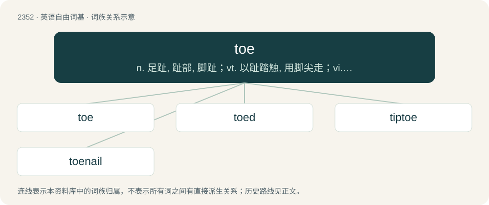

# 2452 · toe — n. 足趾, 趾部, 脚趾；vt. 以趾踏触, 用脚尖走；vi. 动脚尖

[总目录](../00_总目录_按常用程度.md)

**类型**：英语自由词基　｜　**来源语言**：见词源记录

## 核心含义与来源

- 核心含义：n. 足趾, 趾部, 脚趾；vt. 以趾踏触, 用脚尖走；vi. 动脚尖
- 英文含义：Each of the five digits on the end of the human foot.
- 词形：toe

**来源记录 1**（名词；Each of the five digits on the end of the human foot.）

From Middle English to, from Old English tā, (Mercian) tāhe, from Proto-West Germanic \*taihā, from Proto-Germanic \*taihwǭ, from \*tīhwaną (“to show, announce”), from Proto-Indo-European \*deyḱ- (“to show”). Cognate with Dutch teen, German Zehe, Danish, Norwegian Bokmål, Norwegian Nynorsk, and Swedish tå, Faroese and Icelandic tá; also Old English teōn (“to accuse”), German zeihen (“to accuse, blame”); see also Hittite \[script needed\] (tekkuššāi), Latin dīcere (“to say”), digitus (“finger”), Ancient Greek δείκνυμι (deíknumi, “to point out, show”), Sanskrit दिदेष्टि (dídeṣṭi), दिशति (diśáti).

## 词族图

## 单词速览（常用到不常用）

| 单词 | 音标 | 释义 |
|---|---|---|
| [toe](#w-1) | 英 /təʊ/；美 /toʊ/ | n. 足趾, 趾部, 脚趾；vt. 以趾踏触, 用脚尖走；vi. 动脚尖 |
| [toed](#w-2) | 美 /toʊd/；/təʊd/ | a. 有趾的, 斜着钉进去的 |
| [tiptoe](#w-3) | 英 /ˈtɪpˌtəʊ/；美 /ˈtɪpˌtoʊ/ | n. 脚尖；vi. 用脚尖走；adv. 踮着脚 |
| [toenail](#w-4) | /ˈtəʊˌneɪl/ | n. 脚趾甲, 斜钉；\[医\] 趾甲 |

## 逐词详解

### 1. toe

**词性**：名词　｜　**音标**：英 /təʊ/；美 /toʊ/

**中文释义**：n. 足趾, 趾部, 脚趾；vt. 以趾踏触, 用脚尖走；vi. 动脚尖

**英文义项**：Each of the five digits on the end of the human foot. / The equivalent part in an animal.

**词源与演化**：

From Middle English to, from Old English tā, (Mercian) tāhe, from Proto-West Germanic \*taihā, from Proto-Germanic \*taihwǭ, from \*tīhwaną (“to show, announce”), from Proto-Indo-European \*deyḱ- (“to show”). Cognate with Dutch teen, German Zehe, Danish, Norwegian Bokmål, Norwegian Nynorsk, and Swedish tå, Faroese and Icelandic tá; also Old English teōn (“to accuse”), German zeihen (“to accuse, blame”); see also Hittite \[script needed\] (tekkuššāi), Latin dīcere (“to say”), digitus (“finger”), Ancient Greek δείκνυμι (deíknumi, “to point out, show”), Sanskrit दिदेष्टि (dídeṣṭi), दिशति (diśáti).

**用法示例／搭配（非完整句）**：

> to have a lot of toe

该用例对应义项：Speed, energy, vigor.

### 2. toed

**词性**：形容词　｜　**音标**：美 /toʊd/；/təʊd/

**中文释义**：a. 有趾的, 斜着钉进去的

**英文义项**：Having (a specified number or type of) toes.

**构词拆分**：From toe (“digit of a foot”) + -ed.

**词源与演化**：

From toe (“digit of a foot”) + -ed.

**用法示例／搭配（非完整句）**：

> a three-toed sloth

该用例对应义项：Having (a specified number or type of) toes.

### 3. tiptoe

**词性**：名词　｜　**音标**：英 /ˈtɪpˌtəʊ/；美 /ˈtɪpˌtoʊ/

**中文释义**：n. 脚尖；vi. 用脚尖走；adv. 踮着脚

**英文义项**：The tip of the toe.

**构词拆分**：tip + toe

**词源与演化**：

From Middle English tipto, typto; equivalent to tip + toe. Compare fingertip.

**例句**：

> He walks on tiptoe so as not to wake up the family.

### 4. toenail

**词性**：名词　｜　**音标**：/ˈtəʊˌneɪl/

**中文释义**：n. 脚趾甲, 斜钉；\[医\] 趾甲

**英文义项**：The thin, horny, transparent plate covering the upper surface of the end of a toe.

**构词拆分**：toe + nail

**词源与演化**：

From toe + nail.

**用法示例／搭配（非完整句）**：

> toenail clippings

该用例对应义项：The thin, horny, transparent plate covering the upper surface of the end of a toe.
