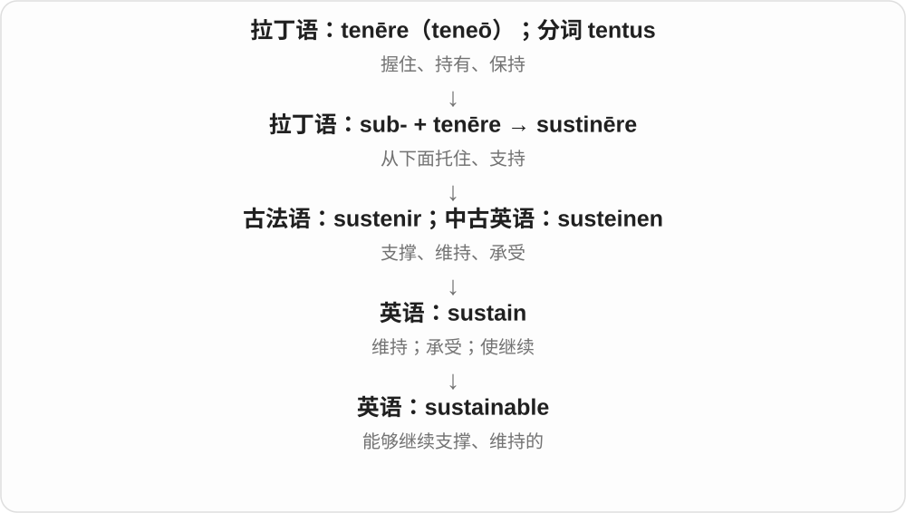
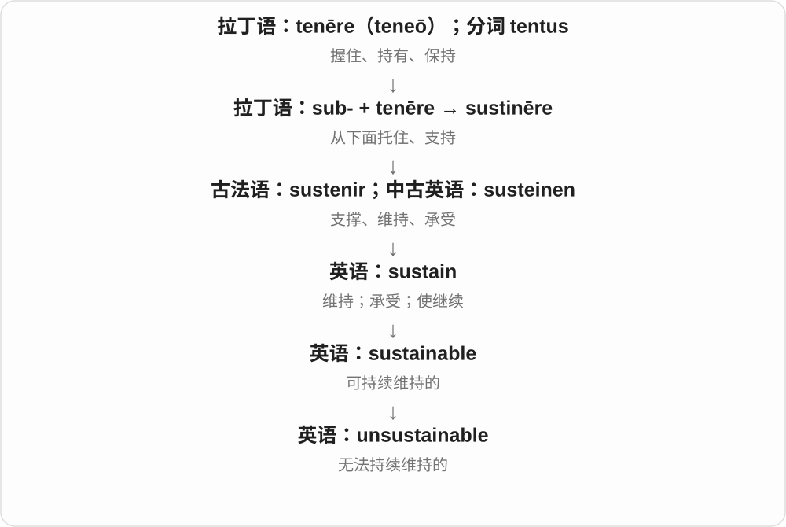

# 2453 · sustainable — 能持续维持的性质，及相应方式、否定

[逐词精讲目录](../00_逐词精讲目录.md) · [总目录](../00_总目录_按常用程度.md)

## 核心词根与来源

资源、环境、工作与经营都能涉及可持续性。具体怎样持续，要由对象和长期条件说明。

**SUSTAINABLE：现在能做，还保留以后继续做的条件**

sustainable → sustainably；unsustainable 不能持续维持。

- **性质、方式与否定**：sustainable · sustainably · unsustainable

## 词形与演化规律

sustain + -able → sustainable；-ably 副词，un- 否定。

## 单词速览（按词族由简到繁）

同一基础词的相关扩展放在一起，先读基础形式，再读扩展；各组之间优先读常用的。具体词源关系见各词讲解。

| 单词 | 音标 | 核心意思 |
|---|---|---|
| [sustainable](#w-1) | /səˈsteɪnəbəl/ | 可持续的；能够长期维持的 |
| [sustainably](#w-3) | /səˈsteɪnəbli/ | 以可持续的方式、能长期维持地 |
| [unsustainable](#w-2) | /ˌʌnsəˈsteɪnəbəl/ | 无法长期维持的；不可持续的 |

## 逐词讲解

### 1. sustainable — 可持续的；能够长期维持的

**音标**：/səˈsteɪnəbəl/

**先抓住这个画面**

sustainable 像一种生活或生产方式，今天能运转，明天也不至于把维持它的资源和条件耗光。

**怎么拆**

sustain + -able。

**怎么变成今天的意思**

环境话题最常见，但也能说工作强度、财务模式、增长速度。不能只翻成绿色或环保而丢掉持续的含义。

**常见搭配与例句**

sustainable development；a sustainable pace；a sustainable business model。

> We need a sustainable pace of work, not constant overtime.

我们需要能长期维持的工作节奏，而不是持续加班。

> The project explores more sustainable ways to use local resources.

项目探索更可持续地使用本地资源的方法。

**别混淆**

renewable 是资源可再生；sustainable 是整体做法能否长期维持，两者相关但不完全相同。

### 2. sustainably — 以可持续的方式、能长期维持地

**音标**：/səˈsteɪnəbli/

**先抓住这个画面**

不把未来继续做这件事的条件耗光，让它有办法长期维持，就是 sustainably 想强调的方式。对象可涉及资源，也可涉及经营、工作节奏。

**怎么拆**

sustainable + -ly，常见 -able 形容词形成 -ably 副词。承接能够持续维持的性质，不只是把一个环保标签贴到动作上。

**怎么变成今天的意思**

**sustain 支持、维持 → sustainable**  
能够持续维持的；涉及资源、环境等可持续性

↓

**sustainable + -ly → sustainably**  
以能够持续维持的方式

sustainably managed forests 可持续管理的森林，sustainably produced goods 可持续生产的商品，grow sustainably 以能长期维持的方式发展。

**常见搭配与例句**

sustainably managed；sustainably produced；grow sustainably。

> The furniture uses wood from sustainably managed forests.

家具使用来自可持续管理森林的木材。

> The team wants to grow sustainably rather than expand too quickly.

团队希望稳健地持续发展，避免扩张太快。

**别混淆**

sustainably 是方式副词，sustainable 是性质形容词。词语主张是否成立，要看实际资源、长期条件，不能只凭标签。

### 3. unsustainable — 无法长期维持的；不可持续的

**音标**：/ˌʌnsəˈsteɪnəbəl/

**先抓住这个画面**

unsustainable 像支出一直大于收入，暂时还能撑一阵，但按同样方式继续迟早会出问题。

**怎么拆**

un-（不）+ sustainable。

**怎么变成今天的意思**

不一定表示当下马上崩溃，而是维持所需条件会被耗尽，或现有负担长期承受不了。

**常见搭配与例句**

an unsustainable workload；unsustainable costs；an unsustainable practice。

> The team’s workload had become unsustainable.

团队的工作负担已经到了无法长期维持的程度。

> Relying on emergency funds every month is unsustainable.

每个月都依靠应急资金是无法长久维持的。

**别混淆**

impossible 是无法做到；unsustainable 可以短期做到，只是无法长期照这样继续。

## 这一组要分清什么

sustainably 修饰做法；sustainable 描述性质；可持续不只是商品宣传中的一个字样。

## 串起来练习

A sustainable plan explains how the work can continue sustainably.

一项可持续的计划应说明工作怎样持续进行。
