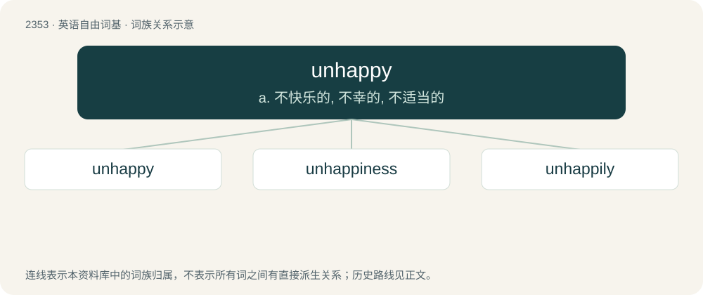

# 2453 · unhappy — a. 不快乐的, 不幸的, 不适当的

[总目录](../00_总目录_按常用程度.md)

**类型**：英语自由词基　｜　**来源语言**：见词源记录

## 核心含义与来源

- 核心含义：a. 不快乐的, 不幸的, 不适当的
- 英文含义：Not happy; sad.
- 词形：unhappy

**来源记录 1**（形容词；Not happy; sad.）

From Middle English unhappy; equivalent to un- + happy.

## 词族图

## 单词速览（常用到不常用）

| 单词 | 音标 | 释义 |
|---|---|---|
| [unhappy](#w-1) | /ʌnˈhæpi/ | a. 不快乐的, 不幸的, 不适当的 |
| [unhappiness](#w-2) |  | n. 苦恼；忧愁 |
| [unhappily](#w-3) | /ʌnˈhæpɪli/ | adv. 不幸福地, 不幸地 |

## 逐词详解

### 1. unhappy

**词性**：形容词　｜　**音标**：/ʌnˈhæpi/

**中文释义**：a. 不快乐的, 不幸的, 不适当的

**英文义项**：Not happy; sad. / Not satisfied; unsatisfied.

**构词拆分**：un- + happy

**词源与演化**：

From Middle English unhappy; equivalent to un- + happy.

**例句**：

> The doomed lovers must have been born under an unhappy star.

该用例对应义项：Not lucky; unlucky.

### 2. unhappiness

**词性**：名词

**中文释义**：n. 苦恼；忧愁

**英文义项**：The feeling of not being happy.

**构词拆分**：unhappy + -ness；un- + happiness

**词源与演化**：

From unhappy + -ness or un- + happiness.

**例句**：

> My unhappiness probably is because I very much like to be alone.

### 3. unhappily

**词性**：副词　｜　**音标**：/ʌnˈhæpɪli/

**中文释义**：adv. 不幸福地, 不幸地

**英文义项**：Unfortunately; regrettably. / Through evil fate or chance; wretchedly.

**构词拆分**：un- + happily；unhappy + -ly

**词源与演化**：

From Middle English onhappily, unhappili, unhappily, unhappyly; equivalent to un- + happily or unhappy + -ly.

**例句**：

> Due to differing opinions between the two, they argued angrily, before leaving unhappily.
