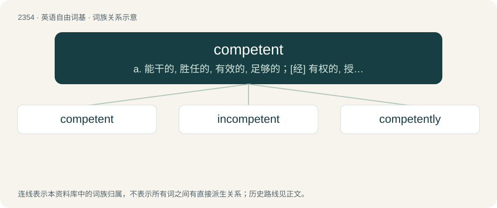

# 2454 · competent — a. 能干的, 胜任的, 有效的, 足够的；\[经\] 有权的, 授权的, 胜任的

[总目录](../00_总目录_按常用程度.md)

**类型**：英语自由词基　｜　**来源语言**：见词源记录

## 核心含义与来源

- 核心含义：a. 能干的, 胜任的, 有效的, 足够的；\[经\] 有权的, 授权的, 胜任的
- 英文含义：Having sufficient skill, knowledge, ability, or qualifications.
- 词形：competent

**来源记录 1**（形容词；Having sufficient skill, knowledge, ability, or qualifications.）

From Middle English competent, conpetent, from Old French competent (modern French compétent), from Latin competens, competentem, present participle of competō (“coincide, be equal to, be capable of”). Compare Dutch competent (“competent”), German kompetent (“competent”), Danish kompetent (“competent”).

## 词族图

## 单词速览（常用到不常用）

| 单词 | 音标 | 释义 |
|---|---|---|
| [competent](#w-1) | /ˈkɒmpətənt/ | a. 能干的, 胜任的, 有效的, 足够的；\[经\] 有权的, 授权的, 胜任的 |
| [incompetent](#w-2) | 美 /ɪnˈkɒmpətənt/ | a. 无能力的, 无资格的, 机能不全的, 不胜任的；n. 无能力者 |
| [competently](#w-3) |  | adv. 胜任地；适合地 |

## 逐词详解

### 1. competent

**词性**：形容词　｜　**音标**：/ˈkɒmpətənt/

**中文释义**：a. 能干的, 胜任的, 有效的, 足够的；\[经\] 有权的, 授权的, 胜任的

**英文义项**：Having sufficient skill, knowledge, ability, or qualifications. / Having jurisdiction or authority over a particular issue or question.

**词源与演化**：

From Middle English competent, conpetent, from Old French competent (modern French compétent), from Latin competens, competentem, present participle of competō (“coincide, be equal to, be capable of”). Compare Dutch competent (“competent”), German kompetent (“competent”), Danish kompetent (“competent”).

**例句**：

> For any disagreements arising from this contract, the competent court shall be the Springfield Circuit Court.

该用例对应义项：Having jurisdiction or authority over a particular issue or question.

### 2. incompetent

**词性**：形容词　｜　**音标**：美 /ɪnˈkɒmpətənt/

**中文释义**：a. 无能力的, 无资格的, 机能不全的, 不胜任的；n. 无能力者

**英文义项**：Lacking the degree of ability and responsibility necessary to do a task successfully. / Unable to make rational decisions; insane or otherwise cognitively impaired.

**构词拆分**：in- + competent

**词源与演化**：

Borrowed from French incompétent, from Late Latin incompetentem, from Latin incompetēns, equivalent to in- + competent.

**例句**：

> The charged was judged incompetent to stand trial, at least until his medication started working.

该用例对应义项：Unable to make rational decisions; insane or otherwise cognitively impaired.

### 3. competently

**词性**：副词

**中文释义**：adv. 胜任地；适合地

**英文义项**：In a competent manner.

**构词拆分**：competent + -ly

**词源与演化**：

From competent + -ly.

**例句**：

> In any language, those who use adverbs, prepositions, and conjunctions competently are capable of writing good texts.
