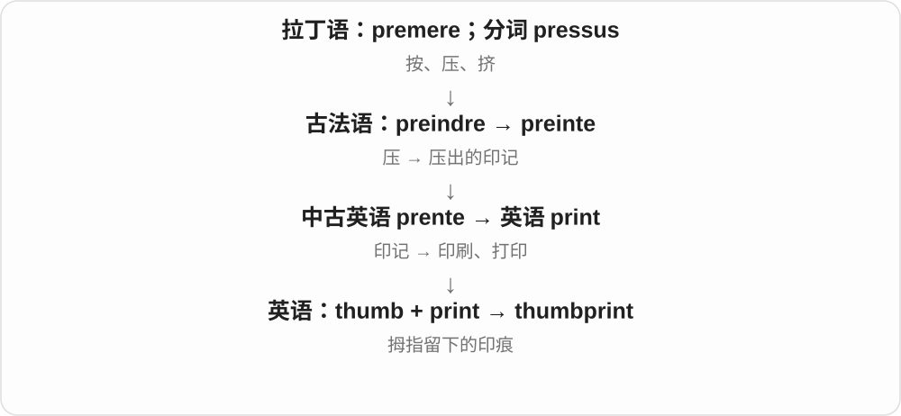

# 2454 · thumb — 粗短拇指及相关指套、印记和缩略图

[逐词精讲目录](../00_逐词精讲目录.md) · [总目录](../00_总目录_按常用程度.md)

## 核心词根与来源

拇指甲、拇指印看复合前项，缩略图借拇指甲小尺寸命名。顶针则有更早的工具后缀与音形变化。

**THUMB：用最灵活的粗短指，留下印记也帮着翻页**

thumb → thumbnail、thumbprint；thimble 保存旧工具构词。

- **拇指及印记、图像复合**：thumb · thumbprint · thumbnail
- **旧指套工具名**：thimble
- **thumb → thumbs：拇指、手势与翻看**：thumb · thumbs

## 词形与演化规律

þūma → thumb；nail 指甲，print 印记；þȳmel 工具名 → thimble。

thumbs 的 b 不发音；名词拇指、动词 thumb through 翻看都在常见表达中出现。

## 单词速览（按词族由简到繁）

同一基础词的相关扩展放在一起，先读基础形式，再读扩展；各组之间优先读常用的。具体词源关系见各词讲解。

| 单词 | 音标 | 核心意思 |
|---|---|---|
| [thumb](#w-1) | /θʌm/ | 拇指；用拇指翻动、示意 |
| [thumbs](#w-5) | /θʌmz/ | 拇指〔复数〕；翻看等〔thumb 的第三人称单数〕 |
| [thumbnail](#w-2) | /ˈθʌmneɪl/ | 拇指甲；缩略图；简要概述、小草图 |
| [thimble](#w-3) | /ˈθɪmbəl/ | 顶针、缝纫指套 |
| [thumbprint](#w-4) | 英 /ˈθʌmprɪnt/；美 /ˈθʌmprɪnt/ | 拇指印 |

## 逐词讲解

### 1. thumb — 拇指；用拇指翻动、示意

**音标**：/θʌm/

**先抓住这个画面**

手上能与其他指尖相对的粗短那根，是 thumb；翻书时拇指哗哗拨页，就 thumb through。

**怎么拆**

承古英语 þūma，经中古英语形式延续；更远通常联系粗壮、膨起。b 是历史拼写发展，现代常用读音不发 /b/。

**怎么变成今天的意思**

**古英语 þūma → 中古英语 thome、thombe → thumb**  
拇指；更远常联系粗壮、膨起

↓

**中古英语 thombe → thumb**  
拼写出现 b，现代读音保留 /θʌm/

thumbs up 赞成手势，thumb through a book 快速翻书，under someone’s thumb 受某人控制，a rule of thumb 经验性准则。

**常见搭配与例句**

thumbs up；thumb through；a rule of thumb。

> She gave us a thumbs up.

她向我们竖起拇指表示赞成。

> He thumbed through the magazine while waiting.

等候时，他快速翻了翻杂志。

**别混淆**

thumb 的 th 读 /θ/，b 不发音；rule of thumb 是大致经验准则，不自动等于精密、无例外的规则。

### 2. thumbs — 拇指〔复数〕；翻看等〔thumb 的第三人称单数〕

**音标**：/θʌmz/

**先抓住这个画面**

两只拇指是 thumbs；用拇指一页页拨过书本，动词就可以说 thumbs through。b 写着，常见现代读音却不发出来。

**怎么拆**

thumb + -s，词末 /m/ 后读 /z/。thumb 接古英语 thuma 等拇指词，b 是后来的拼写发展；动词由拇指的动作转用。

**怎么变成今天的意思**

**古英语 thuma → thumb**  
拇指；拼写后来加入 b

↓

**thumb 名词、动词 + -s → thumbs**  
多个拇指；单数主语翻看、拨弄等

thumbs up 竖拇指、赞成；thumbs down 不赞成；be all thumbs 笨手笨脚；thumbs through a book 快速翻书。

**常见搭配与例句**

twiddle your thumbs；give a thumbs up。

> He gave us a thumbs up after checking the equipment.

检查完设备后，他向我们竖起拇指。

> She thumbs through the catalogue while she waits.

等候时，她随手翻看商品目录。

**别混淆**

thumbs through 常说粗略翻看，而非逐字细读。be all thumbs 用来形容手上动作不灵巧；这些固定说法要连着理解。

### 3. thumbnail — 拇指甲；缩略图；简要概述、小草图

**音标**：/ˈθʌmneɪl/

**先抓住这个画面**

先是拇指上的甲。像拇指甲那么小的一幅草图，再发展成代表大图的小预览图；简短勾勒一个人、一件事，也可用 thumbnail 修饰。

**怎么拆**

thumb 拇指 + nail 甲。小尺寸的形象发展出 thumbnail sketch，再到现代图像预览等用途。thumb 的 b 不读。

**怎么变成今天的意思**

**古英语 nægl、næglan → 中古英语 nail、naylen**  
指甲、趾甲；钉子及钉牢动作

↓

**按位置命名身体部位**  
fingernail、toenail、thumbnail

↓

**thumb + nail → thumbnail**  
拇指甲 → 小草图、简述 → 缩略图

click a thumbnail 点击缩略图，a video thumbnail 视频封面预览图，a thumbnail sketch of someone 某人的简短介绍。

**常见搭配与例句**

a video thumbnail；click a thumbnail；a thumbnail sketch。

> Click the thumbnail to open the full image.

点击缩略图打开完整图片。

> The introduction gives a thumbnail sketch of the author’s life.

引言简要介绍了作者的一生。

**别混淆**

thumbnail 是预览图时，不要求尺寸真等于一片指甲；thumbnail sketch 是简要勾勒，也不保证完整细致。

### 4. thimble — 顶针、缝纫指套

**音标**：/ˈθɪmbəl/

**先抓住这个画面**

缝衣时手指顶住针尾，把针推过布，需要一个小硬套保护、受力，这个套就是 thimble。它的名字确实与拇指词族有关。

**怎么拆**

承古英语 þȳmel，联系 þūma 拇指 + 旧工具名后缀 -el；经中古英语 thimel 等到 thimble，b 后来进入拼写。与 thumb 的元音、b 发音都不同。

**怎么变成今天的意思**

**古英语 þūma → 中古英语 thome、thombe → thumb**  
拇指；更远常联系粗壮、膨起

↓

**旧工具名 þȳmel → thimble**  
拇指词族 + 工具后缀；后有元音变化及 b 拼写

a sewing thimble 缝纫顶针，a metal thimble 金属顶针；现代实际戴在哪根手指取决于使用习惯，不受旧名字限制。

**常见搭配与例句**

a sewing thimble；a metal thimble。

> She wore a thimble while sewing the thick fabric.

缝厚布料时，她戴着顶针。

> An old silver thimble lay in the sewing box.

针线盒里放着一枚旧银顶针。

**别混淆**

thumb /θʌm/ 的 b 不发音，thimble /ˈθɪmbəl/ 的 b 发音；旧工具后缀不能一概翻成小。

### 5. thumbprint — 拇指印

**音标**：英 /ˈθʌmprɪnt/；美 /ˈθʌmprɪnt/

**先抓住这个画面**

把范围从所有手指收窄到拇指，它按下后留下的印痕就是 thumbprint。

**怎么拆**

thumb 拇指 + print 印痕。

**怎么变成今天的意思**

可以指识别用的拇指纹，也可指颜料、软泥上的拇指印。thumb 中的 b 不发音。

**常见搭配与例句**

leave a thumbprint；an inked thumbprint。

> A thumbprint remained in the soft clay.

软泥上留着一个拇指印。

> The artist made a pattern using coloured thumbprints.

艺术家用彩色拇指印做出了图案。

**别混淆**

fingerprint 是手指纹的总称；thumbprint 明确是哪根手指。

## 这一组要分清什么

thumb 与 thimble 的元音、b 发音不同；thumbnail 不都是指甲，也可缩略图。

## 串起来练习

She used her thumb to turn the page showing a picture of a thimble.

她用拇指翻到印着顶针图片的那一页。
