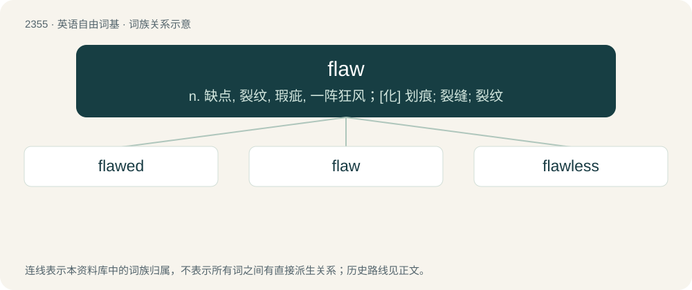

# 2455 · flaw — n. 缺点, 裂纹, 瑕疵, 一阵狂风；\[化\] 划痕; 裂缝; 裂纹

[总目录](../00_总目录_按常用程度.md)

**类型**：英语自由词基　｜　**来源语言**：见词源记录

## 核心含义与来源

- 核心含义：n. 缺点, 裂纹, 瑕疵, 一阵狂风；\[化\] 划痕; 裂缝; 裂纹
- 英文含义：A crack or breach, a gap or fissure; a defect of continuity or cohesion.
- 词形：flaw

**多个词源／构词路径**：同一拼写可能有不同来源；以下按词性和含义分别列出。

**来源记录 1**（名词；A crack or breach, a gap or fissure; a defect of continuity or cohesion.）

From Middle English flawe, flay (“a flake of fire or snow, spark, splinter”), probably from Old Norse flaga (“a flag or slab of stone, flake”), from Proto-Germanic \*flagō (“a layer of soil”), from Proto-Indo-European \*plok- (“broad, flat”). Cognate with Icelandic flaga (“flake”), Swedish flaga (“flake, scale”), Danish flage (“flake”), Middle Low German vlage (“a layer of soil”), Old English flōh (“a fragment, piece”).

**来源记录 2**（名词；A sudden burst or gust of wind of short duration; windflaw.）

From Middle English \*flaugh, from Middle Dutch vlāghe or Middle Low German vlāge, ultimately from Proto-West Germanic \*flagā. Or, possibly of North Germanic origin, from Swedish flaga (“gust of wind”), from Old Norse flaga; all from Proto-Germanic \*flagǭ (“blow, strike”). See modern Dutch vlaag (“gust of wind”).

## 词族图

## 单词速览（常用到不常用）

| 单词 | 音标 | 释义 |
|---|---|---|
| [flawed](#w-1) | 英 /flɔːd/；/flɔd/ | a. 有缺陷的；有裂纹的；有瑕疵的 |
| [flaw](#w-2) | 英 /flɔː/；美 /flɔ/ | n. 缺点, 裂纹, 瑕疵, 一阵狂风；\[化\] 划痕; 裂缝; 裂纹 |
| [flawless](#w-3) | 英 /ˈflɔːləs/；美 /ˈflɔləs/ | a. 无瑕疵的, 无缺点的；\[化\] 无裂纹的; 无裂缝的 |

## 逐词详解

### 1. flawed

**词性**：形容词　｜　**音标**：英 /flɔːd/；/flɔd/

**中文释义**：a. 有缺陷的；有裂纹的；有瑕疵的

**英文义项**：Having a flaw or imperfection.

**构词拆分**：flaw + -ed

**词源与演化**：

From Middle English flaued, equivalent to flaw + -ed.

**例句**：

> His design for a perpetual motion machine is flawed because water does not flow uphill.

该用例对应义项：Having a flaw or imperfection.

### 2. flaw

**词性**：名词　｜　**音标**：英 /flɔː/；美 /flɔ/

**中文释义**：n. 缺点, 裂纹, 瑕疵, 一阵狂风；\[化\] 划痕; 裂缝; 裂纹

**英文义项**：A crack or breach, a gap or fissure; a defect of continuity or cohesion. / A defect, fault, or imperfection, especially one that is hidden.

**词源与演化**：

From Middle English flawe, flay (“a flake of fire or snow, spark, splinter”), probably from Old Norse flaga (“a flag or slab of stone, flake”), from Proto-Germanic \*flagō (“a layer of soil”), from Proto-Indo-European \*plok- (“broad, flat”). Cognate with Icelandic flaga (“flake”), Swedish flaga (“flake, scale”), Danish flage (“flake”), Middle Low German vlage (“a layer of soil”), Old English flōh (“a fragment, piece”).

**例句**：

> There is a flaw in that knife.

该用例对应义项：A crack or breach, a gap or fissure; a defect of continuity or cohesion.

### 3. flawless

**词性**：形容词　｜　**音标**：英 /ˈflɔːləs/；美 /ˈflɔləs/

**中文释义**：a. 无瑕疵的, 无缺点的；\[化\] 无裂纹的; 无裂缝的

**英文义项**：Without flaws, defects, or shortcomings; perfect.

**构词拆分**：flaw + -less (suffix meaning ‘without (something)’)

**词源与演化**：

From flaw + -less (suffix meaning ‘without (something)’).

**例句**：

> The pianist’s performance this evening was flawless.

该用例对应义项：Without flaws, defects, or shortcomings; perfect.
