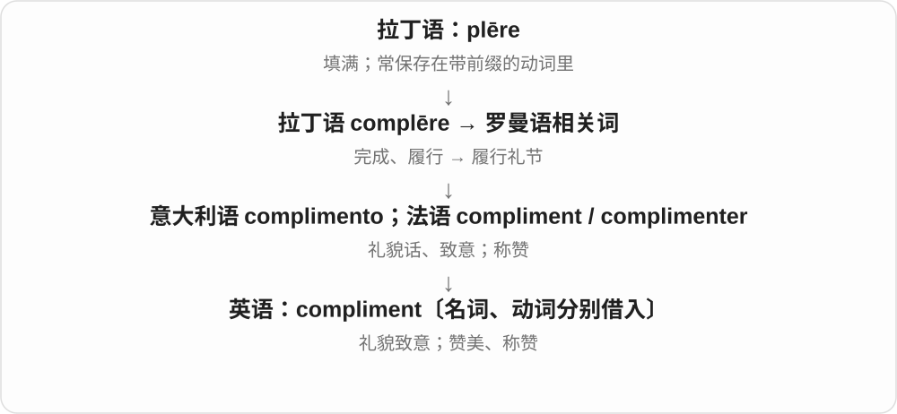
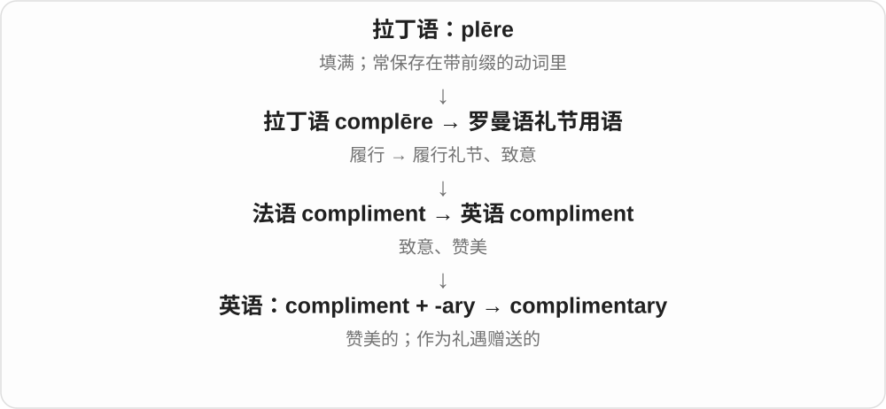

# 2456 · compliment — 赞美；恭维；免费提供的

[逐词精讲目录](../00_逐词精讲目录.md) · [总目录](../00_总目录_按常用程度.md)

## 核心词根与来源

compliment 经法语、意大利语礼貌表达一支传入。complimentary 可以表示赞美的，也可表示免费赠送的，后者常见于服务场景。

**COMPLIMENT：对别人表达肯定，也进入礼貌赠送的用法**

说一句赞美的话，酒店也可能礼貌地附送某样物品。

- **赞美的言语与动作**：compliment
- **赞美或附送属性**：complimentary
- **compliment 的称赞与礼貌致意**：compliment · compliments · complimented · complimenting

## 词形与演化规律

pay someone a compliment；complimentary remarks；complimentary breakfast。两个 i 拼写与 complement 的 e 要分清。

借法语名词、动词相关形式，更远从完成、履行礼节走向礼貌话；不说全部现代动词仅由英语名词转成。

## 单词速览（按词族由简到繁）

同一基础词的相关扩展放在一起，先读基础形式，再读扩展；各组之间优先读常用的。具体词源关系见各词讲解。

| 单词 | 音标 | 核心意思 |
|---|---|---|
| [compliment](#w-1) | 名词：英 /ˈkɒmplɪmənt/，美 /ˈkɑːmplɪmənt/；动词：英 /ˈkɒmplɪment/，美 /ˈkɑːmplɪment/ | 赞美；称赞；礼貌的致意〔compliments〕 |
| [compliments](#w-3) | 名词：英 /ˈkɒmplɪmənts/、美 /ˈkɑːmplɪmənts/；动词：英 /ˈkɒmplɪments/、美 /ˈkɑːmplɪments/ | 称赞、赞美话、致意〔复数〕；称赞〔第三人称单数〕 |
| [complimentary](#w-2) | 英 /ˌkɒmplɪˈmentəri/；美 /ˌkɑːmplɪˈmentəri/ | 赞美的；免费赠送的 |
| [complimented](#w-4) | 英 /ˈkɒmplɪmentɪd/；美 /ˈkɑːmplɪmentɪd/ | 称赞了；受到称赞的 |
| [complimenting](#w-5) | 英 /ˈkɒmplɪmentɪŋ/；美 /ˈkɑːmplɪmentɪŋ/ | 正在称赞、说赞美话 |

## 逐词讲解

### 1. compliment — 赞美；称赞；礼貌的致意〔compliments〕

**音标**：名词：英 /ˈkɒmplɪmənt/，美 /ˈkɑːmplɪmənt/；动词：英 /ˈkɒmplɪment/，美 /ˈkɑːmplɪment/

**先抓住这个画面**

把对方的一个优点说出来，让对方知道你看到了：“这件事你做得真好。”

**怎么拆**

与 complēre“完成、履行”同族。罗曼语里的“履行礼节”发展成礼貌话；名词经法语 compliment 借入，更早联系意大利语 complimento，也有西班牙语影响的解释。动词经法语 complimenter。

**怎么变成今天的意思**

compliment someone on something 是就某事称赞人；pay someone a compliment 是给一句赞美。with our compliments 常表示奉送、敬赠，并不是要求你回夸。

**常见搭配与例句**

compliment someone on；pay a compliment；take it as a compliment。

> She complimented him on the clear presentation.

她称赞他的讲解很清楚。

> I took her question as a compliment to my work.

我把她的问题看作对自己工作的肯定。

**别混淆**

praise 可以正式表扬成就；compliment 常是一句针对优点的赞美。complaint“抱怨”来自另一个词族。

### 2. compliments — 称赞、赞美话、致意〔复数〕；称赞〔第三人称单数〕

**音标**：名词：英 /ˈkɒmplɪmənts/、美 /ˈkɑːmplɪmənts/；动词：英 /ˈkɒmplɪments/、美 /ˈkɑːmplɪments/

**先抓住这个画面**

一句“这件事你做得真好”是 compliment，几句好话是 compliments；说某人常夸别人，也用同形动词。

**怎么拆**

compliment + -s，/t/ 后读 /s/。基础名词、动词经法语相关形式借入，更远有履行礼节的历史材料。

**怎么变成今天的意思**

**拉丁 complere 完成、履行 → 罗曼语相关形式**  
履行礼节的材料走向礼貌话、致意

↓

**意大利 complimento、法语 compliment／complimenter → 英语**  
名词与动词分别有借入路线，现代指称赞、致意

↓

**compliment + -s → compliments**  
几句好话、致意；他、她称赞

pay someone compliments 是说好话称赞，with my compliments 可作礼貌致意；实际场景还可能有赠送的客套用途。

**常见搭配与例句**

accept compliments 接受称赞；compliments her on her work 称赞她的工作。

> She accepted the compliments with a smile.

她微笑着接受了称赞。

> He often compliments his colleagues on their work.

他经常称赞同事们的工作。

**别混淆**

compliments 是好话、致意，complements 是补足、互相配合的东西或动作；现代区别靠中间的 i、e 写明。

### 3. complimentary — 赞美的；免费赠送的

**音标**：英 /ˌkɒmplɪˈmentəri/；美 /ˌkɑːmplɪˈmentəri/

**先抓住这个画面**

要么是送上一句好话，要么是送上一份礼遇；两种都保留了友好致意的感觉。

**怎么拆**

compliment〔名词〕 + -ary；“敬赠”这层礼节义连到“免费提供”。

**怎么变成今天的意思**

a complimentary remark 是赞美话；complimentary breakfast 是免费早餐。后者不是“称赞早餐”，也不是 complementary“互补的早餐”。

**常见搭配与例句**

complimentary about someone；complimentary tickets；complimentary breakfast。

> The reviewer was complimentary about the young actor’s performance.

评论者对这位年轻演员的表演赞赏有加。

> The hotel offers complimentary tea in the lobby.

酒店在大堂提供免费茶水。

**别混淆**

free 只说明不收费；complimentary 常带商家或主办方作为礼遇赠送的意味。

### 4. complimented — 称赞了；受到称赞的

**音标**：英 /ˈkɒmplɪmentɪd/；美 /ˈkɑːmplɪmentɪd/

**先抓住这个画面**

刚才有人认真说了一句好话，夸衣服、作品或表现，就可以说 complimented。

**怎么拆**

动词 compliment + 完整 -ed，/t/ 后读 /ɪd/。基础动词有法语 complimenter 等来源，不只按现代英语名词转动词解释历史。

**怎么变成今天的意思**

**拉丁 complere 完成、履行 → 罗曼语相关形式**  
履行礼节的材料走向礼貌话、致意

↓

**意大利 complimento、法语 compliment／complimenter → 英语**  
名词与动词分别有借入路线，现代指称赞、致意

↓

**compliment + -ed → complimented**  
过去称赞；得到赞许的状态

complimented someone on something 是称赞某人某方面；was complimented on her work 是工作受到夸赞。

**常见搭配与例句**

complimented her on the design 称赞了她的设计；felt complimented 觉得受到了夸赞。

> He complimented her on the presentation.

他称赞了她的汇报。

> She was complimented on her choice of colours.

她选择的配色受到了称赞。

**别混淆**

complimented 是说出赞美话，complemented 是补足、配得更好；两个过去式也保留 i、e 的区别。

### 5. complimenting — 正在称赞、说赞美话

**音标**：英 /ˈkɒmplɪmentɪŋ/；美 /ˈkɑːmplɪmentɪŋ/

**先抓住这个画面**

把觉得好看的、做得好的地方告诉对方，正在做这件事就是 complimenting。

**怎么拆**

compliment + -ing，原词不以不发音 e 结尾，直接加完整词尾。礼貌话、称赞动词的借词历史保留在基础词中。

**怎么变成今天的意思**

**拉丁 complere 完成、履行 → 罗曼语相关形式**  
履行礼节的材料走向礼貌话、致意

↓

**意大利 complimento、法语 compliment／complimenter → 英语**  
名词与动词分别有借入路线，现代指称赞、致意

↓

**compliment + -ing → complimenting**  
说赞美话的过程、活动

complimenting her on the work 是正在称赞她的工作；对象通常是人，on 后说明赞哪里。

**常见搭配与例句**

complimenting the team 称赞团队；complimenting someone on their style 夸某人风格。

> She was complimenting him on his clear explanation.

她正在夸他解释得清楚。

> I was complimenting your choice, not asking you to change it.

我是在称赞你的选择，不是让你换。

**别混淆**

flattering 可带奉承、讨好的语气，complimenting 可以是真诚直接地说好话；是否奉承要看实际态度。

## 这一组要分清什么

complement 是补足、相配之物，compliment 是赞美。complimentary ticket 通常不是一张会夸人的票。

## 串起来练习

She paid the chef a compliment after enjoying the complimentary breakfast.

享用免费早餐后，她称赞了厨师。
