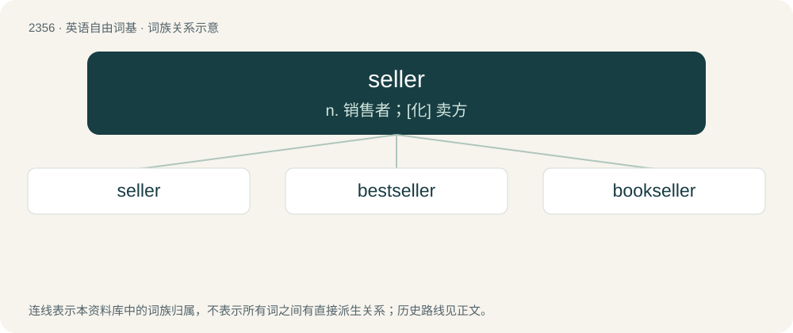

# 2456 · seller — n. 销售者；\[化\] 卖方

[总目录](../00_总目录_按常用程度.md)

**类型**：英语自由词基　｜　**来源语言**：见词源记录

## 核心含义与来源

- 核心含义：n. 销售者；\[化\] 卖方
- 英文含义：Someone who sells; a vendor; a clerk.
- 词形：seller

**来源记录 1**（名词；Someone who sells; a vendor; a clerk.）

From Middle English seller, sellere, (also siller, sullar, sullere), from Old English \*sellere, \*syllere, equivalent to sell + -er (agent noun) (sense 1) and sell + -er (patient) (sense 2). Cognate with Danish sælger, Swedish säljare, Icelandic seljari (“a seller; dealer”).

## 词族图

## 单词速览（常用到不常用）

| 单词 | 音标 | 释义 |
|---|---|---|
| [seller](#w-1) | 英 /ˈsɛlə/；美 /ˈsɛlɚ/ | n. 销售者；\[化\] 卖方 |
| [bestseller](#w-2) |  | n. 畅销书 |
| [bookseller](#w-3) | 美 /ˈbʊksɛlɚ/ | n. 书商 |

## 逐词详解

### 1. seller

**词性**：名词　｜　**音标**：英 /ˈsɛlə/；美 /ˈsɛlɚ/

**中文释义**：n. 销售者；\[化\] 卖方

**英文义项**：Someone who sells; a vendor; a clerk. / Something which sells.

**构词拆分**：sell + -er (agent noun)；sell + -er (patient)

**词源与演化**：

From Middle English seller, sellere, (also siller, sullar, sullere), from Old English \*sellere, \*syllere, equivalent to sell + -er (agent noun) (sense 1) and sell + -er (patient) (sense 2). Cognate with Danish sælger, Swedish säljare, Icelandic seljari (“a seller; dealer”).

**例句**：

> Two of the books Alisha authored had become big sellers.

该用例对应义项：Something which sells.

### 2. bestseller

**词性**：名词

**中文释义**：n. 畅销书

**英文义项**：A book or other product that has sold in large numbers.

**构词拆分**：best + seller

**词源与演化**：

From best + seller.

**例句**：

> The book ought to have been a bestseller, but it was a flop.

### 3. bookseller

**词性**：名词　｜　**音标**：美 /ˈbʊksɛlɚ/

**中文释义**：n. 书商

**英文义项**：A person engaged in the business of selling books. / A business that sells books.

**构词拆分**：book + seller

**词源与演化**：

From Middle English boksellere, bok-sillere, equivalent to book + seller.

**例句**：

> The bookseller reads a lot of books.
