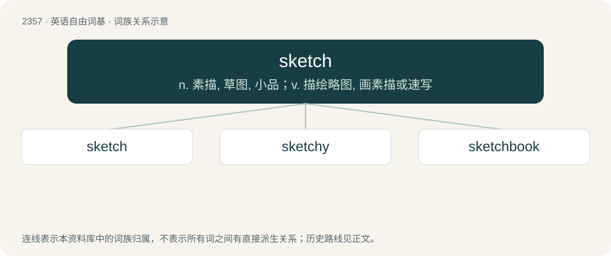

# 2457 · sketch — n. 素描, 草图, 小品；v. 描绘略图, 画素描或速写

[总目录](../00_总目录_按常用程度.md)

**类型**：英语自由词基　｜　**来源语言**：见词源记录

## 核心含义与来源

- 核心含义：n. 素描, 草图, 小品；v. 描绘略图, 画素描或速写
- 英文含义：To make a brief, basic drawing.
- 词形：sketch

**来源记录 1**（动词；To make a brief, basic drawing.）

From Dutch schets or German Skizze, from Italian schizzo, from Latin schedium, from Ancient Greek σχέδιος (skhédios, “made suddenly, off-hand”), from σχεδόν (skhedón, “near, nearby”), from ἔχω (ékhō, “to hold”). Compare scheme.

## 词族图

## 单词速览（常用到不常用）

| 单词 | 音标 | 释义 |
|---|---|---|
| [sketch](#w-1) | 英 /ˈskɛt͡ʃ/ | n. 素描, 草图, 小品；v. 描绘略图, 画素描或速写 |
| [sketchy](#w-2) | /ˈskɛt͡ʃi/ | a. 概略的, 草草完成的 |
| [sketchbook](#w-3) | /ˈskɛt͡ʃˌbʊk/ | n. 写生簿, 素描簿, 短文集, 随笔集 |

## 逐词详解

### 1. sketch

**词性**：动词　｜　**音标**：英 /ˈskɛt͡ʃ/

**中文释义**：n. 素描, 草图, 小品；v. 描绘略图, 画素描或速写

**英文义项**：To make a brief, basic drawing. / To describe briefly and with very few details.

**词源与演化**：

From Dutch schets or German Skizze, from Italian schizzo, from Latin schedium, from Ancient Greek σχέδιος (skhédios, “made suddenly, off-hand”), from σχεδόν (skhedón, “near, nearby”), from ἔχω (ékhō, “to hold”). Compare scheme.

**例句**：

> He sketched the accident, sticking to the facts as they had happened.

该用例对应义项：To describe briefly and with very few details.

### 2. sketchy

**词性**：形容词　｜　**音标**：/ˈskɛt͡ʃi/

**中文释义**：a. 概略的, 草草完成的

**英文义项**：Roughly or hastily laid out; intended for later refinement. / Not thorough or detailed.

**构词拆分**：sketch + -y

**词源与演化**：

From sketch + -y. Extension of "brief, imperfect, unfinished" notion.

**例句**：

> Because he is so sketchy, I always think that he is up to something.

该用例对应义项：Suspected of taking part in illicit or dishonorable dealings.

### 3. sketchbook

**词性**：名词　｜　**音标**：/ˈskɛt͡ʃˌbʊk/

**中文释义**：n. 写生簿, 素描簿, 短文集, 随笔集

**英文义项**：A book or pad with blank pages for sketching; a sketch pad. / A book of printed sketches.

**构词拆分**：sketch + book

**词源与演化**：

From sketch + book.

**例句**：

> If I draw this in my sketchbook, do you think my parents will kill me?
