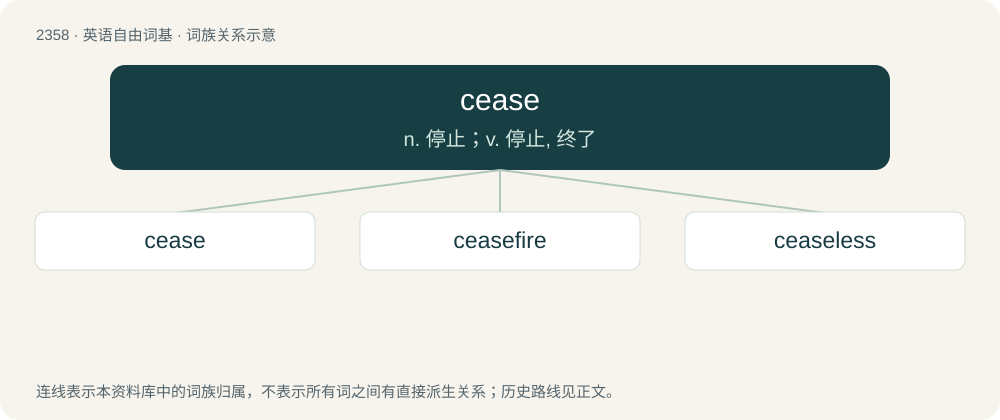

# 2458 · cease — n. 停止；v. 停止, 终了

[总目录](../00_总目录_按常用程度.md)

**类型**：英语自由词基　｜　**来源语言**：见词源记录

## 核心含义与来源

- 核心含义：n. 停止；v. 停止, 终了
- 英文含义：To stop.
- 词形：cease

**来源记录 1**（动词；To stop.）

From Middle English cesen, cessen, from Middle French cesser (“to cease”), from Latin cessō (“leave off”), frequentative of cēdō (“to leave off, go away”). Compare secede.

## 词族图

## 单词速览（常用到不常用）

| 单词 | 音标 | 释义 |
|---|---|---|
| [cease](#w-1) | 英 /siːs/；美 /sis/ | n. 停止；v. 停止, 终了 |
| [ceasefire](#w-2) | /ˈsiːsfaɪə(r)/ | n. （通常指永久性的）停火, 停战; 停火命令 |
| [ceaseless](#w-3) | /ˈsiːsləs/ | a. 不停的, 不断的 |

## 逐词详解

### 1. cease

**词性**：动词　｜　**音标**：英 /siːs/；美 /sis/

**中文释义**：n. 停止；v. 停止, 终了

**英文义项**：To stop. / To stop doing (something).

**词源与演化**：

From Middle English cesen, cessen, from Middle French cesser (“to cease”), from Latin cessō (“leave off”), frequentative of cēdō (“to leave off, go away”). Compare secede.

**例句**：

> The day will come when I cease to be on this earth.

### 2. ceasefire

**词性**：名词　｜　**音标**：/ˈsiːsfaɪə(r)/

**中文释义**：n. （通常指永久性的）停火, 停战; 停火命令

**英文义项**：In warfare, an agreed end to hostilities for a specific purpose. (Typically only temporary).

**构词拆分**：cease + fire

**词源与演化**：

From cease + fire.

**例句**：

> The rebels agreed to a ceasefire while the peace talks were underway.

该用例对应义项：In warfare, an agreed end to hostilities for a specific purpose. (Typically only temporary).

### 3. ceaseless

**词性**：形容词　｜　**音标**：/ˈsiːsləs/

**中文释义**：a. 不停的, 不断的

**英文义项**：Without an end. / Without stop or pause, incessant.

**构词拆分**：cease + -less

**词源与演化**：

From cease + -less.

**例句**：

> Her ceaseless caterwauling alarmed every dog within a 500-foot radius.
