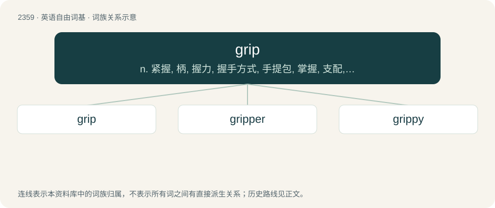

# 2459 · grip — n. 紧握, 柄, 握力, 握手方式, 手提包, 掌握, 支配, 控制；vt. 抓紧, 抱住, 吸住, 掌握；vi. 握牢, 有吸引力

[总目录](../00_总目录_按常用程度.md)

**类型**：英语自由词基　｜　**来源语言**：见词源记录

## 核心含义与来源

- 核心含义：n. 紧握, 柄, 握力, 握手方式, 手提包, 掌握, 支配, 控制；vt. 抓紧, 抱住, 吸住, 掌握；vi. 握牢, 有吸引力
- 英文含义：To take hold (of), particularly with the hand.
- 词形：grip

**多个词源／构词路径**：同一拼写可能有不同来源；以下按词性和含义分别列出。

**来源记录 1**（动词；To take hold (of), particularly with the hand.）

Verb from Middle English grippen, from Old English grippan, from a Proto-Germanic \*gripjaną (compare Old High German gripfen); compare the related Old English grīpan, whence English gripe. See also grope, and the related Proto-Germanic \*grīpaną. Noun from Middle English grippe, gripe, an amalgam of Old English gripe (“grasp, hold”) (cognate with German Griff) and Old English gripa (“handful”) (cognate with Swedish grepp).

**来源记录 2**（名词；A small ditch or trench; a channel to carry off water or other liquid; a drain.）

From Middle English grip, grippe, gryppe (“a ditch, drain”), from Old English grēp (“a furrow, burrow”) and grēpe (“a furrow, ditch, drain”), from Proto-Germanic \*grōpiz (“a furrow, groove”). Cognate with Middle Dutch grippe, gruppe (“ditch, drain”), greppe, German Low German Gruppe (“ditch, drain”). Related also to Old English grōp (“a ditch, drain”). More at groop.

## 词族图

## 单词速览（常用到不常用）

| 单词 | 音标 | 释义 |
|---|---|---|
| [grip](#w-1) | /ˈɡɹɪp/ | n. 紧握, 柄, 握力, 握手方式, 手提包, 掌握, 支配, 控制；vt. 抓紧, 抱住, 吸住, 掌握；vi. 握牢, 有吸引力 |
| [gripper](#w-2) | 英 /ˈɡɹɪ.pə(ɹ)/；美 /ˈɡɹɪ.pəɹ/ | n. 握者, 抓爪, 抓器, 夹子；\[计\] 机械爪, 夹子 |
| [grippy](#w-3) | /ˈɡripi/ | a. &lt;口&gt;患流行性感冒的 |

## 逐词详解

### 1. grip

**词性**：动词　｜　**音标**：/ˈɡɹɪp/

**中文释义**：n. 紧握, 柄, 握力, 握手方式, 手提包, 掌握, 支配, 控制；vt. 抓紧, 抱住, 吸住, 掌握；vi. 握牢, 有吸引力

**英文义项**：To take hold (of), particularly with the hand. / To figuratively take hold of or grasp.

**词源与演化**：

Verb from Middle English grippen, from Old English grippan, from a Proto-Germanic \*gripjaną (compare Old High German gripfen); compare the related Old English grīpan, whence English gripe. See also grope, and the related Proto-Germanic \*grīpaną. Noun from Middle English grippe, gripe, an amalgam of Old English gripe (“grasp, hold”) (cognate with German Griff) and Old English gripa (“handful”) (cognate with Swedish grepp).

**例句**：

> We need to grip this problem, not shut our eyes and hope it goes away.

该用例对应义项：To figuratively take hold of or grasp.

### 2. gripper

**词性**：名词　｜　**音标**：英 /ˈɡɹɪ.pə(ɹ)/；美 /ˈɡɹɪ.pəɹ/

**中文释义**：n. 握者, 抓爪, 抓器, 夹子；\[计\] 机械爪, 夹子

**英文义项**：A person who or thing which grips something. / A cover on a handle that makes it easier to grip.

**构词拆分**：grip + -er

**词源与演化**：

From grip + -er.

**例句**：

> Put those grippers away!

该用例对应义项：A foot.

### 3. grippy

**词性**：形容词　｜　**音标**：/ˈɡripi/

**中文释义**：a. &lt;口&gt;患流行性感冒的

**英文义项**：Having a tight grip, or tending to grip well. / Tight-fisted, greedy, stingy.

**构词拆分**：From grip + -y.

**词源与演化**：

From grip + -y.

**例句**：

> The book is a quick, grippy summer read.

该用例对应义项：Gripping; compelling.
