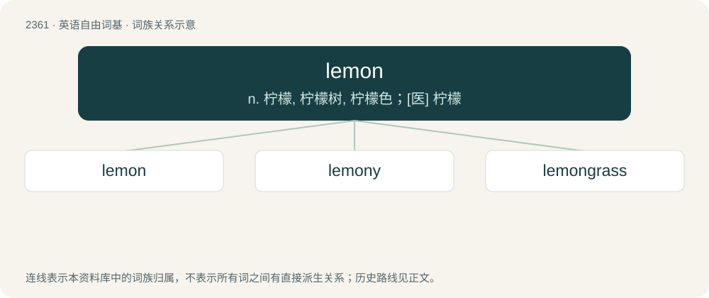

# 2463 · lemon — n. 柠檬, 柠檬树, 柠檬色；\[医\] 柠檬

[总目录](../00_总目录_按常用程度.md)

**类型**：英语自由词基　｜　**来源语言**：见词源记录

## 核心含义与来源

- 核心含义：n. 柠檬, 柠檬树, 柠檬色；\[医\] 柠檬
- 英文含义：A yellowish citrus fruit.
- 词形：lemon

**来源记录 1**（名词；A yellowish citrus fruit.）

Inherited from Middle English lymon, from Old French lymon (“citrus”), from Arabic لَيْمُون (laymūn) or Classical Persian لِیمُون (līmūn), a variant of Classical Persian لِیمُو (līmū, līmō), from Sanskrit निम्बू (nimbū, “lime”), ultimately from Proto-Malayo-Polynesian \*limaw or Munda. Doublet of lime. The fandom sense is named after the erotic anime series Cream Lemon.

## 词族图

## 单词速览（常用到不常用）

| 单词 | 音标 | 释义 |
|---|---|---|
| [lemon](#w-1) | /ˈlɛmən/ | n. 柠檬, 柠檬树, 柠檬色；\[医\] 柠檬 |
| [lemony](#w-2) | /ˈleməni/ | a. 柠檬的 |
| [lemongrass](#w-3) | /ˈlemən^rɑːs;-^ræs/ | n. 柠檬香草 |

## 逐词详解

### 1. lemon

**词性**：名词　｜　**音标**：/ˈlɛmən/

**中文释义**：n. 柠檬, 柠檬树, 柠檬色；\[医\] 柠檬

**英文义项**：A yellowish citrus fruit. / A semitropical evergreen tree, Citrus limon, that bears such fruits.

**词源与演化**：

Inherited from Middle English lymon, from Old French lymon (“citrus”), from Arabic لَيْمُون (laymūn) or Classical Persian لِیمُون (līmūn), a variant of Classical Persian لِیمُو (līmū, līmō), from Sanskrit निम्बू (nimbū, “lime”), ultimately from Proto-Malayo-Polynesian \*limaw or Munda. Doublet of lime. The fandom sense is named after the erotic anime series Cream Lemon.

**例句**：

> A thousand quid for that motor? Do me a lemon! I could get it for half that.

该用例对应义项：Favor.

### 2. lemony

**词性**：形容词　｜　**音标**：/ˈleməni/

**中文释义**：a. 柠檬的

**英文义项**：Resembling or characteristic of lemons, especially in terms of aroma, taste or colour. / Of or pertaining to lemons.

**构词拆分**：lemon + -y

**词源与演化**：

From lemon + -y.

**例句**：

> We were served a lemony cheesecake for dessert.

该用例对应义项：Resembling or characteristic of lemons, especially in terms of aroma, taste or colour.

### 3. lemongrass

**词性**：名词　｜　**音标**：/ˈlemən^rɑːs;-^ræs/

**中文释义**：n. 柠檬香草

**英文义项**：One of various species of grass of the genus Cymbopogon, especially Cymbopogon citratus, which have a lemon-like taste and aroma, and are used in cooking, for tea, and for fragrance. / Sourgrass (Oxalis pes-caprae).

**构词拆分**：lemon + grass

**词源与演化**：

From lemon + grass.

**例句**：

> The salmon was seasoned with wild garlic and lemongrass.
