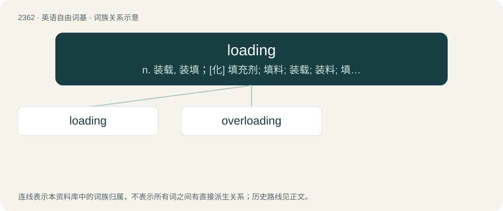

# 2464 · loading — n. 装载, 装填；\[化\] 填充剂; 填料; 装载; 装料; 填充; 载液; 填充量; 装模; 装载

[总目录](../00_总目录_按常用程度.md)

**类型**：英语自由词基　｜　**来源语言**：见词源记录

## 核心含义与来源

- 核心含义：n. 装载, 装填；\[化\] 填充剂; 填料; 装载; 装料; 填充; 载液; 填充量; 装模; 装载
- 英文含义：The process by which something is loaded.
- 词形：loading

**来源记录 1**（名词；The process by which something is loaded.）

By surface analysis, load + -ing.

## 词族图

## 单词速览（常用到不常用）

| 单词 | 音标 | 释义 |
|---|---|---|
| [loading](#w-1) | 英 /ˈləʊ.dɪŋ/；美 /ˈloʊ.dɪŋ/ | n. 装载, 装填；\[化\] 填充剂; 填料; 装载; 装料; 填充; 载液; 填充量; 装模; 装载 |
| [overloading](#w-2) | 英 /ˈəʊ.və(ɹ)ləʊdɪŋ/；美 /ˈoʊ.vɚloʊ.diŋ/ | v. 超负荷, 过载（overload的现在分词形式） |

## 逐词详解

### 1. loading

**词性**：名词　｜　**音标**：英 /ˈləʊ.dɪŋ/；美 /ˈloʊ.dɪŋ/

**中文释义**：n. 装载, 装填；\[化\] 填充剂; 填料; 装载; 装料; 填充; 载液; 填充量; 装模; 装载

**英文义项**：The process by which something is loaded. / A load, especially in the engineering and electrical engineering senses of force exerted, or electrical current or power supplied.

**词源与演化**：

By surface analysis, load + -ing.

**例句**：

> The salary package also included 30% shift loading to compensate for the long hours.

该用例对应义项：An increased rate of pay given to an employee in order to compensate for specified non-standard working conditions, or a lack of specific other benefits. For example, an employee paid a casual loading is paid more than an equivalent full-time or part-time employee's rate, to compensate for a lack of benefits such as sick leave or annual leave.

### 2. overloading

**词性**：名词　｜　**音标**：英 /ˈəʊ.və(ɹ)ləʊdɪŋ/；美 /ˈoʊ.vɚloʊ.diŋ/

**中文释义**：v. 超负荷, 过载（overload的现在分词形式）

**英文义项**：A type of polymorphism, where different functions, operators or variables with the same name are invoked based on the data types of the parameters passed. / The loading of a vehicle etc. with too heavy a weight.

**构词拆分**：over + loading

**词源与演化**：

From over + loading.

**例句**：

> Operators can be fined for overloading of vehicles.

该用例对应义项：The loading of a vehicle etc. with too heavy a weight.
