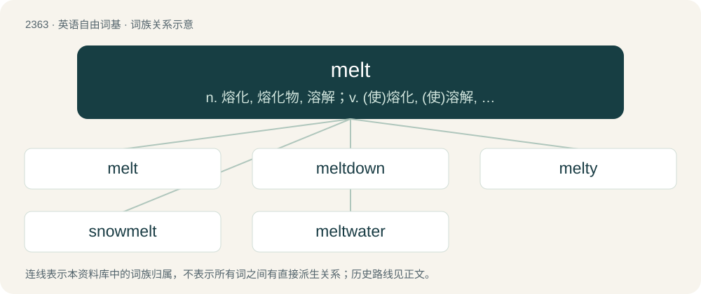

# 2465 · melt — n. 熔化, 熔化物, 溶解；v. (使)熔化, (使)溶解, (使)消散, (使)变软

[总目录](../00_总目录_按常用程度.md)

**类型**：英语自由词基　｜　**来源语言**：见词源记录

## 核心含义与来源

- 核心含义：n. 熔化, 熔化物, 溶解；v. (使)熔化, (使)溶解, (使)消散, (使)变软
- 英文含义：To change (or to be changed) from a solid state to a liquid state, usually by a gradual heat.
- 词形：melt

**来源记录 1**（动词；To change (or to be changed) from a solid state to a liquid state, usually by a gradual heat.）

From Middle English melten, from a merger of Old English meltan (intransitive) and mieltan (transitive), both meaning “to melt, digest,” from Proto-West Germanic \*meltan and \*maltijan, from Proto-Germanic \*meltaną and \*maltijaną, both from Proto-Indo-European \*(s)meld- (“melt”). Cognate with Icelandic melta (“to digest”).

## 词族图

## 单词速览（常用到不常用）

| 单词 | 音标 | 释义 |
|---|---|---|
| [melt](#w-1) | /mɛlt/ | n. 熔化, 熔化物, 溶解；v. (使)熔化, (使)溶解, (使)消散, (使)变软 |
| [meltdown](#w-2) | 英 /ˈmɛltdaʊn/；美 /ˈmɛltˌdaʊn/ | \[经\] 销毁(货币等), 变卖(财产) |
| [melty](#w-3) | /ˈmɛlti/ | 【英文】Having a high tendency to melt. |
| [snowmelt](#w-4) | 美 /ˈsnoʊˌmɛlt/ | n. 融雪水 |
| [meltwater](#w-5) | /ˈmelt,wɔːtə/ | n. 冰雪融化成的水,冰河融化后的水 |

## 逐词详解

### 1. melt

**词性**：动词　｜　**音标**：/mɛlt/

**中文释义**：n. 熔化, 熔化物, 溶解；v. (使)熔化, (使)溶解, (使)消散, (使)变软

**英文义项**：To change (or to be changed) from a solid state to a liquid state, usually by a gradual heat. / To dissolve, disperse, vanish.

**词源与演化**：

From Middle English melten, from a merger of Old English meltan (intransitive) and mieltan (transitive), both meaning “to melt, digest,” from Proto-West Germanic \*meltan and \*maltijan, from Proto-Germanic \*meltaną and \*maltijaną, both from Proto-Indo-European \*(s)meld- (“melt”). Cognate with Icelandic melta (“to digest”).

**例句**：

> She melted when she saw the romantic message in the Valentine's Day card.

该用例对应义项：To be emotionally softened or touched.

### 2. meltdown

**词性**：名词　｜　**音标**：英 /ˈmɛltdaʊn/；美 /ˈmɛltˌdaʊn/

**中文释义**：\[经\] 销毁(货币等), 变卖(财产)

**英文义项**：An act or process of melting. / Severe uncontrolled overheating and melting of the fuel in the core of a nuclear reactor, with the potential for radiation to escape; (countable) an instance of this.

**构词拆分**：melt (verb) + down (adverb)

**词源与演化**：

From melt (verb) + down (adverb), a deverbal from melt down (verb).

**例句**：

> There is little likelihood of a meltdown comparable to the American banking collapse in March 1933.

该用例对应义项：a disaster comparable to a nuclear meltdown

### 3. melty

**词性**：形容词　｜　**音标**：/ˈmɛlti/

**英文义项**：Having a high tendency to melt. / In the state of being melted.

**构词拆分**：melt + -y

**词源与演化**：

From melt + -y.

### 4. snowmelt

**词性**：名词　｜　**音标**：美 /ˈsnoʊˌmɛlt/

**中文释义**：n. 融雪水

**英文义项**：Runoff from melting snow.

**构词拆分**：snow + melt

**词源与演化**：

From snow + melt.

**例句**：

> The snowmelt causes the river to flood.

该用例对应义项：Runoff from melting snow.

### 5. meltwater

**词性**：名词　｜　**音标**：/ˈmelt,wɔːtə/

**中文释义**：n. 冰雪融化成的水,冰河融化后的水

**英文义项**：Water from melting ice or snow.

**构词拆分**：melt + water

**词源与演化**：

From melt + water.

**例句**：

> Glacial meltwater is not purer than other types of water.
