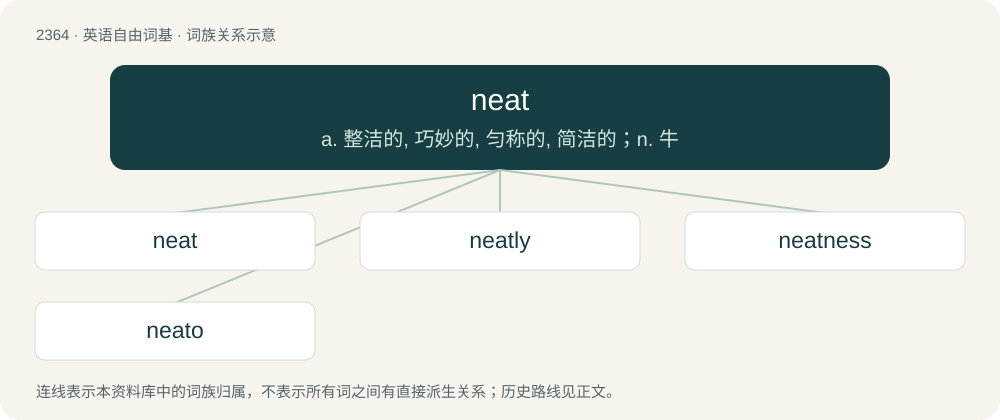

# 2466 · neat — a. 整洁的, 巧妙的, 匀称的, 简洁的；n. 牛

[总目录](../00_总目录_按常用程度.md)

**类型**：英语自由词基　｜　**来源语言**：见词源记录

## 核心含义与来源

- 核心含义：a. 整洁的, 巧妙的, 匀称的, 简洁的；n. 牛
- 英文含义：Clean, tidy; free from dirt or impurities.
- 词形：neat

**来源记录 1**（形容词；Clean, tidy; free from dirt or impurities.）

From Middle English nete, net, nette, from Anglo-Norman neit (“good, desirable, clean”), a variant of Old French net, nette (“clean, clear, pure”), from Latin nitidus (“gleaming”), derived from nitēre (“to shine”). Doublet of net and nitid. Cognate with German nett (“nice, kind”). Compare also nait.

## 词族图

## 单词速览（常用到不常用）

| 单词 | 音标 | 释义 |
|---|---|---|
| [neat](#w-1) | /ˈniːt/ | a. 整洁的, 巧妙的, 匀称的, 简洁的；n. 牛 |
| [neatly](#w-2) | /ˈniːtli/ | adv. 整洁地, 干净地, 匀称地 |
| [neatness](#w-3) | /ˈniːtnis/ | n. 整洁, 干净 |
| [neato](#w-4) | 美 /ˈnitoʊ/ | abbr. Northeast Asian Treaty Organization 亚洲东北部条约组织 |

## 逐词详解

### 1. neat

**词性**：形容词　｜　**音标**：/ˈniːt/

**中文释义**：a. 整洁的, 巧妙的, 匀称的, 简洁的；n. 牛

**英文义项**：Clean, tidy; free from dirt or impurities. / Free from contaminants or impurities, unadulterated.

**词源与演化**：

From Middle English nete, net, nette, from Anglo-Norman neit (“good, desirable, clean”), a variant of Old French net, nette (“clean, clear, pure”), from Latin nitidus (“gleaming”), derived from nitēre (“to shine”). Doublet of net and nitid. Cognate with German nett (“nice, kind”). Compare also nait.

**例句**：

> Having the two protagonists meet in the last act was a particularly neat touch.

该用例对应义项：Well-executed or delivered; clever, skillful, precise.

### 2. neatly

**词性**：副词　｜　**音标**：/ˈniːtli/

**中文释义**：adv. 整洁地, 干净地, 匀称地

**英文义项**：In a neat manner.

**构词拆分**：neat + -ly

**词源与演化**：

From neat + -ly.

**例句**：

> Mary neatly folded her clothes and placed them in her dresser drawers.

### 3. neatness

**词性**：名词　｜　**音标**：/ˈniːtnis/

**中文释义**：n. 整洁, 干净

**英文义项**：The state of being neat.

**构词拆分**：neat + -ness

**词源与演化**：

From neat + -ness.

**例句**：

> The neatness of his attire was almost incredible.

### 4. neato

**词性**：感叹词　｜　**音标**：美 /ˈnitoʊ/

**中文释义**：abbr. Northeast Asian Treaty Organization 亚洲东北部条约组织

**英文义项**：Neat (in the sense of being excellent or desirable).

**构词拆分**：neat + -o

**词源与演化**：

From neat + -o.

**例句**：

> Oh, neato! My car is fixed.

该用例对应义项：Neat (in the sense of being excellent or desirable).
