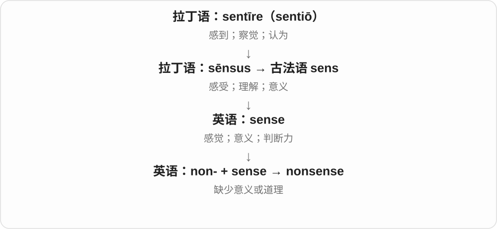

# 2466 · nonsense — 没有道理、意义的内容，及相应形容词

[逐词精讲目录](../00_逐词精讲目录.md) · [总目录](../00_总目录_按常用程度.md)

## 核心词根与来源

日常批评可说荒唐，文学也能故意用不合常理的话创造幽默。不同场景的评价并不相同。

**NONSENSE：道理、意义接不上；艺术里也可故意荒诞**

nonsense → nonsensical。

- **内容名词与性质形容词**：nonsense · nonsensical

## 词形与演化规律

non- + sense → nonsense；-ical 形成性质形容词，使用 nonsens- 词干。

## 单词速览（按词族由简到繁）

同一基础词的相关扩展放在一起，先读基础形式，再读扩展；各组之间优先读常用的。具体词源关系见各词讲解。

| 单词 | 音标 | 核心意思 |
|---|---|---|
| [nonsense](#w-1) | 英 /ˈnɒnsəns/；美 /ˈnɑːnsens/ | 胡说；无意义的话；荒唐事 |
| [nonsensical](#w-2) | /nɒnˈsensɪkəl/；美 /nɑːnˈsensɪkəl/ | 荒谬、不合道理、无意义的 |

## 逐词讲解

### 1. nonsense — 胡说；无意义的话；荒唐事

**音标**：英 /ˈnɒnsəns/；美 /ˈnɑːnsens/

**先抓住这个画面**

话说了一大堆，却拼不成能成立的意思或理由，听者会把它判断为 nonsense。

**怎么拆**

non-（无、不）+ sense（意义、道理）。

**怎么变成今天的意思**

可以批评荒唐说法，也可指故意玩语言的无意义文学。并不是所有含糊、暂时听不懂的话就一定没有意义。

**常见搭配与例句**

talk nonsense；complete nonsense；nonsense verse；no more nonsense。

> That excuse is complete nonsense.

那个借口完全是胡说。

> The children enjoyed the playful nonsense poem.

孩子们很喜欢那首充满语言游戏的无意义诗。

**别混淆**

nonsense 通常不可数；不说 a nonsense 来泛指一句胡话。a piece of nonsense 更合适。

### 2. nonsensical — 荒谬、不合道理、无意义的

**音标**：/nɒnˈsensɪkəl/；美 /nɑːnˈsensɪkəl/

**先抓住这个画面**

话听完连不上道理、安排根本不成立，可以 nonsensical。它评价意思、逻辑、做法，不只是耳朵听不清。

**怎么拆**

nonsense + -ical，去词尾 e，以 nonsens- 词干形成形容词。更里层 non- 否定 sense 意义、道理。

**怎么变成今天的意思**

**non- 不 + sense 意义、道理 → nonsense**  
没有道理、荒唐内容等

↓

**nonsense + -ical → nonsensical**  
荒谬、没有意义的性质

a nonsensical statement 荒谬说法，a nonsensical rule 不合道理的规则，a nonsensical question 没道理的问题。

**常见搭配与例句**

a nonsensical statement；a nonsensical rule。

> The instructions were so contradictory that they became nonsensical.

说明互相矛盾，变得不合道理。

> The story contains delightfully nonsensical conversations.

故事里有一些有趣的荒诞对话。

**别混淆**

nonsense 是名词，nonsensical 是常用形容词。听不懂也可能因为知识不足，不能只凭不熟悉就判为没道理。

## 这一组要分清什么

nonsensical 常作形容词；文学荒诞不必等于作品无价值；听不懂不自动证明没道理。

## 串起来练习

The nonsensical reply sounded like complete nonsense to the visitor.

那个荒诞回答在访客听来完全是胡说。
