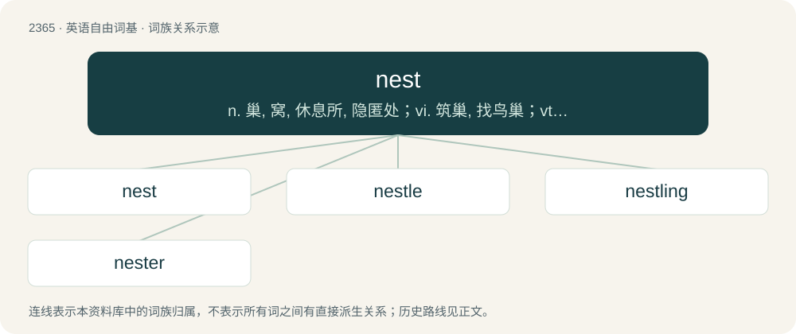

# 2467 · nest — n. 巢, 窝, 休息所, 隐匿处；vi. 筑巢, 找鸟巢；vt. 为...设窝, 使套叠

[总目录](../00_总目录_按常用程度.md)

**类型**：英语自由词基　｜　**来源语言**：见词源记录

## 核心含义与来源

- 核心含义：n. 巢, 窝, 休息所, 隐匿处；vi. 筑巢, 找鸟巢；vt. 为...设窝, 使套叠
- 英文含义：A structure built by a bird as a place to incubate eggs and rear young.
- 词形：nest

**多个词源／构词路径**：同一拼写可能有不同来源；以下按词性和含义分别列出。

**来源记录 1**（名词；A structure built by a bird as a place to incubate eggs and rear young.）

From Middle English nest, nist, nyst, from Old English nest, from Proto-West Germanic \*nest, from Proto-Germanic \*nestą, from Proto-Indo-European \*nisdós (“nest”), literally "where \[the bird\] sits down", a compound of \*ni (“down”) (whence also English nether) + the zero-grade of the root \*sed- (“to sit”) (whence also English sit).

**来源记录 2**（动词；To build or settle into a nest.）

From Middle English nesten, nisten, from Old English nistan, nistian, from Proto-West Germanic \*nistijan (“to nest, build a nest”). Cognate with Saterland Frisian näästje (“to nest”), Dutch nesten (“to nest”), German Low German nüsten (“to nest”), German nisten (“to nest”).

## 词族图

## 单词速览（常用到不常用）

| 单词 | 音标 | 释义 |
|---|---|---|
| [nest](#w-1) | /nɛst/ | n. 巢, 窝, 休息所, 隐匿处；vi. 筑巢, 找鸟巢；vt. 为...设窝, 使套叠 |
| [nestle](#w-2) | /ˈnɛsəl/ | vi. 舒适地坐定, 挨靠, 偎依；vt. 抱, 安置 |
| [nestling](#w-3) | /ˈnɛstlɪŋ/ | n. 刚孵出的雏, 未离巢的雏, 幼儿 |
| [nester](#w-4) | /ˈnestə/ | n. 穴居的兽；筑巢的鸟；放牧地自耕农；试验筛组的单位筛 |

## 逐词详解

### 1. nest

**词性**：名词　｜　**音标**：/nɛst/

**中文释义**：n. 巢, 窝, 休息所, 隐匿处；vi. 筑巢, 找鸟巢；vt. 为...设窝, 使套叠

**英文义项**：A structure built by a bird as a place to incubate eggs and rear young. / A place used by a mammal, fish, amphibian or insect, for depositing eggs and hatching young.

**词源与演化**：

From Middle English nest, nist, nyst, from Old English nest, from Proto-West Germanic \*nest, from Proto-Germanic \*nestą, from Proto-Indo-European \*nisdós (“nest”), literally "where \[the bird\] sits down", a compound of \*ni (“down”) (whence also English nether) + the zero-grade of the root \*sed- (“to sit”) (whence also English sit).

**例句**：

> I was forced to change trumps when I found the ace, jack, and nine of diamonds in the nest.

该用例对应义项：A fixed number of cards in some bidding games awarded to the highest bidder allowing him to exchange any or all with cards in his hand.

### 2. nestle

**词性**：动词　｜　**音标**：/ˈnɛsəl/

**中文释义**：vi. 舒适地坐定, 挨靠, 偎依；vt. 抱, 安置

**英文义项**：To settle oneself comfortably and snugly. / To press oneself against another affectionately.

**构词拆分**：nest + -le

**词源与演化**：

From Middle English nestelen, nestlen, from Old English nistlan, nestlian, nistlian (“to make or build a nest”), from Proto-West Germanic \*nistilōn (“to build or occupy a nest; nestle”), equivalent to nest + -le. Cognate with Middle Low German nëstelen (“to build a nest”), Dutch nestelen (“to nest, nestle”).

**例句**：

> Pauline's baby Selina would just nestle in her arms as if they were the most comfortable place on earth.

### 3. nestling

**词性**：名词　｜　**音标**：/ˈnɛstlɪŋ/

**中文释义**：n. 刚孵出的雏, 未离巢的雏, 幼儿

**英文义项**：A small, young bird that is still confined to the nest.

**构词拆分**：nest + -ling

**词源与演化**：

From Middle English nestling, equivalent to nest + -ling.

### 4. nester

**词性**：名词　｜　**音标**：/ˈnestə/

**中文释义**：n. 穴居的兽；筑巢的鸟；放牧地自耕农；试验筛组的单位筛

**英文义项**：One who nests. / One who forms a strong attachment to their home.

**构词拆分**：From nest + -er.

**词源与演化**：

From nest + -er.
