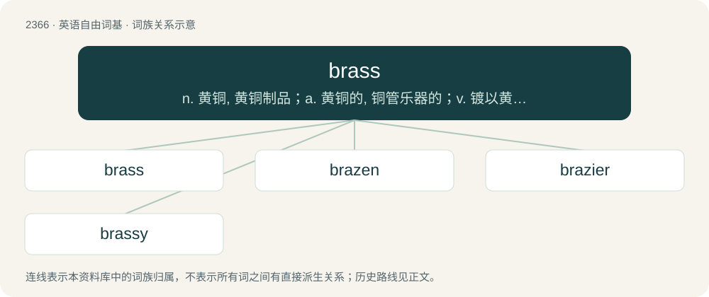

# 2469 · brass — n. 黄铜, 黄铜制品；a. 黄铜的, 铜管乐器的；v. 镀以黄铜, 支付

[总目录](../00_总目录_按常用程度.md)

**类型**：英语自由词基　｜　**来源语言**：见词源记录

## 核心含义与来源

- 核心含义：n. 黄铜, 黄铜制品；a. 黄铜的, 铜管乐器的；v. 镀以黄铜, 支付
- 英文含义：A memorial or sepulchral tablet usually made of brass or latten: a monumental brass.
- 词形：brass

**多个词源／构词路径**：同一拼写可能有不同来源；以下按词性和含义分别列出。

**来源记录 1**（名词；A memorial or sepulchral tablet usually made of brass or latten: a monumental brass.）

From Middle English bras, bres, from Old English bræs (“brass, bronze”), of uncertain origin. Perhaps representing a backformation from Proto-Germanic \*brasnaz (“brazen”), from or related to \*brasō (“fire, pyre”). Compare Old Norse and Icelandic bras (“solder”), Icelandic brasa (“to harden in the fire”), Swedish brasa (“a small controlled fire”), Danish brase (“to fry”); French braser ("to solder"; &gt; English braise) from the same Germanic root. Compare also Middle Dutch braspenninc ("a silver coin", literally, "silver-penny"; &gt; Dutch braspenning), Old Frisian bress (“copper”), Middle Low German bras (“metal, ore”) and برنج (branj, “brass”) In the military sense an ellipsis of the brass hats.

**来源记录 2**（名词；A prostitute.）

By ellipsis from brass nail, in turn from "nail\[ing\]" (fig.) and "brass blonde" (see "brazen"); and also shortened from Cockney Rhyming slang brass flute for "prostitute".

## 词族图

## 单词速览（常用到不常用）

| 单词 | 音标 | 释义 |
|---|---|---|
| [brass](#w-1) | 英 /bɹɑːs/；美 /bɹæs/ | n. 黄铜, 黄铜制品；a. 黄铜的, 铜管乐器的；v. 镀以黄铜, 支付 |
| [brazen](#w-2) | /ˈbɹeɪ̯zən/ | a. 黄铜制的, 厚颜无耻的；vt. 厚脸皮地对待 |
| [brazier](#w-3) | 英 /ˈbɹeɪ.ʒə(ɹ)/；美 /ˈbɹeɪ.ʒɚ/ | n. 火盆, 铜匠 |
| [brassy](#w-4) | 英 /ˈbɹɑː.si/；美 /ˈbɹæs.i/ | a. 似黄铜的, 厚脸皮的；n. 铜头高尔夫球棍 |

## 逐词详解

### 1. brass

**词性**：名词　｜　**音标**：英 /bɹɑːs/；美 /bɹæs/

**中文释义**：n. 黄铜, 黄铜制品；a. 黄铜的, 铜管乐器的；v. 镀以黄铜, 支付

**英文义项**：A memorial or sepulchral tablet usually made of brass or latten: a monumental brass. / Fittings, utensils, or other items made of brass.

**词源与演化**：

From Middle English bras, bres, from Old English bræs (“brass, bronze”), of uncertain origin. Perhaps representing a backformation from Proto-Germanic \*brasnaz (“brazen”), from or related to \*brasō (“fire, pyre”). Compare Old Norse and Icelandic bras (“solder”), Icelandic brasa (“to harden in the fire”), Swedish brasa (“a small controlled fire”), Danish brase (“to fry”); French braser ("to solder"; &gt; English braise) from the same Germanic root. Compare also Middle Dutch braspenninc ("a silver coin", literally, "silver-penny"; &gt; Dutch braspenning), Old Frisian bress (“copper”), Middle Low German bras (“metal, ore”) and برنج (branj, “brass”) In the military sense an ellipsis of the brass hats.

**例句**：

> A few measures later, the brass comes in strong!

该用例对应义项：A class of wind instruments, usually made of metal (such as brass), that use vibrations of the player's lips to produce sound; a band or the section of an orchestra that features such instruments.

### 2. brazen

**词性**：形容词　｜　**音标**：/ˈbɹeɪ̯zən/

**中文释义**：a. 黄铜制的, 厚颜无耻的；vt. 厚脸皮地对待

**英文义项**：Brass-like in appearance or character; bright, ruddy, hard. / Sounding harsh and loud, like brass cymbals or brass instruments.

**构词拆分**：brass + -en

**词源与演化**：

From Middle English brasen, from Old English bræsen (“brazen, of brass”); equivalent to brass + -en (compare golden, wooden, etc.). The word originally meant “of brass”; the figurative verb sense (as in brazen it out (“face impudently”)) dates from the 1550s (perhaps evoking the sense “face like brass, unmoving and not showing shame”), and the adjective sense “impudent” from the 1570s. Compare brass neck, bold as brass.

**例句**：

> She was brazen enough to deny stealing the handbag even though she was caught on camera doing so.

该用例对应义项：Shameless or impudent; shocking or audacious; brash.

### 3. brazier

**词性**：名词　｜　**音标**：英 /ˈbɹeɪ.ʒə(ɹ)/；美 /ˈbɹeɪ.ʒɚ/

**中文释义**：n. 火盆, 铜匠

**英文义项**：A worker in brass; a brassworker.

**构词拆分**：By surface analysis, bras(s) + -ier

**词源与演化**：

From Middle English brasiere, from brasen (“to cover with brass”), from Old English brasian, bræsian (“to cover with brass”). By surface analysis, bras(s) + -ier.

**例句**：

> I lost this oblong Japanese brazier in an earthquake.

### 4. brassy

**词性**：形容词　｜　**音标**：英 /ˈbɹɑː.si/；美 /ˈbɹæs.i/

**中文释义**：a. 似黄铜的, 厚脸皮的；n. 铜头高尔夫球棍

**英文义项**：Resembling brass. / Impudent; impudently bold.

**构词拆分**：brass + -y (suffix forming adjectives meaning “having the quality of”)

**词源与演化**：

From brass + -y (suffix forming adjectives meaning “having the quality of”).

**例句**：

> Don’t get brassy with me, young lady!

该用例对应义项：Impudent; impudently bold.
