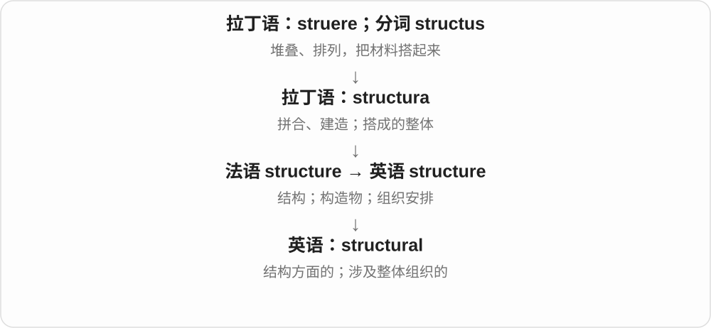
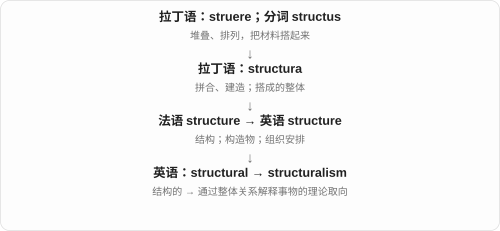
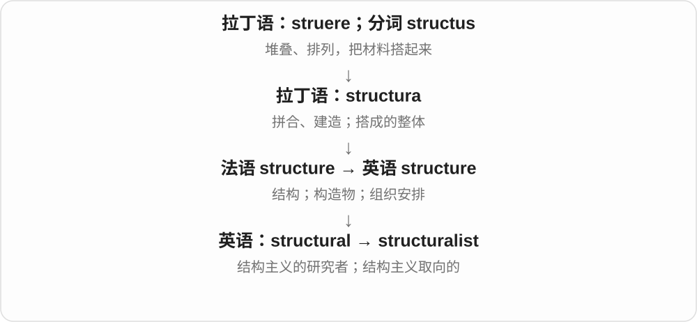

# 2471 · structural — 结构；组成关系

[逐词精讲目录](../00_逐词精讲目录.md) · [总目录](../00_总目录_按常用程度.md)

## 核心词根与来源

structural 联系 structure 和拉丁建造、堆起一支。structurally 作副词，structuralism 是结构主义，structuralist 是相关研究者或其立场形容词。

**STRUCTURAL：看部件如何搭成整体**

材料是什么之外，还要问它们怎么连接、分工和支撑。

- **组成关系**：structural · structurally
- **理论和持有者**：structuralism · structuralist

## 词形与演化规律

structural change 不只指建筑变化，也能指制度和经济组成关系的改变；理论术语须看学科。

## 单词速览（按词族由简到繁）

同一基础词的相关扩展放在一起，先读基础形式，再读扩展；各组之间优先读常用的。具体词源关系见各词讲解。

| 单词 | 音标 | 核心意思 |
|---|---|---|
| [structural](#w-1) | /ˈstrʌktʃərəl/ | 结构的；影响整体基础或组织方式的 |
| [structurally](#w-2) | /ˈstrʌktʃərəli/ | 在结构上；从组织方式看 |
| [structuralism](#w-3) | /ˈstrʌktʃərəlɪzəm/ | 结构主义 |
| [structuralist](#w-4) | /ˈstrʌktʃərəlɪst/ | 结构主义者；结构主义的 |

## 逐词讲解

### 1. structural — 结构的；影响整体基础或组织方式的

**音标**：/ˈstrʌktʃərəl/

**先抓住这个画面**

structural 像房子的梁柱，或公司里“谁管谁、钱怎么流”的安排：说的是支撑整体的组织方式。

**怎么拆**

structure + -al，英语中形成表示“与结构有关”的形容词。

**怎么变成今天的意思**

structural damage 可能影响建筑支撑；structural problems 也可指制度、组织造成的问题，不是换一个人或补一个小洞就能解决。

**常见搭配与例句**

structural damage；structural change；structural problems；structural engineering。

> The survey found no structural damage to the house.

勘查没有发现房屋结构受损。

> The company needs structural changes to reduce repeated delays.

公司需要调整组织结构，才能减少反复出现的延误。

**别混淆**

structural 强调内部安排或支撑；superficial 强调表面。结构问题未必肉眼立刻可见。

### 2. structurally — 在结构上；从组织方式看

**音标**：/ˈstrʌktʃərəli/

**先抓住这个画面**

structurally 是暂时不看颜色、题材或包装，只看里面的骨架怎么搭。

**怎么拆**

structural + -ly，限定比较、判断所针对的方面。

**怎么变成今天的意思**

structurally sound 是结构可靠、稳固；structurally similar 说明组成关系相似，即使外观看起来不一样。

**常见搭配与例句**

structurally sound；structurally similar；structurally different。

> The old barn is still structurally sound.

这座旧谷仓的结构仍然稳固。

> The two arguments are structurally similar.

这两个论证在结构上很相似。

**别混淆**

visually similar 说看起来像；structurally similar 说内部安排像，两个判断可以不同。

### 3. structuralism — 结构主义

**音标**：/ˈstrʌktʃərəlɪzəm/

**先抓住这个画面**

structuralism 像看一盘棋：不只看一枚棋子本身，还看它在规则和其他棋子之间占什么位置。

**怎么拆**

structural + -ism，表示重视结构关系的一类理论取向；不同学科里的具体理论并不完全一样。

**怎么变成今天的意思**

在语言、文化或文学研究中，常把单个现象放进关系系统来理解。这个画面帮助入门，但不能把各领域的 structuralism 当成一个细节完全相同的学说。

**常见搭配与例句**

linguistic structuralism；structuralism in anthropology；a study of structuralism。

> The seminar introduced structuralism in the study of language.

研讨课介绍了语言研究中的结构主义。

> Her essay compares structuralism with later approaches to literature.

她的论文比较了结构主义和后来的文学研究方法。

**别混淆**

structure 是对象的结构；structuralism 是一种研究取向，不是“凡有结构都叫结构主义”。

### 4. structuralist — 结构主义者；结构主义的

**音标**：/ˈstrʌktʃərəlɪst/

**先抓住这个画面**

structuralist 会追问：“这个元素为什么有这个意义？它和整个系统里的其他元素是什么关系？”

**怎么拆**

structural + -ist，与 structuralism 对应，可指采用这种研究取向的人，也可作形容词。

**怎么变成今天的意思**

a structuralist reading 是以结构关系为重点的解读；a structuralist 可以指相关理论的支持者或研究者。

**常见搭配与例句**

a structuralist approach；a structuralist analysis；a structuralist reading。

> The structuralist examined the relationships among the symbols.

这位结构主义者研究了各个符号之间的关系。

> The chapter offers a structuralist reading of the myth.

这一章从结构主义角度解读了这个神话。

**别混淆**

structural engineer 是研究结构安全与设计的工程师；structuralist 通常是理论取向标签，两者不是同一种职业称谓。

## 这一组要分清什么

structural 与 superficial 表面上的关注层次不同；structuralist 不等于结构工程师。

## 串起来练习

The two systems look different but are structurally similar.

两个系统看起来不同，但结构上相似。
