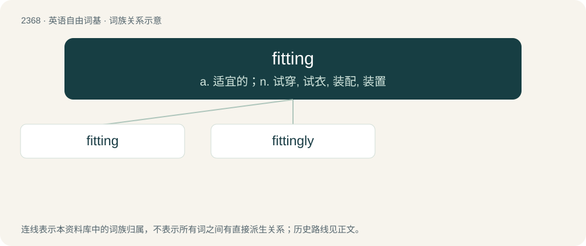

# 2472 · fitting — a. 适宜的；n. 试穿, 试衣, 装配, 装置

[总目录](../00_总目录_按常用程度.md)

**类型**：英语自由词基　｜　**来源语言**：见词源记录

## 核心含义与来源

- 核心含义：a. 适宜的；n. 试穿, 试衣, 装配, 装置
- 英文含义：Chiefly preceded by a descriptive adverb or noun: that fits in some manner (often closely) to the shape or size of something.
- 词形：fitting

**来源记录 1**（形容词；Chiefly preceded by a descriptive adverb or noun: that fits in some manner (often closely) to the shape or size of something.）

From fit (“to conform to in shape or size; to be suitable for”, verb) + -ing (suffix forming present participles of verbs, and gerunds and nouns denoting the act of doing something or the embodiment of an action).

## 词族图

## 单词速览（常用到不常用）

| 单词 | 音标 | 释义 |
|---|---|---|
| [fitting](#w-1) | 英 /ˈfɪtɪŋ/；美 /ˈfɪtɪŋ/ | a. 适宜的；n. 试穿, 试衣, 装配, 装置 |
| [fittingly](#w-2) | /ˈfɪtɪŋlɪ/ | adv. 适切地, 适合地 |

## 逐词详解

### 1. fitting

**词性**：形容词　｜　**音标**：英 /ˈfɪtɪŋ/；美 /ˈfɪtɪŋ/

**中文释义**：a. 适宜的；n. 试穿, 试衣, 装配, 装置

**英文义项**：Chiefly preceded by a descriptive adverb or noun: that fits in some manner (often closely) to the shape or size of something. / Appropriate, suitable, proper.

**构词拆分**：fit (“to conform to in shape or size; to be suitable for”, verb) + -ing (suffix forming present participles of verbs, and gerunds and nouns denoting the act of doing something or the embodiment of an action)

**词源与演化**：

From fit (“to conform to in shape or size; to be suitable for”, verb) + -ing (suffix forming present participles of verbs, and gerunds and nouns denoting the act of doing something or the embodiment of an action).

**用法示例／搭配（非完整句）**：

> close-fitting form-fitting ill-fitting

该用例对应义项：Chiefly preceded by a descriptive adverb or noun: that fits in some manner (often closely) to the shape or size of something.

### 2. fittingly

**词性**：副词　｜　**音标**：/ˈfɪtɪŋlɪ/

**中文释义**：adv. 适切地, 适合地

**英文义项**：In a fitting manner.

**构词拆分**：fitting + -ly

**词源与演化**：

From fitting + -ly.

**例句**：

> "I've never really been happy," Tom admitted. Fittingly, a baby began to cry somewhere in the background.
