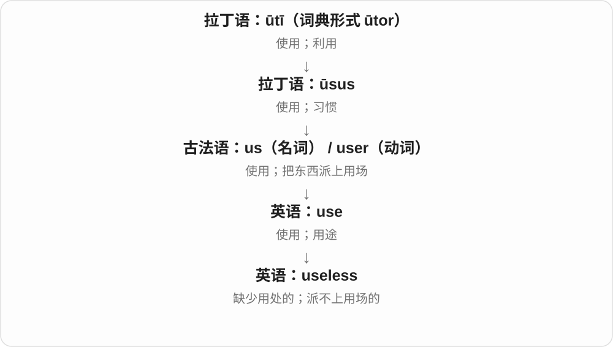
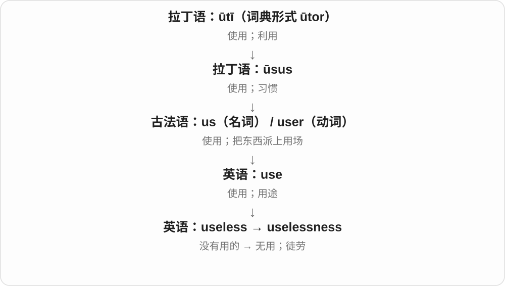

# 2472 · useless — 能否起作用，及不起作用的方式、状态

[逐词精讲目录](../00_逐词精讲目录.md) · [总目录](../00_总目录_按常用程度.md)

## 核心词根与来源

不是只背一个没用：useless 说东西或办法的性质，uselessly 说白费的动作，uselessness 把无用的状态当作一件事讨论。

**USELESS：对眼前目的帮不上忙**

useless → uselessly、uselessness。

- **性质、方式与状态**：useless · uselessly · uselessness

## 词形与演化规律

use + -less → useless；-ly 副词，-ness 状态名词。

## 单词速览（按词族由简到繁）

同一基础词的相关扩展放在一起，先读基础形式，再读扩展；各组之间优先读常用的。具体词源关系见各词讲解。

| 单词 | 音标 | 核心意思 |
|---|---|---|
| [useless](#w-1) | /ˈjuːsləs/ | 没有用的；派不上用场的 |
| [uselessness](#w-2) | /ˈjuːsləsnəs/ | 无用；徒劳无益 |
| [uselessly](#w-3) | /ˈjuːsləsli/ | 无用地、徒劳地 |

## 逐词讲解

### 1. useless — 没有用的；派不上用场的

**音标**：/ˈjuːsləs/

**先抓住这个画面**

useless 是“拿它来办这件事，帮不上忙”。手机没电时，很多功能就暂时派不上用场。

**怎么拆**

use + -less；-less 表示缺少。这里缺少的是实际用处。

**怎么变成今天的意思**

它可以说东西没有作用，也可以说某项努力改变不了结果。This key is useless 可能只是钥匙打不开眼前这把锁，不一定完全坏了。

**常见搭配与例句**

useless for…；useless at doing…；It is useless to argue（争下去没有用）。

> Without the password, the file was useless to us.

没有密码，这个文件对我们来说派不上用场。

> It is useless to blame each other now; we need a solution.

现在互相责怪没有用，我们需要一个解决办法。

**别混淆**

useless 比 not very useful 强得多。用它直接评价人往往很伤人；说“某方法在这个任务中没用”则更具体。

### 2. uselessness — 无用；徒劳无益

**音标**：/ˈjuːsləsnəs/

**先抓住这个画面**

uselessness 把“怎么做都帮不上忙”的感觉或状况单独拿出来说。

**怎么拆**

useless + -ness；表示“没有用”这种性质或状态。

**怎么变成今天的意思**

它既可评价一个办法，也可描述一个人觉得自己帮不上忙的感受。a feeling of uselessness 说的是人的感受，不能据此断言这个人没有价值。

**常见搭配与例句**

the uselessness of…；a sense / feeling of uselessness；recognize the uselessness of an approach。

> The experiment showed the uselessness of that shortcut.

实验表明，那条捷径根本帮不上忙。

> Joining the volunteer group eased his feeling of uselessness.

加入志愿者团队后，他那种觉得自己帮不上忙的感受减轻了。

**别混淆**

uselessness 是没能产生所需帮助；failure 常指某一次没达到目标。失败的尝试仍可能留下有用的经验。

### 3. uselessly — 无用地、徒劳地

**音标**：/ˈjuːsləsli/

**先抓住这个画面**

钥匙转了，锁却没开；你需要的结果没有发生。uselessly 说动作白费了，不是仅仅动作做得慢。

**怎么拆**

useless + -ly；更里层是 use + -less 缺少用途、作用。use 在这里按名词词干的 /s/ 音进入形容词，不读动词 use 的 /z/。

**怎么变成今天的意思**

**use 使用 → useless**  
对某个目的不起作用、没有用处

↓

**useless + -ly → uselessly**  
做了却没有产生需要的效果

spin uselessly 空转，struggle uselessly 徒劳挣扎，search uselessly 搜寻却无结果。它常突出做了也没用的感觉。

**常见搭配与例句**

spin uselessly；struggle uselessly。

> The key turned uselessly in the broken lock.

钥匙在坏锁里转着，却打不开。

> The wheels spun uselessly in the mud.

车轮在泥里空转，车仍走不了。

**别混淆**

useless 是性质，uselessly 说动作的方式、效果；某件工具对当前任务没用，不代表它在任何地方都没用。

## 这一组要分清什么

be useless at 可说不擅长；uselessness 是抽象名词。批评办法无效，不必扩大为对人的整体判断。

## 串起来练习

The damaged motor ran uselessly, making the machine useless.

坏马达徒劳地运转着，机器无法使用。
