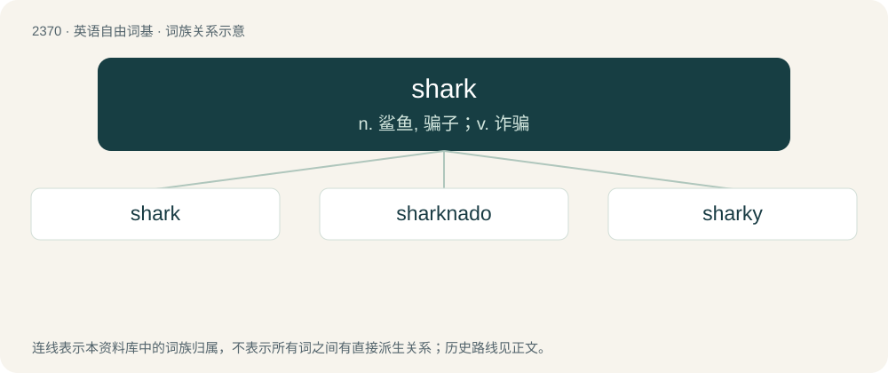

# 2473 · shark — n. 鲨鱼, 骗子；v. 诈骗

[总目录](../00_总目录_按常用程度.md)

**类型**：英语自由词基　｜　**来源语言**：见词源记录

## 核心含义与来源

- 核心含义：n. 鲨鱼, 骗子；v. 诈骗
- 英文含义：Any predatory fish of the superorder Selachimorpha, with a cartilaginous skeleton and 5 to 7 gill slits on each side of its head.
- 词形：shark

**多个词源／构词路径**：同一拼写可能有不同来源；以下按词性和含义分别列出。

**来源记录 1**（名词；Any predatory fish of the superorder Selachimorpha, with a cartilaginous skeleton and 5 to 7 gill slits on each side of its head.）

From Middle English shark (used by Thomas Beckington in 1442 to refer to a kind of fish), of uncertain origin. Most likely from a semantic extension of the German-derived shark (“scoundrel”), see below. The fish was originally called a dogfish or haye in English and Middle English. Its name in Old English is unknown, although some uses of the word hranfisċ that do not appear to carry the sense of "whale" may have been referencing it. alternative theories Some older dictionaries derived the word from Latin c(h)archarias, c(h)acharus (from Ancient Greek), but admit that "the requisite \[Old French\] forms intermediate between E. shark and L. carcharus are not found, and it is not certain that the name \[shark\] was orig. applied to the fish; it may have been first used of a greedy man". Other older authorities speculated that the word might derive from Yucatec Maya xok (“fish”) (/ʃok/), as John Hawkins brought a specimen from the area where Mayan was spoken to England in the 1560s. However, the 1442 use rules out a New World origin for the word.

**来源记录 2**（名词；Someone who exploits others, for example by trickery, lies, usury, extortion.）

From German Schurke (“scoundrel”); compare Dutch schurk.

## 词族图

## 单词速览（常用到不常用）

| 单词 | 音标 | 释义 |
|---|---|---|
| [shark](#w-1) | 英 /ʃɑːk/；美 /ʃɑɹk/ | n. 鲨鱼, 骗子；v. 诈骗 |
| [sharknado](#w-2) |  | 【英文】A tornado containing sharks. |
| [sharky](#w-3) |  | 【英文】Resembling or characteristic of a shark. |

## 逐词详解

### 1. shark

**词性**：名词　｜　**音标**：英 /ʃɑːk/；美 /ʃɑɹk/

**中文释义**：n. 鲨鱼, 骗子；v. 诈骗

**英文义项**：Any predatory fish of the superorder Selachimorpha, with a cartilaginous skeleton and 5 to 7 gill slits on each side of its head. / Meat of this animal, consumed as food.

**词源与演化**：

From Middle English shark (used by Thomas Beckington in 1442 to refer to a kind of fish), of uncertain origin. Most likely from a semantic extension of the German-derived shark (“scoundrel”), see below. The fish was originally called a dogfish or haye in English and Middle English. Its name in Old English is unknown, although some uses of the word hranfisċ that do not appear to carry the sense of "whale" may have been referencing it. alternative theories Some older dictionaries derived the word from Latin c(h)archarias, c(h)acharus (from Ancient Greek), but admit that "the requisite \[Old French\] forms intermediate between E. shark and L. carcharus are not found, and it is not certain that the name \[shark\] was orig. applied to the fish; it may have been first used of a greedy man". Other older authorities speculated that the word might derive from Yucatec Maya xok (“fish”) (/ʃok/), as John Hawkins brought a specimen from the area where Mayan was spoken to England in the 1560s. However, the 1442 use rules out a New World origin for the word.

**例句**：

> You'd be a fool if you borrowed money from a loan shark.

### 2. sharknado

**词性**：名词

**英文义项**：A tornado containing sharks.

**构词拆分**：shark + -nado

**词源与演化**：

From shark + -nado.

### 3. sharky

**词性**：形容词

**英文义项**：Resembling or characteristic of a shark. / Indicating possible presence of sharks.

**构词拆分**：shark + -y

**词源与演化**：

From shark + -y.
