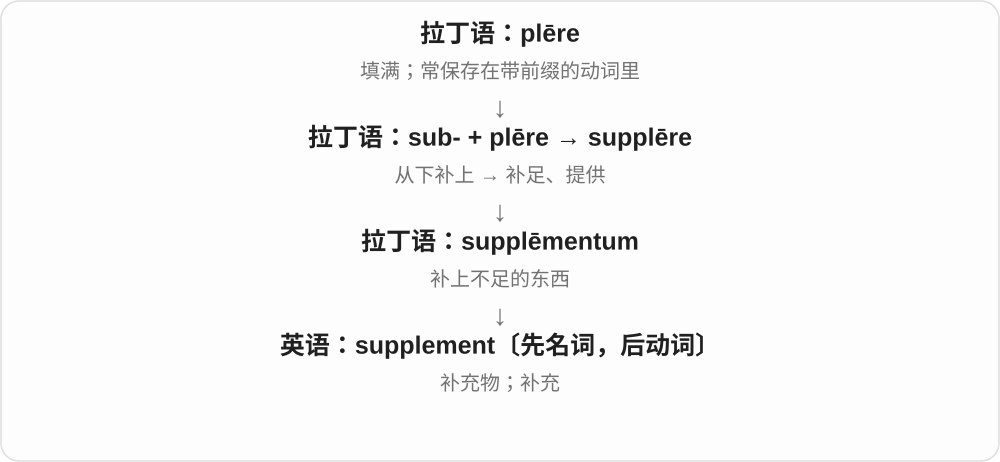
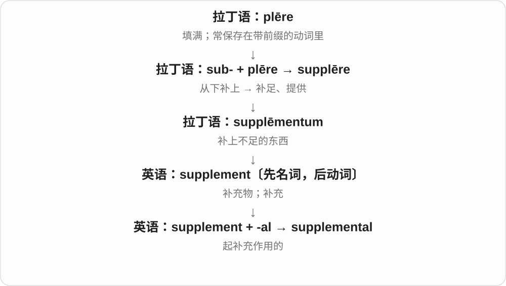
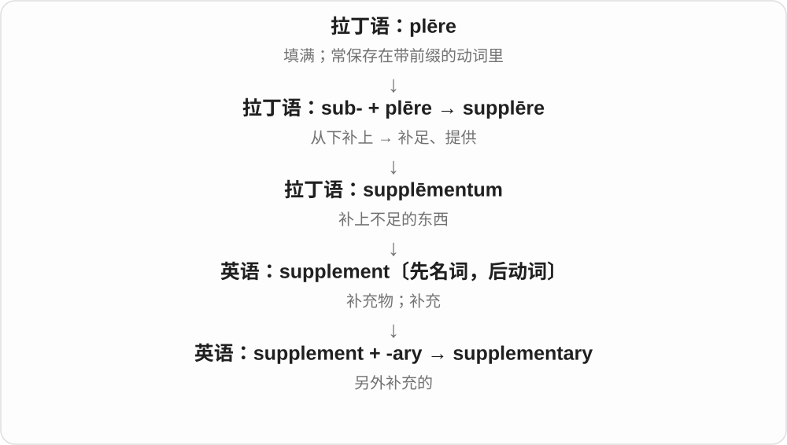
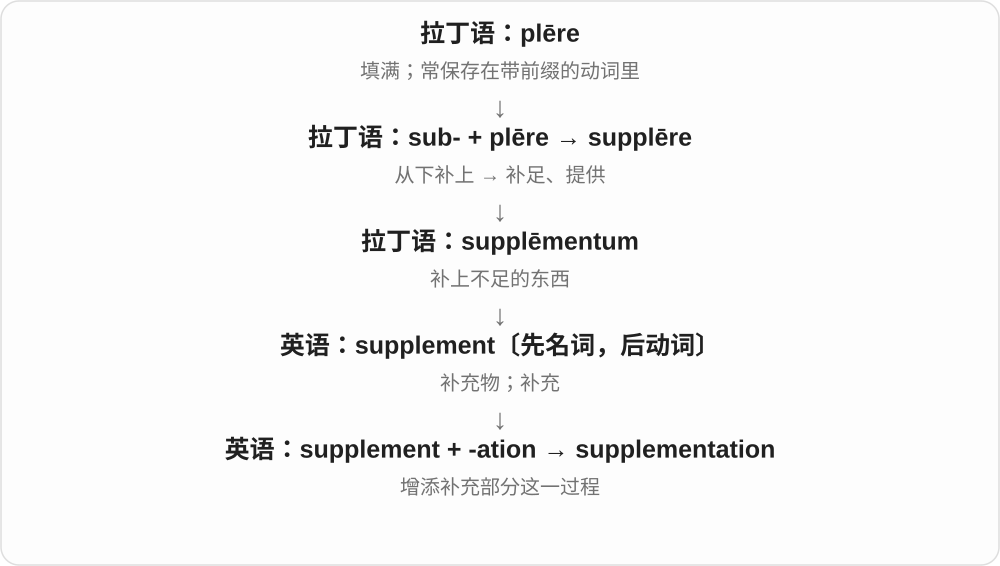

# 2474 · supplement — 补充；补充物

[逐词精讲目录](../00_逐词精讲目录.md) · [总目录](../00_总目录_按常用程度.md)

## 核心词根与来源

supplement 经拉丁补足一支传来。supplemental、supplementary 都是相关形容词，supplementation 表示补充过程；实际领域决定补什么。

**SUPPLEMENT：在原有东西之外再补上不足或内容**

主材料已在，另外一部分帮助补齐。

- **补充物与动作**：supplement
- **属性与过程**：supplemental · supplementary · supplementation

## 词形与演化规律

supplement 可作名词或动词；supplement A with B 是用 B 补充 A。形容词两种形式常有使用偏好，不宜划成所有场景固定对立。

## 单词速览（按词族由简到繁）

同一基础词的相关扩展放在一起，先读基础形式，再读扩展；各组之间优先读常用的。具体词源关系见各词讲解。

| 单词 | 音标 | 核心意思 |
|---|---|---|
| [supplement](#w-1) | 名词：英 /ˈsʌplɪmənt/，美 /ˈsʌpləmənt/；动词：英 /ˈsʌplɪment/，美 /ˈsʌpləment/ | 补充物；增刊；补助；补充；另付的费用 |
| [supplemental](#w-2) | 英 /ˌsʌplɪˈmentəl/；美 /ˌsʌpləˈmentəl/ | 补充的；额外提供的 |
| [supplementary](#w-3) | 英 /ˌsʌplɪˈmentəri/；美 /ˌsʌpləˈmentəri/ | 补充的；附加的；互补的〔两角和为180°〕 |
| [supplementation](#w-4) | 英 /ˌsʌplɪmenˈteɪʃən/；美 /ˌsʌpləmenˈteɪʃən/ | 补充；增补的过程 |

## 逐词讲解

### 1. supplement — 补充物；增刊；补助；补充；另付的费用

**音标**：名词：英 /ˈsʌplɪmənt/，美 /ˈsʌpləmənt/；动词：英 /ˈsʌplɪment/，美 /ˈsʌpləment/

**先抓住这个画面**

主体已经在那里，再加一部分，让信息、收入或供应更够用。

**怎么拆**

拉丁语 supplēmentum“补上不足的东西”来自 supplēre；先作名词借入，英语后来用作动词。

**怎么变成今天的意思**

a supplement to a report 是报告补充材料；supplement your income 是增加一笔收入。饮食中的 supplement 指补充剂。旅馆等场景 a supplement 还可能是额外收费，具体看说明。

**常见搭配与例句**

supplement an income；a supplement to the report；a newspaper supplement。

> She supplements her income by teaching on Saturdays.

她通过周六授课增加收入。

> The book comes with a short supplement containing updated maps.

这本书附有一份简短的补充册，收录了更新的地图。

> A sea view is available for a small supplement.

付一小笔额外费用即可入住海景房。

**别混淆**

complement 侧重相配、合成完整整体；supplement 侧重额外补上一部分。两者有重叠，不能机械等同。

### 2. supplemental — 补充的；额外提供的

**音标**：英 /ˌsʌplɪˈmentəl/；美 /ˌsʌpləˈmentəl/

**先抓住这个画面**

主件之外再添一份，用来补不足或应付新增需要。

**怎么拆**

supplement + -al；英语派生。

**怎么变成今天的意思**

常见 supplemental funding、supplemental materials。与 supplementary 大量重叠，尤其在美式行政、教育语境常见，不能划出“一个必需、一个非必需”的硬界线。

**常见搭配与例句**

supplemental funding；supplemental materials；supplemental information。

> The project received supplemental funding for the final tests.

项目获得了一笔补充经费用于最后的测试。

> Supplemental reading materials are available online.

补充阅读材料可在网上获取。

**别混淆**

additional 只说另外加的；supplemental 更说明加来的东西为原有部分作补充。

### 3. supplementary — 补充的；附加的；互补的〔两角和为180°〕

**音标**：英 /ˌsʌplɪˈmentəri/；美 /ˌsʌpləˈmentəri/

**先抓住这个画面**

正文说完了，再给一张表或一段说明，把需要的内容补上。

**怎么拆**

supplement + -ary；与法语 supplémentaire 对应。

**怎么变成今天的意思**

supplementary information 是补充信息。几何中 supplementary angles 的和为 180°，补成平角；与和为 90° 的 complementary angles 分开记。

**常见搭配与例句**

supplementary information；supplementary questions；supplementary angles。

> Please attach any supplementary information to your application.

请在申请中附上其他补充信息。

> Angles of seventy and one hundred ten degrees are supplementary.

七十度角和一百一十度角互为补角。

**别混淆**

supplemental 与 supplementary 通常近义；数学角度术语固定用 supplementary。

### 4. supplementation — 补充；增补的过程

**音标**：英 /ˌsʌplɪmenˈteɪʃən/；美 /ˌsʌpləmenˈteɪʃən/

**先抓住这个画面**

持续把缺的那一部分加进去，而不是另换一整套。

**怎么拆**

supplement〔动词〕 + -ation。

**怎么变成今天的意思**

词较正式，营养研究中常见；也可谈数据、饲料等方面的补充。它只描述增加什么，不表示增加了就一定有益。

**常见搭配与例句**

dietary supplementation；supplementation with additional data。

> The report examines dietary supplementation among older adults.

报告考察了老年人使用膳食补充品的情况。

> Supplementation of the survey data with interviews revealed new concerns.

在问卷数据之外补入访谈材料，揭示了新的问题。

**别混淆**

supplement 是补充物或补充动作；supplementation 把补充作为过程来谈。

## 这一组要分清什么

supplement 是补充，substitute 是替代；补充材料通常不直接取代全部主体内容。

## 串起来练习

The supplementary notes supplement the main text.

补充注释对正文作了补充。
