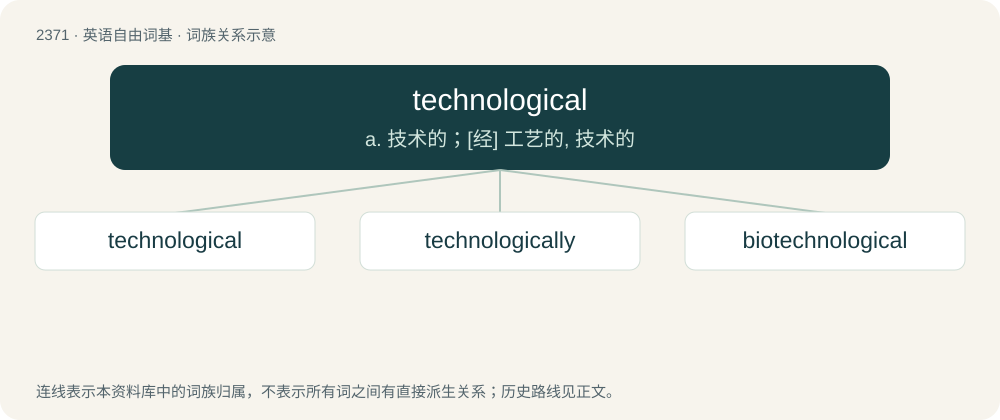

# 2474 · technological — a. 技术的；\[经\] 工艺的, 技术的

[总目录](../00_总目录_按常用程度.md)

**类型**：英语自由词基　｜　**来源语言**：见词源记录

## 核心含义与来源

- 核心含义：a. 技术的；\[经\] 工艺的, 技术的
- 英文含义：Of, relating to, or involving technology, especially modern scientific technology.
- 词形：technological

**来源记录 1**（形容词；Of, relating to, or involving technology, especially modern scientific technology.）

From technology + -ical.

## 词族图

## 单词速览（常用到不常用）

| 单词 | 音标 | 释义 |
|---|---|---|
| [technological](#w-1) | 英 /ˌtɛk.nəˈlɒdʒ.ɪ.kəl/；美 /ˌtɛk.nəˈlɑ.dʒɪ.kəl/ | a. 技术的；\[经\] 工艺的, 技术的 |
| [technologically](#w-2) | /teknəˈlɔdʒikəli/ | adv. 技术上地；科技地 |
| [biotechnological](#w-3) | 英 /ˈbaɪəʊˌtɛk.nə.lɒdʒ.ɪk.əl/ | a. 生物技术的 |

## 逐词详解

### 1. technological

**词性**：形容词　｜　**音标**：英 /ˌtɛk.nəˈlɒdʒ.ɪ.kəl/；美 /ˌtɛk.nəˈlɑ.dʒɪ.kəl/

**中文释义**：a. 技术的；\[经\] 工艺的, 技术的

**英文义项**：Of, relating to, or involving technology, especially modern scientific technology.

**构词拆分**：technology + -ical

**词源与演化**：

From technology + -ical.

**例句**：

> There were many technological advances at the beginning of the twenty-first century.

### 2. technologically

**词性**：副词　｜　**音标**：/teknəˈlɔdʒikəli/

**中文释义**：adv. 技术上地；科技地

**英文义项**：In a technological manner. / Concerning or using technology.

**构词拆分**：technological + -ly

**词源与演化**：

From technological + -ly.

**例句**：

> For now, it is technologically impossible to have a manned flight to Mercury.

该用例对应义项：Concerning or using technology.

### 3. biotechnological

**词性**：形容词　｜　**音标**：英 /ˈbaɪəʊˌtɛk.nə.lɒdʒ.ɪk.əl/

**中文释义**：a. 生物技术的

**英文义项**：Of or pertaining to biotechnology.

**构词拆分**：biotechnology + -ical；bio- + technological

**词源与演化**：

From biotechnology + -ical or bio- + technological.
