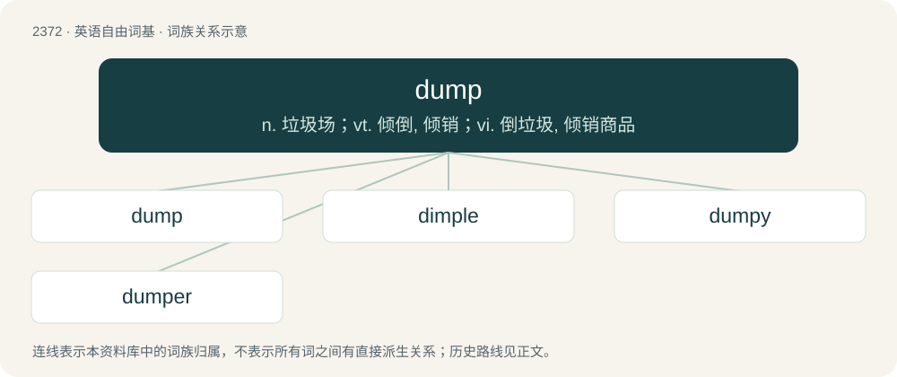

# 2475 · dump — n. 垃圾场；vt. 倾倒, 倾销；vi. 倒垃圾, 倾销商品

[总目录](../00_总目录_按常用程度.md)

**类型**：英语自由词基　｜　**来源语言**：见词源记录

## 核心含义与来源

- 核心含义：n. 垃圾场；vt. 倾倒, 倾销；vi. 倒垃圾, 倾销商品
- 英文含义：A place where waste or garbage is left; a ground or place for dumping ashes, refuse, etc.; a disposal site.
- 词形：dump

**多个词源／构词路径**：同一拼写可能有不同来源；以下按词性和含义分别列出。

**来源记录 1**（名词；A place where waste or garbage is left; a ground or place for dumping ashes, refuse, etc.; a disposal site.）

From Middle English dumpen, dompen, probably from Old Norse dumpa (“to thump”) (whence Danish dumpe (“to fall suddenly”)), of uncertain origin, possibly imitative of falling, similar to thump.

**来源记录 2**（名词；A deep hole in a river bed; a pool.）

Cognate with Scots dump (“hole in the ground”), Norwegian dump (“a depression or hole in the ground”), German Low German dumpen (“to submerge”), Dutch dompen (“to dip, sink, submerge”).

## 词族图

## 单词速览（常用到不常用）

| 单词 | 音标 | 释义 |
|---|---|---|
| [dump](#w-1) | /dʌmp/ | n. 垃圾场；vt. 倾倒, 倾销；vi. 倒垃圾, 倾销商品 |
| [dimple](#w-2) | 英 /ˈdɪm.pəl/ | n. 酒窝, 涟漪；vt. 使起涟漪 |
| [dumpy](#w-3) | /ˈdʌmpi/ | 【英文】Of or relating to a garbage dump; rubbishy. |
| [dumper](#w-4) | 英 /ˈdʌmpə/；美 /ˈdʌmpɚ/ | n. 垃圾车, 卸货车, 自动倾卸车, 清洁工人, 倾卸者, 倾销者；\[化\] 卸料器 |

## 逐词详解

### 1. dump

**词性**：名词　｜　**音标**：/dʌmp/

**中文释义**：n. 垃圾场；vt. 倾倒, 倾销；vi. 倒垃圾, 倾销商品

**英文义项**：A place where waste or garbage is left; a ground or place for dumping ashes, refuse, etc.; a disposal site. / A car or boat for dumping refuse, etc.

**词源与演化**：

From Middle English dumpen, dompen, probably from Old Norse dumpa (“to thump”) (whence Danish dumpe (“to fall suddenly”)), of uncertain origin, possibly imitative of falling, similar to thump.

**例句**：

> Don't feel bad about moving away from this dump.

该用例对应义项：An unpleasant, dirty, disreputable, unfashionable, boring, or depressing looking place.

### 2. dimple

**词性**：名词　｜　**音标**：英 /ˈdɪm.pəl/

**中文释义**：n. 酒窝, 涟漪；vt. 使起涟漪

**英文义项**：A small depression or indentation in a surface. / A small natural depression on the skin, especially on the face near the corners of the mouth.

**构词拆分**：dump (“deep hole, pool”) + -le (diminutive suffix)

**词源与演化**：

From Middle English dimpel, dimpil, dympull, from Old English \*dympel (“pit, depression”), from Proto-West Germanic \*dumpil, from Proto-Germanic \*dumpilaz (“sink-hole, dimple”), from Proto-Germanic \*dumpaz (“hole, hollow, pit”), from Proto-Indo-European \*dʰewb- (“deep, hollow”), equivalent to dialectal dump (“deep hole, pool”) + -le (diminutive suffix). Cognate with German Low German Dümpel, German Tümpel (“pond, pool”). Related also to Old English dyppan (“to dip”).

**例句**：

> The accident created a dimple in the hood of the car.

该用例对应义项：A small depression or indentation in a surface.

### 3. dumpy

**词性**：形容词　｜　**音标**：/ˈdʌmpi/

**英文义项**：Of or relating to a garbage dump; rubbishy.

**构词拆分**：From dump + -y.

**词源与演化**：

From dump + -y.

### 4. dumper

**词性**：名词　｜　**音标**：英 /ˈdʌmpə/；美 /ˈdʌmpɚ/

**中文释义**：n. 垃圾车, 卸货车, 自动倾卸车, 清洁工人, 倾卸者, 倾销者；\[化\] 卸料器

**英文义项**：A small vehicle often used to carry loads and material around, often on building sites; a dumpcart. / A dropper of refuse, particularly not in landfill or recycling sites.

**构词拆分**：dump + -er

**词源与演化**：

From dump + -er.
