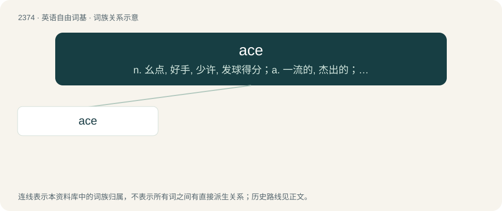

# 2476 · ace — n. 幺点, 好手, 少许, 发球得分；a. 一流的, 杰出的；\[计\] 应答允许, 自适应计算机试验, 自动呼叫设备, 自动执行控制

[总目录](../00_总目录_按常用程度.md)

**类型**：英语自由词基　｜　**来源语言**：见词源记录

## 核心含义与来源

- 核心含义：n. 幺点, 好手, 少许, 发球得分；a. 一流的, 杰出的；\[计\] 应答允许, 自适应计算机试验, 自动呼叫设备, 自动执行控制
- 英文含义：A playing card showing a single pip, typically the highest or lowest ranking card in a game.
- 词形：ace

**多个词源／构词路径**：同一拼写可能有不同来源；以下按词性和含义分别列出。

**来源记录 1**（名词；A playing card showing a single pip, typically the highest or lowest ranking card in a game.）

Inherited from Middle English as, from Old French as, from Latin as, assis (“unity, copper coin, the unit of coinage”), probably borrowed from Etruscan. Doublet of as.

**来源记录 2**（形容词；Asexual, not experiencing sexual attraction.）

Clipping of asexual.

## 词族图

## 单词速览（常用到不常用）

| 单词 | 音标 | 释义 |
|---|---|---|
| [ace](#w-1) | /ˈeɪ̯s/ | n. 幺点, 好手, 少许, 发球得分；a. 一流的, 杰出的；\[计\] 应答允许, 自适应计算机试验, 自动呼叫设备, 自动执行控制 |

## 逐词详解

### 1. ace

**词性**：名词　｜　**音标**：/ˈeɪ̯s/

**中文释义**：n. 幺点, 好手, 少许, 发球得分；a. 一流的, 杰出的；\[计\] 应答允许, 自适应计算机试验, 自动呼叫设备, 自动执行控制

**英文义项**：A playing card showing a single pip, typically the highest or lowest ranking card in a game. / A die face marked with a single dot, typically representing the number one.

**词源与演化**：

Inherited from Middle English as, from Old French as, from Latin as, assis (“unity, copper coin, the unit of coinage”), probably borrowed from Etruscan. Doublet of as.

**用法示例／搭配（非完整句）**：

> an ace detective

该用例对应义项：An expert at something; a maverick, genius; a person of supreme talent.
