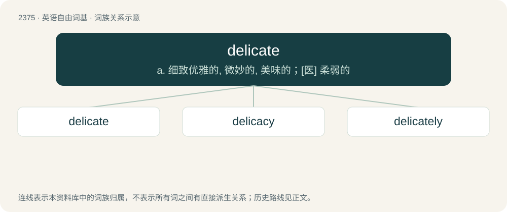

# 2477 · delicate — a. 细致优雅的, 微妙的, 美味的；\[医\] 柔弱的

[总目录](../00_总目录_按常用程度.md)

**类型**：英语自由词基　｜　**来源语言**：见词源记录

## 核心含义与来源

- 核心含义：a. 细致优雅的, 微妙的, 美味的；\[医\] 柔弱的
- 英文含义：Easily damaged or requiring careful handling.
- 词形：delicate

**来源记录 1**（形容词；Easily damaged or requiring careful handling.）

From Middle English delicat, from Latin dēlicātus (“giving pleasure, delightful, soft, luxurious, delicate, (in Medieval Latin also) fine, slender”), from dēlicia + -ātus (see -ate (adjective-forming suffix)), usually in plural dēliciae (“pleasure, delight, luxury”), from dēliciō (“to allure, entice”), from dē- (“away”) + laciō (“to lure, to deceive”), from Proto-Italic \*lakjō (“to draw, pull”), of unknown ultimate origin. Compare delight, delicious and Spanish delgado (“thin, skinny”). The noun is from a substantivization of the adjective (see -ate).

## 词族图

## 单词速览（常用到不常用）

| 单词 | 音标 | 释义 |
|---|---|---|
| [delicate](#w-1) | 英 /ˈdɛl.ɪ.kət/；美 /ˈdɛl.ɪ.kɪt/ | a. 细致优雅的, 微妙的, 美味的；\[医\] 柔弱的 |
| [delicacy](#w-2) | 英 /ˈdɛlɪkəsi/ | n. 细软, 精致, 精美的食品, 娇气, 微妙, 棘手, 娇弱, 灵敏, 灵巧 |
| [delicately](#w-3) | /ˈdɛlɪkətli/ | adv. 优美地；微妙地；精致地 |

## 逐词详解

### 1. delicate

**词性**：形容词　｜　**音标**：英 /ˈdɛl.ɪ.kət/；美 /ˈdɛl.ɪ.kɪt/

**中文释义**：a. 细致优雅的, 微妙的, 美味的；\[医\] 柔弱的

**英文义项**：Easily damaged or requiring careful handling. / Characterized by a fine structure or thin lines.

**词源与演化**：

From Middle English delicat, from Latin dēlicātus (“giving pleasure, delightful, soft, luxurious, delicate, (in Medieval Latin also) fine, slender”), from dēlicia + -ātus (see -ate (adjective-forming suffix)), usually in plural dēliciae (“pleasure, delight, luxury”), from dēliciō (“to allure, entice”), from dē- (“away”) + laciō (“to lure, to deceive”), from Proto-Italic \*lakjō (“to draw, pull”), of unknown ultimate origin. Compare delight, delicious and Spanish delgado (“thin, skinny”). The noun is from a substantivization of the adjective (see -ate).

**例句**：

> Please don't speak so loudly: I'm feeling a bit delicate this morning.

该用例对应义项：Unwell, especially because of having drunk too much alcohol.

### 2. delicacy

**词性**：名词　｜　**音标**：英 /ˈdɛlɪkəsi/

**中文释义**：n. 细软, 精致, 精美的食品, 娇气, 微妙, 棘手, 娇弱, 灵敏, 灵巧

**英文义项**：The quality of being delicate. / Something appealing, usually a pleasing food, especially a choice dish of a certain culture suggesting rarity and refinement.

**构词拆分**：delic(ate) + -acy

**词源与演化**：

From Middle English delicacie, from Middle English delicat, from Latin delicatus. Equivalent to delic(ate) + -acy.

**用法示例／搭配（非完整句）**：

> a Chinese delicacy

该用例对应义项：Something appealing, usually a pleasing food, especially a choice dish of a certain culture suggesting rarity and refinement.

### 3. delicately

**词性**：副词　｜　**音标**：/ˈdɛlɪkətli/

**中文释义**：adv. 优美地；微妙地；精致地

**英文义项**：In a delicate manner; exquisitely. / Tactfully.

**构词拆分**：delicate + -ly

**词源与演化**：

From delicate + -ly.

**例句**：

> The gingerbread was delicately, if imprecisely, captured by the brushstrokes.

该用例对应义项：In a delicate manner; exquisitely.
