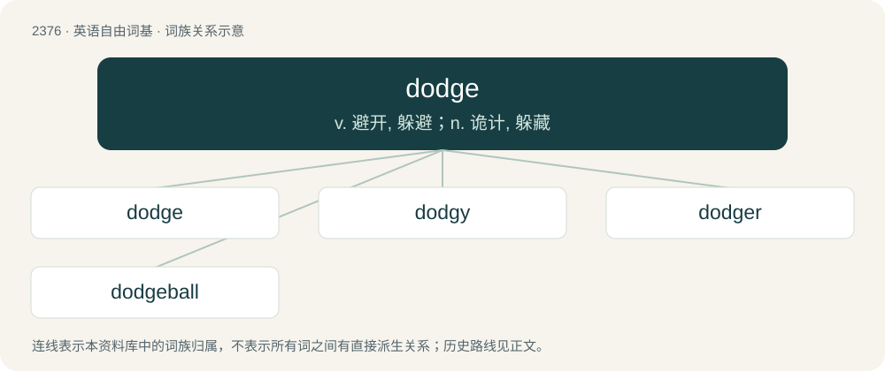

# 2478 · dodge — v. 避开, 躲避；n. 诡计, 躲藏

[总目录](../00_总目录_按常用程度.md)

**类型**：英语自由词基　｜　**来源语言**：见词源记录

## 核心含义与来源

- 核心含义：v. 避开, 躲避；n. 诡计, 躲藏
- 英文含义：To avoid (something) by moving suddenly out of the way.
- 词形：dodge

**来源记录 1**（动词；To avoid (something) by moving suddenly out of the way.）

Likely from dialectal dodge, dod, dodd (“to jog, trudge along, totter", also "to jerk, jig”), of uncertain origin. Perhaps from unrecorded Middle English \*dodden, ultimately from Proto-Germanic \*dud- (“to move”), related to Old English dydrian, dyderian (“to delude, deceive”), Middle English dideren (“to tremble, quake, shiver”), English dodder, Norwegian dudra (“to tremble”).

## 词族图

## 单词速览（常用到不常用）

| 单词 | 音标 | 释义 |
|---|---|---|
| [dodge](#w-1) | 英 /dɒd͡ʒ/；美 /dɑd͡ʒ/ | v. 避开, 躲避；n. 诡计, 躲藏 |
| [dodgy](#w-2) | /ˈdɒd͡ʒ.i/ | a. 狡猾的, 逃避的, 难弄的 |
| [dodger](#w-3) | 英 /ˈdɒd͡ʒ.ə(ɹ)/；美 /ˈdɑ.d͡ʒɚ/ | n. 躲闪者, 用诡计逃脱者, 蒙骗者, 推托者；\[法\] 推托者, 规避者, 用诡计蒙骗者 |
| [dodgeball](#w-4) | /ˈdɒd͡ʒˌbɔl/ | n. 躲球游戏 |

## 逐词详解

### 1. dodge

**词性**：动词　｜　**音标**：英 /dɒd͡ʒ/；美 /dɑd͡ʒ/

**中文释义**：v. 避开, 躲避；n. 诡计, 躲藏

**英文义项**：To avoid (something) by moving suddenly out of the way. / To avoid; to sidestep.

**词源与演化**：

Likely from dialectal dodge, dod, dodd (“to jog, trudge along, totter", also "to jerk, jig”), of uncertain origin. Perhaps from unrecorded Middle English \*dodden, ultimately from Proto-Germanic \*dud- (“to move”), related to Old English dydrian, dyderian (“to delude, deceive”), Middle English dideren (“to tremble, quake, shiver”), English dodder, Norwegian dudra (“to tremble”).

**例句**：

> Tom decided not to play dodge ball because he wasn't feeling well.

### 2. dodgy

**词性**：形容词　｜　**音标**：/ˈdɒd͡ʒ.i/

**中文释义**：a. 狡猾的, 逃避的, 难弄的

**英文义项**：Evasive and shifty. / Unsound and unreliable.

**构词拆分**：dodge (verb) + -y

**词源与演化**：

From dodge (verb) + -y. First used in mid-19th century England.

**例句**：

> This is a slightly dodgy plan, because there is a lot that is being changed for this fix.

该用例对应义项：Risky.

### 3. dodger

**词性**：名词　｜　**音标**：英 /ˈdɒd͡ʒ.ə(ɹ)/；美 /ˈdɑ.d͡ʒɚ/

**中文释义**：n. 躲闪者, 用诡计逃脱者, 蒙骗者, 推托者；\[法\] 推托者, 规避者, 用诡计蒙骗者

**英文义项**：Someone who dodges (avoids something by quickly moving). / A person full of tricks or street smarts.

**构词拆分**：dodge + -er

**词源与演化**：

From dodge + -er.

**例句**：

> I know that Tom was a draft dodger.

### 4. dodgeball

**词性**：名词　｜　**音标**：/ˈdɒd͡ʒˌbɔl/

**中文释义**：n. 躲球游戏

**英文义项**：A team sport whose main objective is to dodge or catch balls thrown by the opposition. / The ball thrown in this sport.

**构词拆分**：dodge + ball

**词源与演化**：

From dodge + ball.

**例句**：

> Which would you rather play, dodgeball or volleyball?
