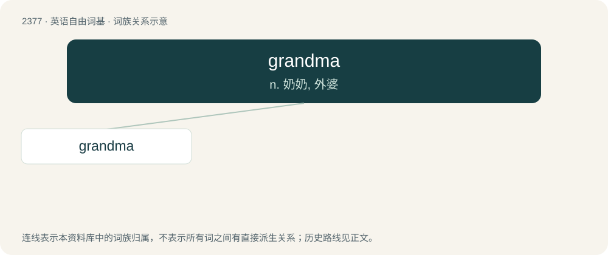

# 2479 · grandma — n. 奶奶, 外婆

[总目录](../00_总目录_按常用程度.md)

**类型**：英语自由词基　｜　**来源语言**：见词源记录

## 核心含义与来源

- 核心含义：n. 奶奶, 外婆
- 英文含义：Grandmother.
- 词形：grandma

**来源记录 1**（名词；Grandmother.）

From grand- + ma, after grandmother.

## 词族图

## 单词速览（常用到不常用）

| 单词 | 音标 | 释义 |
|---|---|---|
| [grandma](#w-1) | /ˈɡɹænmɑː/ | n. 奶奶, 外婆 |

## 逐词详解

### 1. grandma

**词性**：名词　｜　**音标**：/ˈɡɹænmɑː/

**中文释义**：n. 奶奶, 外婆

**英文义项**：Grandmother. / Any elderly woman, regardless of if she has grandchildren.

**构词拆分**：grand- + ma

**词源与演化**：

From grand- + ma, after grandmother.

**例句**：

> On my bed is a coloured bedspread, which my grandma once made.
