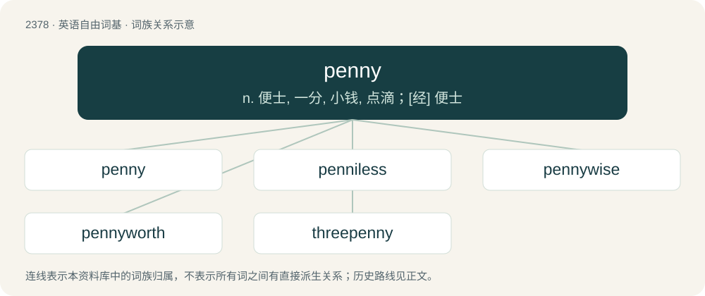

# 2482 · penny — n. 便士, 一分, 小钱, 点滴；\[经\] 便士

[总目录](../00_总目录_按常用程度.md)

**类型**：英语自由词基　｜　**来源语言**：见词源记录

## 核心含义与来源

- 核心含义：n. 便士, 一分, 小钱, 点滴；\[经\] 便士
- 英文含义：In the United Kingdom, a unit of currency worth ¹⁄₁₀₀ of a pound sterling, or a copper coin worth this amount. Abbreviation: p.
- 词形：penny

**来源记录 1**（名词；In the United Kingdom, a unit of currency worth ¹⁄₁₀₀ of a pound sterling, or a copper coin worth this amount. Abbreviation: p.）

From Middle English peny, from Old English peniġ, penniġ, penning (“penny”), from Proto-West Germanic \*panning, from Proto-Germanic \*panningaz, of uncertain origin (see that page for theories). Doublet of pfennig and fening.

## 词族图

## 单词速览（常用到不常用）

| 单词 | 音标 | 释义 |
|---|---|---|
| [penny](#w-1) | 英 /ˈpɛni/；美 /ˈpɪni/ | n. 便士, 一分, 小钱, 点滴；\[经\] 便士 |
| [penniless](#w-2) | /ˈpɛ.nɪ.ləs/ | a. 赤贫的, 贫穷的 |
| [pennywise](#w-3) | /ˈpeniˈwaiz/ | adj. 小数目上节约的 |
| [pennyworth](#w-4) | /ˈpeniwəːθ/ | n. 一便士的价钱, 价值一便士之物, 少量, 交易 |
| [threepenny](#w-5) | 英 /ˈθɹʌpəni/ | a. 三便士的, 无价值的, 便宜的 |

## 逐词详解

### 1. penny

**词性**：名词　｜　**音标**：英 /ˈpɛni/；美 /ˈpɪni/

**中文释义**：n. 便士, 一分, 小钱, 点滴；\[经\] 便士

**英文义项**：In the United Kingdom, a unit of currency worth ¹⁄₁₀₀ of a pound sterling, or a copper coin worth this amount. Abbreviation: p. / In the US and (formerly) Canada, a one-cent coin, worth ¹⁄₁₀₀ of a dollar. Abbreviation: ¢.

**词源与演化**：

From Middle English peny, from Old English peniġ, penniġ, penning (“penny”), from Proto-West Germanic \*panning, from Proto-Germanic \*panningaz, of uncertain origin (see that page for theories). Doublet of pfennig and fening.

**用法示例／搭配（非完整句）**：

> to turn an honest penny

该用例对应义项：Money in general.

### 2. penniless

**词性**：形容词　｜　**音标**：/ˈpɛ.nɪ.ləs/

**中文释义**：a. 赤贫的, 贫穷的

**英文义项**：Lacking even the smallest amount of money. / Of a country's system of money, abstaining from the use of penny coins, despite having fully decimalized currency, by means of rounding of cash transactions (but not necessarily of cashless ones).

**构词拆分**：penny + -less

**词源与演化**：

From Middle English penyles, penylees; equivalent to penny + -less. Compare Old Norse penningalauss (“penniless”).

**例句**：

> In societies without national insurance of any kind, almshouses are the last refuge of penniless people.

该用例对应义项：Lacking even the smallest amount of money.

### 3. pennywise

**词性**：形容词　｜　**音标**：/ˈpeniˈwaiz/

**中文释义**：adj. 小数目上节约的

**英文义项**：Careful with small amounts of money or over small matters.

**构词拆分**：penny + wise

**词源与演化**：

From penny + wise.

### 4. pennyworth

**词性**：名词　｜　**音标**：/ˈpeniwəːθ/

**中文释义**：n. 一便士的价钱, 价值一便士之物, 少量, 交易

**英文义项**：The amount that can be bought for a penny. / A small quantity or value.

**构词拆分**：penny + worth

**词源与演化**：

From penny + worth.

### 5. threepenny

**词性**：形容词　｜　**音标**：英 /ˈθɹʌpəni/

**中文释义**：a. 三便士的, 无价值的, 便宜的

**英文义项**：Having a value or cost of threepence. / Of little worth; mean; vulgar.

**构词拆分**：three + penny

**词源与演化**：

From three + penny.
