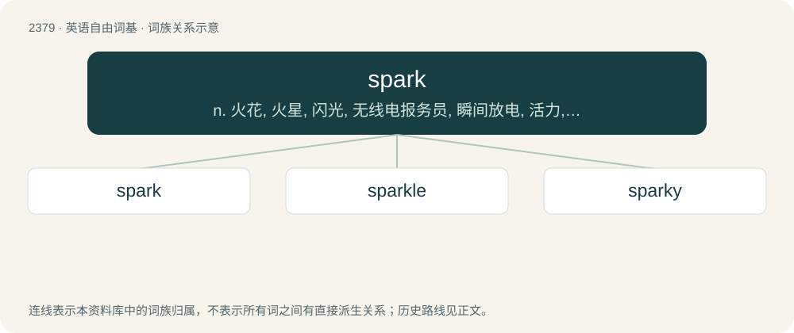

# 2483 · spark — n. 火花, 火星, 闪光, 无线电报务员, 瞬间放电, 活力, 朝气, 花花公子, 情郎；vi. 闪光, 发火花, 求婚；vt. 发动, 鼓舞, 使有朝气, 求婚

[总目录](../00_总目录_按常用程度.md)

**类型**：英语自由词基　｜　**来源语言**：见词源记录

## 核心含义与来源

- 核心含义：n. 火花, 火星, 闪光, 无线电报务员, 瞬间放电, 活力, 朝气, 花花公子, 情郎；vi. 闪光, 发火花, 求婚；vt. 发动, 鼓舞, 使有朝气, 求婚
- 英文含义：A small particle of glowing matter, either molten or on fire, resulting from an electrical surge or excessive heat created by friction.
- 词形：spark

**多个词源／构词路径**：同一拼写可能有不同来源；以下按词性和含义分别列出。

**来源记录 1**（名词；A small particle of glowing matter, either molten or on fire, resulting from an electrical surge or excessive heat created by friction.）

From Middle English sparke, sperke, from Old English spearca, from Proto-West Germanic \*sparkō (compare Saterland Frisian Spoorke, West Frisian spark, Dutch spark, German Low German Sparke, German Sparke), perhaps from Proto-Germanic \*sparkaz (“lively, energetic”), from Proto-Indo-European \*sperg- (“to strew, sprinkle”) (compare Breton erc’h (“snow”), Latin spargō (“to scatter, spread”), sparsus (“scattered”), Lithuanian sprógti (“to germinate”), Ancient Greek σπαργάω (spargáō, “to swell”), Avestan 𐬟𐬭𐬀𐬯𐬞𐬀𐬭𐬈𐬔𐬀 (frasparega, “branch, twig”), Sanskrit पर्जन्य (parjanya, “rain, rain god”)).

**来源记录 2**（名词；A gallant; a foppish young man.）

Probably Scandinavian, akin to Old Norse sparkr (“sprightly”).

## 词族图

## 单词速览（常用到不常用）

| 单词 | 音标 | 释义 |
|---|---|---|
| [spark](#w-1) | 英 /ˈspɑːk/；美 /ˈspɑɹk/ | n. 火花, 火星, 闪光, 无线电报务员, 瞬间放电, 活力, 朝气, 花花公子, 情郎；vi. 闪光, 发火花, 求婚；vt. 发动, 鼓舞, 使有朝气, 求婚 |
| [sparkle](#w-2) | 英 /ˈspɑː.kəl/；美 /ˈspɑɹ.kəl/ | n. 闪耀, 火花, 活力, 发泡；vi. 闪耀, 冒火花；vt. 使闪耀 |
| [sparky](#w-3) | /ˈspɑːki/ | a. 活泼的, 充满活力的 |

## 逐词详解

### 1. spark

**词性**：名词　｜　**音标**：英 /ˈspɑːk/；美 /ˈspɑɹk/

**中文释义**：n. 火花, 火星, 闪光, 无线电报务员, 瞬间放电, 活力, 朝气, 花花公子, 情郎；vi. 闪光, 发火花, 求婚；vt. 发动, 鼓舞, 使有朝气, 求婚

**英文义项**：A small particle of glowing matter, either molten or on fire, resulting from an electrical surge or excessive heat created by friction. / A short or small burst of electrical discharge.

**词源与演化**：

From Middle English sparke, sperke, from Old English spearca, from Proto-West Germanic \*sparkō (compare Saterland Frisian Spoorke, West Frisian spark, Dutch spark, German Low German Sparke, German Sparke), perhaps from Proto-Germanic \*sparkaz (“lively, energetic”), from Proto-Indo-European \*sperg- (“to strew, sprinkle”) (compare Breton erc’h (“snow”), Latin spargō (“to scatter, spread”), sparsus (“scattered”), Lithuanian sprógti (“to germinate”), Ancient Greek σπαργάω (spargáō, “to swell”), Avestan 𐬟𐬭𐬀𐬯𐬞𐬀𐬭𐬈𐬔𐬀 (frasparega, “branch, twig”), Sanskrit पर्जन्य (parjanya, “rain, rain god”)).

**例句**：

> A spark of interest.

该用例对应义项：a small but noticeable trace of some quality that might become stronger

### 2. sparkle

**词性**：名词　｜　**音标**：英 /ˈspɑː.kəl/；美 /ˈspɑɹ.kəl/

**中文释义**：n. 闪耀, 火花, 活力, 发泡；vi. 闪耀, 冒火花；vt. 使闪耀

**英文义项**：A little spark; a scintillation. / Brilliance; luster.

**构词拆分**：spark + -le (diminutive suffix)

**词源与演化**：

From Middle English sparkel, sparkle, sparcle, equivalent to spark + -le (diminutive suffix). In some modern uses deverbal from etymology 2 below.

**用法示例／搭配（非完整句）**：

> the sparkle of his conversation over dinner

该用例对应义项：Liveliness; vivacity.

### 3. sparky

**词性**：形容词　｜　**音标**：/ˈspɑːki/

**中文释义**：a. 活泼的, 充满活力的

**英文义项**：Lively and animated. / Resembling or characteristic of an electrical spark.

**构词拆分**：spark + -y

**词源与演化**：

From spark + -y.

**例句**：

> We need to get a sparky in to look at that socket.
