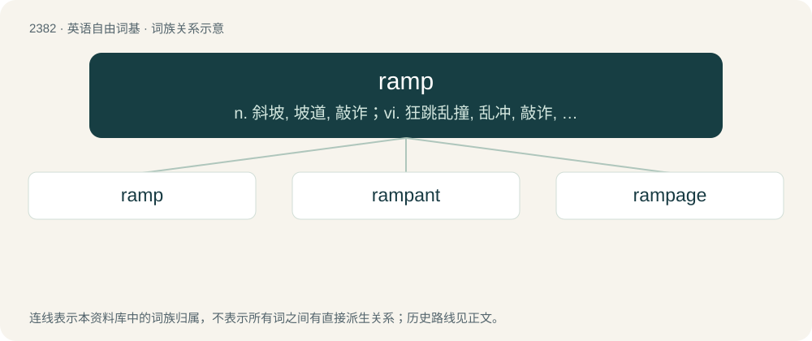

# 2488 · ramp — n. 斜坡, 坡道, 敲诈；vi. 狂跳乱撞, 乱冲, 敲诈, 蔓延；vt. 使有斜面, 敲诈

[总目录](../00_总目录_按常用程度.md)

**类型**：英语自由词基　｜　**来源语言**：见词源记录

## 核心含义与来源

- 核心含义：n. 斜坡, 坡道, 敲诈；vi. 狂跳乱撞, 乱冲, 敲诈, 蔓延；vt. 使有斜面, 敲诈
- 英文含义：An inclined surface that connects two levels; an incline.
- 词形：ramp

**多个词源／构词路径**：同一拼写可能有不同来源；以下按词性和含义分别列出。

**来源记录 1**（名词；An inclined surface that connects two levels; an incline.）

From French rampe, from Middle French rampe, deverbal of ramper, from Old French ramper (“to crawl, climb, scale up”), from Frankish \*hrampōn (“to contract oneself, wrinkle, rumple, crumple, curve”), from Proto-Germanic \*hrimpaną (“to shrivel, shrink”). Cognate with German Rampf (“retraction, curvature, shrinkage, spasm”). Doublet of romp. Akin also to Old English ġehrimpan (“to wrinkle, rimple, rumple”), Old High German rimpfan (German rümpfen (“to wrinkle up”)). Compare Danish rimpe (“to fold" (archaic), "to baste”), Icelandic rimpa. More at rimple.

**来源记录 2**（名词；Any of species Allium tricoccum of plants related to the onion; a wild leek.）

\]See ramson.

## 词族图

## 单词速览（常用到不常用）

| 单词 | 音标 | 释义 |
|---|---|---|
| [ramp](#w-1) | /ɹæmp/ | n. 斜坡, 坡道, 敲诈；vi. 狂跳乱撞, 乱冲, 敲诈, 蔓延；vt. 使有斜面, 敲诈 |
| [rampant](#w-2) | /ˈɹæm.pənt/ | a. 猖獗的, 蔓生的, 猛烈的, 跃立作扑击状的 |
| [rampage](#w-3) | /ˈɹæmpeɪd͡ʒ/ | n. 乱闹, 乱冲, 暴跳；vi. 乱闹, 狂暴 |

## 逐词详解

### 1. ramp

**词性**：名词　｜　**音标**：/ɹæmp/

**中文释义**：n. 斜坡, 坡道, 敲诈；vi. 狂跳乱撞, 乱冲, 敲诈, 蔓延；vt. 使有斜面, 敲诈

**英文义项**：An inclined surface that connects two levels; an incline. / An interchange, a road that connects a freeway to a surface street or another freeway.

**词源与演化**：

From French rampe, from Middle French rampe, deverbal of ramper, from Old French ramper (“to crawl, climb, scale up”), from Frankish \*hrampōn (“to contract oneself, wrinkle, rumple, crumple, curve”), from Proto-Germanic \*hrimpaną (“to shrivel, shrink”). Cognate with German Rampf (“retraction, curvature, shrinkage, spasm”). Doublet of romp. Akin also to Old English ġehrimpan (“to wrinkle, rimple, rumple”), Old High German rimpfan (German rümpfen (“to wrinkle up”)). Compare Danish rimpe (“to fold" (archaic), "to baste”), Icelandic rimpa. More at rimple.

**例句**：

> He hit three ramps in a row to push his team near the opponents total.

该用例对应义项：A way of hitting a boundary by facing the bat face front and pushing with force to launch the ball. 100% of it done against pace.

### 2. rampant

**词性**：形容词　｜　**音标**：/ˈɹæm.pənt/

**中文释义**：a. 猖獗的, 蔓生的, 猛烈的, 跃立作扑击状的

**英文义项**：Rearing on both hind legs with the forelegs extended. / Rearing up, especially on its hind leg(s), with a foreleg raised and in profile.

**构词拆分**：ramp + -and；ramp + -ant

**词源与演化**：

From Middle English rampand, rampend, present participle of rampen (“to rise by climbing, shoot up, sprout, sty, ascend”), from Old French ramper (“to creep, climb”) (see below), equivalent to ramp + -and or ramp + -ant. Recorded since 1382, "standing on the hind legs" (as in heraldry), later, "fierce, ravenous" (1387). Compare Scots rampand (“rampant”). Alternatively from Middle English \*rampant, from Old French rampant, the present participle of ramper (“to creep, climb”), equivalent to ramp + -ant. Old French ramper derives from Frankish \*rampōn, \*hrampōn (“to hook, grapple, climb”), from \*rampa, \*hrampa (“hook, claw, talon”), from Proto-Germanic \*hrempaną (“to curve, shrivel, shrink, wrinkle”).

**例句**：

> The Vienna riding school displays splendid rampant movement.

该用例对应义项：Rearing on both hind legs with the forelegs extended.

### 3. rampage

**词性**：名词　｜　**音标**：/ˈɹæmpeɪd͡ʒ/

**中文释义**：n. 乱闹, 乱冲, 暴跳；vi. 乱闹, 狂暴

**英文义项**：A course of violent, frenzied action. / Wild partying, typically a drinking binge

**构词拆分**：ramp + -age

**词源与演化**：

From Scots rampage, equivalent to ramp + -age. Perhaps influenced by Middle English rampnen (“to force, ram”), from Old English \*hrampian, from Proto-West Germanic \*hrampōn (“to obstruct, hinder”), see ramp.

**例句**：

> What Tom is doing right now is a spiritual rampage.
